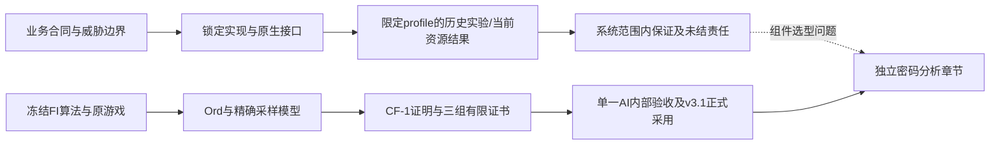

# 密码分析成果接入主论文：定位、版本与插入方案

2026-11-11，Asia/Shanghai。身份：知情作者论文整合与创新主张对齐。本轮使用正式采用版v3.1，状态ADOPTED_V3_1_AND_ARCHIVED、PASS_WITHIN_STATED_SCOPE；历史文件保持只读。

## 1. 贡献位置裁决

推荐设置**独立理论章节，以可更新加密候选组件的安全案例定位**，置于系统实现/原生实证章节之后、总讨论与结论之前。贡献名称采用：**具体发表构造的来源隐藏密码分析、有限参数可靠性分析及证明范围审计**。

这一位置有三项依据。第一，FI成果具有独立算法、原游戏、参数、联合采样合同、定理及内部验收，足以单独组织理论论证。第二，主任务围绕凭据保管、受控使用、刷新、撤回与恢复，能够自然提出“候选密码组件的安全目标和更新可靠性如何核准”的组件研究子问题。第三，所核主系统链使用AES-GCM应用状态、可信Controller和原生认证服务，UE/FI接线及业务来源隐藏游戏尚未建立，组件密码分析的证据链应在章节中独立呈现。

在已确认的2026-11-04七章骨架中，具体方案为：原第1—6章保留其证据范围；新增本成果为**建议第7章**；原第7章“讨论与结论”顺延为建议第8章。若采用DCL-R4提出的后续系统布局，则放在“部署与评估”之后、“对照与局限/结论”之前。现有材料未唯一确认当前全篇主稿，交付章节使用X作为待绑定章号。

## 2. 主稿权威定位与版本链

| 材料 | 实际确认内容 | 本轮用途/权威边界 |
|---|---|---|
| [thesis_draft/TASK_SCOPE.md](D:/毕业设计/thesis_draft/TASK_SCOPE.md)、[THESIS_MAP.md](D:/毕业设计/thesis_draft/THESIS_MAP.md) | 2026-11-04研究者决定的B版口径及七章结构；旧题目《面向AI代理的认证语义安全识别与可撤销性驱动凭据配置方法研究》 | 有范围确认的历史章节基线；用于精确插入锚点 |
| [THESIS_UPDATE_MAP.md](D:/毕业设计/mainline_research_closure_v1/THESIS_UPDATE_MAP.md)、[THESIS_CORE_DRAFT.md](D:/毕业设计/mainline_research_closure_v1/THESIS_CORE_DRAFT.md) | 2026-11-06核心段落和M1—M6组装补丁，明确旧thesis_draft只读 | 历史补丁；并非重新确认全篇当前主稿 |
| [G1-r01交接](D:/毕业设计/research_g1_lifecycle_contract/2026-11-09_r01/08_G1_VERDICT_AND_MAINLINE_HANDOFF.md)、[DCL-R4论文边界](D:/毕业设计/research_main_innovation/decentralized_credential_lifecycle/DCL-R4/R4_THESIS_CONTRIBUTION_BOUNDARY.md) | 主课题沿《面向用户与AI智能体的全生命周期密码与凭据管理系统》；R4给六类章节内容建议 | 当前研究题目和后续结构依据；学校正式题目登记仍需对应记录 |
| 两份2026-11-09根目录DOCX | 封面/前言分别说明调研报告、选题/技术方案评估；读取限标题与样式层级 | 发现候选文档，版本号或修改时间单独不构成全篇权威指定 |
| [最新导航](D:/毕业设计/research_main_innovation/decentralized_credential_lifecycle/README.md)、[batch05裁决](D:/毕业设计/research_main_innovation/decentralized_credential_lifecycle/DCL-R6-batch05/BATCH05_FINAL_DECISION.md) | 2026-11-11当前DCL分支实际推进到batch05及失败关闭 | 当前研究状态依据；未指定整篇论文文件 |

**当前主稿状态：CURRENT_MASTER_UNCONFIRMED。** 已定位历史确认骨架和后续研究交接，所查记录尚未唯一指定新版全篇主论文。因此本轮完成独立章节、可直接采用段落和逐锚点插入方案；所有历史主稿和DOCX原件保持不变。定位依据及候选标题读取得到的实际内容见[evidence/MASTER_DISCOVERY.json](evidence/MASTER_DISCOVERY.json)。

待绑定字段为：权威主稿路径、版本/commit、SHA256、确认目录版本、正式登记题目、最终章号、全篇参考文献编号映射、摘要位置及作者/导师确认记录。这些字段决定最终装配位置，当前章节内容和主张对齐已经交付。

## 3. 当前主线接续与历史证据的采用范围

| 研究线/版本 | 已有结果 | 当前限制与采用方式 |
|---|---|---|
| M1—M6及closure，2026-11-06历史 | 受限单机profile的持久批准/来源/预算/UNKNOWN、处置、条件对账及有限验收 | 按原版本、轨迹、接口与分母引用；原157回归和576校准均为历史结果 |
| [G1-r02](D:/毕业设计/research_g1_lifecycle_contract/2026-11-09_r02/09_G1_R02_VERDICT.md)→[G1-r03](D:/毕业设计/research_g1_lifecycle_contract/2026-11-10_r03/08_G1_R03_VERDICT_AND_G2_HANDOFF.md) | 固定Refresh源合同、直接容量和反例；raw L0最小纸面表示及保守责任保持 | 完整native→当前A/B/AB接线、源精化与全费用仍SOURCE_OR_REFINEMENT_GAP；独立创新ANALYSIS_ONLY |
| [DCL-R5](D:/毕业设计/research_main_innovation/decentralized_credential_lifecycle/DCL-R5/R5_RESEARCH_AND_THESIS_DECISION.md) | D1-PBFT-SEAL/1.1及D2条件规格、部署依赖、强G比较与验证计划 | 标准组合/条件纸面成果；实际跨域PBFT和独立严格优势各待证 |
| [DCL-R6-batch05](D:/毕业设计/research_main_innovation/decentralized_credential_lifecycle/DCL-R6-batch05/BATCH05_FINAL_DECISION.md)，2026-11-11 | C00–C08九项PASS；C09H34 accepted=28 PASS+6 MUTATION_DETECTED | 真实C09入口权限失败；RESOURCE_GATE_FAILED，F1/F4=UNRUN_RESOURCE_GATE，PASS_BOUNDED授予0；batch05关闭，严格分离0、机制门CLOSED |
| [G2-R16](D:/毕业设计/research_g2_dsat_implementation/2026-11-11_r16/06_FINAL_VERDICT_AND_NEXT_STEP.md)→[G2-R17](D:/毕业设计/research_g2_dsat_implementation/2026-11-11_r17/05_FINAL_VERDICT_AND_AUTHORIZATION_REQUEST.md) | 该支线A1可信注册/会话读取门在合成身份与内存SQLite合同内实现并完成限定验收 | 真实H2环境未锁、实际权威读取未运行；部署/真实源精化及S3B2/S5保持各自阻塞。此A1与早期查询选择器、FI定理A按文件对象消歧 |
| [M_r-R3](D:/毕业设计/research_recipe_r3/VERDICT.md)，2026-11-04 | 条件模型内资源谱、量词和有限核对 | 优先权近邻未决，原子重绑原生符合性/外部数学复核另证；后续G1/G2未重审该定理 |
| [FI采用v3.1](D:/毕业设计/crypto_fi_adopted_release_v3_1/RELEASE_NOTES.md) | CF-1原游戏攻击及三组官方参数的一步可靠性，数学内部验收通过 | 精确打印/Ord/独立χ合同；作者UE软件、全球首次和业务游戏映射保持外部条件 |

导航里的旧“下一步/未授权/未创建”只按其历史阶段解释。当前DCL以顶部batch05及其完整裁决为准；G2-R17作为另一条接续线单列。资源监督器的真实失败属于该监督/资源路径，协议模型搜索和FI密码分析各按自己的证据状态使用。本轮只做读取与文稿整合，所有系统批次、测试和模型均未重跑。

## 4. 两条证据链与已经成立的联系

两条链共享“声明安全目标、模型、接口和证据范围”的研究方法联系；目前不存在把FI游戏的胜败直接转换为主系统业务保证的已验收映射。

| 检查项 | 已有事实依据 | 待提出/待验证的联系 |
|---|---|---|
| 主系统采用UE/FI？ | [G1架构](D:/毕业设计/research_g1_lifecycle_contract/2026-11-09_r01/01_ACTUAL_ARCHITECTURE_AUDIT.md)描述托管/Controller/AS链；当前[storage.py](D:/毕业设计/auth-lifecycle/src/auth_lifecycle/online_state/storage.py:110)采用AESGCM写整行应用状态 | 所核链未建立UE/FI接线。src/docs/dependency的限定名称检索0命中只作发现证据，所有其他部署的全称判断保持范围外 |
| fresh/update来源隐藏需求？ | G1保留origin、attempt、version与审计来源；LC10是原生RT刷新/轮换合同 | 面向外部密文观察者隐藏轮换历史可作为新的候选业务需求，须先指定观察者、泄露与收益；现有合同未把它列为必需性质 |
| FI token与业务对象？ | FI token为TG返回四块矩阵；系统服务能力/任务句柄用于RPC身份和批准，AT/RT用于AS/接受路径 | 三类接口、暴露权限、可执行操作和观察需逐一映射；名称相同不构成等价关系 |
| 本章支持什么？ | 对公开UE候选组件提供原游戏检查、参数可靠性和条件定理范围核准，具备已采用的数学结果 | 采购/设计若实际选用UE，需把真实工件、分布和业务目标接到该模型 |
| 能否说明系统已被攻破或修复？ | 当前系统保证有自身的工程/原生证据；FI结果评价其冻结构造 | 业务系统失效、保护收益或端到端增强需要另有部署与游戏保持证据 |

限定源码检索命令、输入清单与结果见[evidence/BOUNDED_UE_SOURCE_SEARCH.json](evidence/BOUNDED_UE_SOURCE_SEARCH.json)；该检索不替代全仓库语义或运行审计。

## 5. 研究问题与章节结构的衔接

旧题目下，已确认的三问分别为有界合法完成条件、重绑预算与独立根数、原生平台对模型前提的支持。当前宽题目又纳入跨配置责任接续、部分进展和部署合同。本轮拟新增研究子问题**RQ-C：对凭据生命周期中考虑采用的可更新加密组件，如何检查其来源隐藏目标、有限参数更新可靠性及条件安全前提？** 它是本次章节整合的研究问题扩展，当前业务采用UE的事实仍按第4节登记。

宽题目能够容纳独立组件安全分析。若继续使用旧的认证配置方法题目，应在绪论明确新增RQ-C与独立理论章节，接受题目覆盖度的作者/导师判断。正式题目、主稿和章号确认前，本轮不重命名历史主论文。

建议结构（以历史七章骨架为装配底座）：1绪论；2相关工作；3系统形式化与真实合同；4条件性资源理论；5验证与实现；6原生实证及当前工程边界；**7已发表UE组件的来源隐藏与有限参数可靠性分析**；8讨论与结论。G1/DCL/G2新材料在3/5/6章按版本更新；该系统同步工作与新增密码章节分别列证据，避免沿旧叙述直接宣布全篇当前定稿。

## 6. 逐位置插入与替换方案

所有操作均为未原位执行的组装补丁，基线指纹、精确旧锚点、完整新段落见[evidence/INSERTION_PATCHES.json](evidence/INSERTION_PATCHES.json)。

| 插槽 | 当前可定位锚点 | 可直接采用的操作 |
|---|---|---|
| P0 摘要 | 当前全篇摘要文件未唯一定位 | 在研究贡献/结果段加入本方案第7节摘要插入段；作者绑定实际文件与段落 |
| P1 总贡献 | [00_CONTRIBUTIONS.md](D:/毕业设计/thesis_draft/chapters/00_CONTRIBUTIONS.md)，`## 与近邻工作的分工`之前 | 加入“新增独立密码分析贡献”，原三类贡献各按其已有证据保留 |
| P2 绪论研究问题 | [01_INTRODUCTION.md](D:/毕业设计/thesis_draft/chapters/01_INTRODUCTION.md)，`## 1.3 方法与贡献`之前 | 增补RQ-C；1.3将原三类支持链与新增FI章节分别列出 |
| P3 绪论结构 | 同文件`## 1.4 研究范围与论文结构` | 将“密码学集成沿用归档”限定为早期支线/实际业务集成；新FI研究按v3.1已采用状态写入；建议新7旧7→8 |
| P4 相关工作 | [02_RELATED_WORK.md](D:/毕业设计/thesis_draft/chapters/02_RELATED_WORK.md) §2.6中“密码学支线已有…”段 | 早期结构/成本支线继续归档；FI采用成果作为后续独立对象研究，补KLR/Frodo方法归属与有界优先权 |
| P5 前章衔接 | [06_EMPIRICAL.md](D:/毕业设计/thesis_draft/chapters/06_EMPIRICAL.md) §6.9末 | 添加“原生接口证据→候选密码组件模型检查”的过渡，明确两种对象和分母 |
| P6 完整章节 | 原第6章与第7章之间 | 插入[INTEGRATED_CRYPTO_CHAPTER.md](INTEGRATED_CRYPTO_CHAPTER.md)，X绑定为确认章号；建议7 |
| P7 总讨论 | [07_DISCUSSION.md](D:/毕业设计/thesis_draft/chapters/07_DISCUSSION.md) §7.1和§7.6 | 增加FI独立证据链、采用状态及局限；历史三链与新链分表，原章建议改8 |
| P8 引文与交叉引用 | 旧R/M编号及当前未确认总参考表 | 本章先沿[1—6]独立编号，按DOI去重后合并全篇；绑定新章号、定理号、表号和附件路径 |
| P9 系统当前状态 | 第3/5/6章关于“当前/已验证/下一步”的表述 | 采用G1-r03、DCL-batch05、G2-R17的实际状态；保留M1—M6和旧576校准原分母，理论证明不由工程失败或局部PASS替代 |

## 7. 可直接采用的统一创新声明

**摘要插入段：** 本文另对FI已发表的FrodoPKE型可更新加密构造开展具体发表构造的来源隐藏密码分析、有限参数可靠性分析及证明范围审计。在声明的Ord与独立采样合同内，构造共同正确CF-1族的原游戏来源隐藏攻击，并认证三组官方参数在逐固定A及均匀Setup下的一次更新高错误率，初始已正确条件下保持显示界。该成果作为独立理论与组件选型案例，其业务适用性由实际工件和游戏映射核准。

**绪论贡献段：** 在生命周期合同、条件性资源理论与版本限定工程/实证之外，本文增加对一个已发表UE构造的独立密码分析。具体增量为原游戏合法攻击与共同正确族匹配，以及保留真实依赖的三参数一次更新可靠性证明和有限证书；方法基础承认公开token一致性、有限采样/卷积及经典代数、概率和Fourier工具。该贡献不改变原A/B/AB算法优势、D1/D2部署或主系统整体优先权的既有裁决。

**章节小结段：** 本章在冻结FI算法和采样合同内完成来源隐藏与可靠性两项分析。CF-1承担共同正确性和渐近区分优势，官方有限配置承担一步概率界；二者具有各自参数和量词。结果为候选组件安全目标检查提供已采用的理论案例，作者实际软件、全球首次和业务游戏映射继续按对应证据判断。

**总论文结论增补段：** 本研究形成分层的生命周期合同、受限模型理论、版本限定实现与实证材料，并独立完成对FI构造的具体密码分析。系统保证按其可信边界、接口和执行版本限定；密码分析按其算法、游戏和精确联合采样模型限定。已采用的FI成果可作为主论文的独立理论贡献，其他机制的独立优势、资源资格、真实源精化和全部署保证保持各自的审查状态。

逐项主张、新增内容、成熟基础、证据入口、范围和状态见[DEFENSE_CLAIM_CARD.md](DEFENSE_CLAIM_CARD.md)，相关表述应成组采用。

## 8. 完成状态与后续绑定

本轮交付满足“独立章节＋插入方案＋准确创新主张”的完成条件。当前整合状态为COMPLETE_AS_STANDALONE_CHAPTER_AND_ANCHORED_INSERTION_PLAN，主稿绑定为CURRENT_MASTER_UNCONFIRMED；未修改历史主稿或运行系统。权威主稿明确后，按P0—P9做一次版本受控装配与交叉引用核对即可决定最终版章号和位置。

候选保护机制继续遵守具体输入族、固定指标、最强同能力通用对照、预测严格差距及至少一个通用方法必须付更高代价的实例要求。本轮文稿整合不改变机制实现门或任何系统执行资格。
