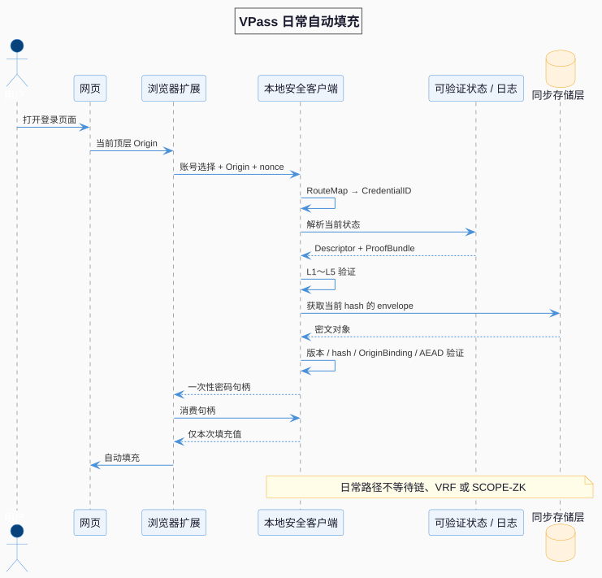

# VPass：可验证密码生命周期管理系统的设计与实现

英文题目：**VPass: Design and Implementation of a Verifiable Password Lifecycle Management System**

系统名称：**VPass: Verifiable Password Lifecycle Management System**

论文类型：专业学位研究生毕业设计  
版本：2.1.0  
阶段：G6 研究原型集成；G7 冻结未达成  
日期：2026 年 7 月 31 日

> 学校、学院、专业、作者、学号与导师信息应在正式提交前由学生按本校模板填写。本稿按第一阶段审计统一为G6研究原型集成。历史`test-results/g7`作为限定范围的证据快照保留，不代表G7已经冻结。本稿不包含真实用户密码数据。

---

## 摘要

密码管理器通过“用户只记一个主密码、系统保存各站点复杂密码”的方式降低认知负担，但在多设备和同步存储场景中仍面临两类相互独立的问题：其一，存储层泄露可能暴露可供离线猜测的密码库材料；其二，即使凭据密文没有被解开，恶意或故障同步存储层仍可返回旧版本、错误对象或冲突状态，诱导设备使用非当前密码。现有方案常把安全重点放在密文机密性上，对“谁在何时有权创建、更新、撤销和同步凭据，以及当前版本如何被独立确认”的控制过程缺少统一验证。

本文设计VPass并实现其G6本地研究原型。系统面向多设备和不可信同步存储环境，以随机高熵名称空间根为密码库根，主密码与设备秘密共同解锁设备专属根胶囊；Origin、用户名、密码、TOTP、恢复码和备注使用独立数据加密密钥实施字段级信封加密。同步存储层只保存内容寻址密文对象，无权裁定当前状态。可验证状态控制层把凭据名称解析扩展为状态、主体、授权、版本、审计检查点和证明包，并以L1主体真实性、L2操作资格、L3动态状态、L4透明历史和L5本地策略五层验证决定设备是否接受一次生命周期转换。

本文进一步提出名称空间授权的凭据操作主体和与网站证据绑定的版本状态机。设备签名只能说明消息来自某私钥，根签发的细粒度能力凭证进一步约束操作类型、凭据范围、有效序和秘密代际。密码更新采用耐久候选和分级确认流程；E0填充、E1提交和E2页面提示不能激活，E3新密码重登录仅在严格策略下激活，E4站点签名回执和E5用户签名确认按各自语义处理。网站结果不明时进入`UNKNOWN/REVIEW_REQUIRED`。多设备接收方以可信状态、对象摘要、因果前序和日志证明拒绝存储层回滚与替换；跨设备并发候选进入冲突状态，等待可验证最终序和显式裁决。

在日常主线之外，系统提供周期不可链接的隐私使用审计。Epoch 密钥生成的隐藏密码见证只进入加密事件，公开透明叶不包含密码、Origin、CredentialID、DeviceID 或稳定复用标签。SCOPE-ZK 被定义为事故分析时的可选 provider；当前实现未配置该 provider，并明确返回 `OPTIONAL_FEATURE_UNAVAILABLE`，不伪造证明时间或大小。

原型使用Go、SQLite、浏览器扩展、本地安全客户端、透明Merkle日志和研究适配器实现。历史汇总证据采用固定seed `20260723`和30次测量：Argon2id根胶囊解锁P95为392.85 ms；10,000和100,000条RouteMap查询P95分别为0.402 ms和0.299 ms；单字段解密P95为0.331 ms；10,000对象按100×100分批完成本地manifest构造、签名和验证的P95为614.70 ms；百万叶Merkle包含证明验证P95为16.79 μs；100,000条审计记录本地扫描为563.62 ms。这些文件未保存每轮原始时延，统计复算保持`UNVERIFIED`。八项本地适配器/协议故障回归和七项自动恢复测试通过。H1～H6由完整机制可执行回归和弱化方案决策模型组成，不代表六组弱化生产实现。

结果支持把密码内容机密性和密码控制过程完整性分别建模：AEAD保护密码内容，可验证状态控制层保证凭据版本和生命周期状态可信。当前代码证明本地研究机制可运行，G7冻结仍受多进程组合、生产多节点/BFT、真实公网同步存储、真实E4、平台安全存储和最终实验证据阻断。

**关键词：** VPass；密码管理器；多设备同步；可验证状态；可验证生命周期；透明日志；隐私审计

---

## Abstract

Password managers reduce users' cognitive burden by letting them remember one master password while the system manages strong, site-specific credentials. In multi-device deployments, however, confidentiality and control-plane integrity are distinct problems. Even when ciphertext remains confidential, a faulty or malicious synchronization service may return a stale version, substitute another encrypted object, or present conflicting state as current.

This thesis presents VPass, a verifiable password lifecycle management system for multi-device environments with untrusted synchronization storage. A randomly generated namespace root anchors the vault. A device-specific root capsule is unlocked by combining a master-password-derived key with a high-entropy device secret. Credential fields are encrypted independently using random data-encryption keys. The storage layer keeps and distributes content-addressed encrypted objects but has no authority to determine the current credential state.

The Verifiable State Control Layer resolves a private credential name to credential state, operation principal, authorization, version, audit checkpoint, and proof material. Each accepted transition passes five layers: principal authenticity, capability authorization, dynamic revocation and causal state, transparency-log verification, and local policy. Device signatures are combined with namespace-issued, fine-grained operation credentials. Password changes use durable candidates and require strong website or explicit user confirmation before activating a new version. Ambiguous outcomes remain in `UNKNOWN` or `REVIEW_REQUIRED`.

The system also supports privacy-preserving usage audits through epoch-separated encrypted witnesses. Incident response and SCOPE-ZK are optional and remain outside the daily unlock, lookup, autofill, and synchronization path. The current prototype explicitly marks unavailable proof providers and reports no fabricated proof metrics.

Historical aggregate measurements report a P95 root-capsule unlock latency of 392.85 ms, 10k and 100k RouteMap lookup latencies of 0.402 ms and 0.299 ms, a 614.70 ms local manifest construction/sign/verify workload for 10k references, and a 16.79 μs one-million-leaf Merkle inclusion verification. Per-repetition latency samples were not preserved, so independent statistical recomputation remains unverified. Eight local adapter/protocol fault regressions and seven automated recovery tests pass. Weakened H1-H6 variants are decision models, not deployed implementations. The current G6 prototype does not implement a final-order authority, production multi-node consensus, networked 10k synchronization, or SCOPE-ZK.

**Keywords:** VPass; password manager; multi-device synchronization; verifiable state; verifiable lifecycle; transparency log; privacy-preserving audit

---

## 符号与缩略语

| 符号/缩写 | 含义 |
|---|---|
| `Rᵤ[g]` | 用户名称空间第 `g` 代高熵根秘密 |
| `Pₘ` | 用户主密码 |
| `Dᵢ` | 第 `i` 台设备的高熵设备秘密 |
| `Kpwd` | Argon2id 从主密码派生的本地 key |
| `Kunlock,i` | 设备专属根胶囊解锁 key |
| DEK | 字段数据加密 key |
| AEAD | 带关联数据的认证加密 |
| HPKE | 混合公钥加密 |
| VPass | 可验证密码生命周期管理系统 |
| legacy wire ID | 冻结签名域、KDF/AAD和旧数据使用的历史机器标识 |
| CAS | Compare-and-Swap，并发条件写 |
| STH | Signed Tree Head，签名树头 |
| AAD | AEAD 关联数据 |
| CSP | 浏览器内容安全策略 |
| KAT | Known Answer Test，已知答案测试 |

---

# 第一章 绪论

## 1.1 研究背景

用户在互联网中需要管理数量不断增加的网站账号。要求用户为每个站点记忆独立、随机且高熵的密码，通常会导致密码复用、规律变形或把密码记录在不安全位置。密码管理器将记忆负担集中到一个主密码，并通过随机生成、加密保存和自动填充管理站点凭据，是兼顾可用性和密码独立性的实际方案。

现代密码管理器通常还提供云同步，使手机、桌面和浏览器可以共享同一密码库。同步同时扩大了攻击面：服务器泄露会暴露整库密文和 KDF 参数；恶意服务器可以删除对象、返回旧快照、制造冲突；丢失但尚能签名的设备可能继续提交更新；浏览器页面可能诱导扩展填充错误站点；网站改密请求的结果可能因网络中断而无法确认。

这些问题不能只用“同步存储层看不到明文”回答。密文机密性不等于状态完整性。一个合法旧密文仍然可以通过 AEAD 验证，却不一定是当前应该使用的密码。系统需要回答：

1. 返回对象是否属于当前名称空间和凭据；
2. 对象是否为当前版本；
3. 更新主体在当时是否有相应权限；
4. 设备是否已被撤销；
5. 事件是否处于正确因果位置并进入可信历史；
6. 网站是否真的接受了本地生成的新密码。

本文将这些问题统一为“可验证密码生命周期”。

## 1.2 国内外研究与工程现状

密码管理研究大体覆盖三条路线。

第一类关注密码生成、主密码保护和加密密码库。Argon2id 等内存困难 KDF 增加离线猜测成本，AEAD 和字段级密钥隔离保护内容完整性与机密性。但若攻击者同时取得本机设备秘密和胶囊，低熵主密码仍可能被离线猜测，因此 KDF、设备安全存储和用户密码质量必须共同考虑。

第二类关注浏览器集成和可用性。既有研究表明，用户可能误以为自动填充或密码变换已经生效，从而形成“危险成功”。因此本系统使用E0～E5区分填充、提交、页面提示、新密码重登录、站点签名回执和用户签名确认，不把页面动作当作远端事实。

第三类关注透明日志、密钥透明度和多设备一致性。追加型 Merkle 日志可以提供包含证明和一致性证明，使观察者发现分叉或回滚。本文借鉴该思路，但不把密码或完整生命周期事件公开；日志只保存最小伪名和对象摘要，周期公告层只锚定状态根。

现有工程产品通常把存储快照、服务器版本号或最后写入值作为同步裁判。本文的差异在于：同步存储层只分发加密对象；设备依据独立可验证的控制面解析结果决定当前版本。可验证状态控制层是面向私有随机凭据名称的状态、权限和证明解析层，不是传统DNS或DNSSEC的替代物，也不把密码写入区块链。

## 1.3 研究问题

本文研究问题定义为：

> 在多设备和不可信同步存储环境中，如何构建一种可验证的密码生命周期管理机制，使用户仅凭一个主密码即可管理多个网站的复杂凭据，同时让每台设备独立验证凭据当前版本、操作来源、授权状态、撤销状态和历史完整性，并避免向同步存储层、可验证状态节点或公告层暴露密码、网站和账号关系。

研究问题分解为：

- **RQ1 内容保护：** 如何组织根、设备秘密、字段 key 和恢复材料；
- **RQ2 状态真实性：** 如何拒绝合法旧密文、替换对象和同版本冲突；
- **RQ3 生命周期真实性：** 如何验证创建、更新、网站确认、撤销和恢复；
- **RQ4 隐私审计：** 如何在不公开稳定密码关系的情况下进行历史分析；
- **RQ5 可复现性：** 如何用固定数据、故障注入和消融对照证明实现边界。

## 1.4 研究目标与非目标

研究目标包括：

1. 实现初始化、解锁、生成、保存、查询、自动填充、更新和多设备同步闭环；
2. 提出名称空间授权的凭据操作主体；
3. 提出五层可信状态生命周期解析；
4. 将新密码激活与网站真实确认绑定；
5. 实现透明历史、周期检查点和本地独立采信；
6. 实现隐私审计和可选泄露响应边界；
7. 给出安全、性能、故障和消融机器证据。

非目标包括：

- 不发明新的 AEAD、签名、KDF、HPKE、VRF 或零知识基础原语；
- 不防御完全控制已解锁进程的攻击者；
- 不把密码、Origin、账号、TOTP 或完整操作历史写入链；
- 不要求链、VRF 或 SCOPE-ZK 在线才能完成日常填充；
- 不声称撤销能擦除设备已取得的历史秘密；
- 不把研究适配器称为生产共识或真实外部站点证明。

## 1.5 主要贡献

本文主要贡献如下。

1. **可验证密码生命周期解析。** 将私有凭据名称解析为 `State + Principal + Authorization + Version + Audit + Proof`，由设备本地执行 L1～L5 验证。
2. **名称空间授权的操作主体。** 设备签名与根签 capability 共同证明“谁在当时有权执行何种操作”。
3. **不可信同步存储下的接收方验证。** 当前版本不由存储层决定，回滚、替换和冲突由接收设备独立发现。
4. **与网站确认绑定的耐久改密。** 先保存候选，再请求网站，只有强确认才激活；不明结果进入显式恢复状态。
5. **周期隔离的隐私审计。** 隐藏见证只进入加密事件，公开投影不形成稳定密码复用索引。
6. **可选事故响应的一致性边界。** 把 SCOPE-ZK 限定为事故增强，不让其重塑密码管理主线或产生虚假能力声明。

## 1.6 论文结构

第二章定义需求与威胁模型；第三章给出总体架构；第四章讨论密码学存储、多设备和恢复；第五章给出生命周期与可信状态协议；第六章讨论隐私审计和可选响应；第七章分析安全性质；第八章说明实现、实验、局限与后续工作。

---

# 第二章 需求分析与威胁模型

## 2.1 使用角色

系统角色包括：

- 用户：记忆主密码并确认高风险操作；
- 浏览器扩展：识别 Origin、展示账号、请求自动填充和改密辅助；
- 本地安全客户端：处理根秘密、字段明文、状态机和验证；
- 合法设备：持有独立签名/HPKE key 和 capability；
- 同步存储层：保存密文对象，但按恶意服务建模；
- 可验证状态控制层、日志和 Monitor：提供可验证状态与异常证据；
- 公告层：周期固定少量状态根；
- 可选证明 provider：只在显式事故活动中被调用。

## 2.2 功能需求

系统冻结 43 项功能需求，可以归纳为五组：

| 组 | 范围 | 主要结果 |
|---|---|---|
| 根、解锁与恢复 | FR-001～008 | 设备绑定 RootCapsule、高熵恢复、新设备加入 |
| 日常密码库 | FR-009～018 | 生成、字段加密、RouteMap、查询、自动填充 |
| 生命周期与同步 | FR-019～027 | 版本、CAS、网站确认、冲突和恢复 |
| 可验证状态与透明历史 | FR-028～035 | L1～L5、日志、Monitor 和周期锚定 |
| 隐私审计与响应 | FR-036～043 | Epoch 见证、安全检查、Affected/Rotation root |

21 项验收条件 AC-001～AC-021 贯穿功能、安全、性能、可用性和声明准确性。机器证据映射保存在 `experiments/g7/ac-evidence-map.json`。

## 2.3 非功能需求

安全要求强调秘密不进入日志、URL、环境变量或公开检查点；所有生产随机数来自 OS CSPRNG；密码学对象具有用途域分离；失败路径不返回部分明文。

正确性要求规定状态只能通过领域状态机转换；关键写使用事务、write-ahead 和 outbox；相同对象、检查点和策略在设备间产生一致结果；安全顺序使用最终日志序而不是攻击者墙钟。

性能要求包括 1.5 s 解锁 P95、10k RouteMap 查询 5 ms P95、单字段解密 10 ms P95、本地自动填充 100 ms P95、L1～L5 100k 叶验证 25 ms P95、百万叶证明不超过 32 个哈希，以及 100k 审计扫描 5 s。

可用性要求包括重启恢复、已验证缓存离线使用、日志不可用时按风险降级和一键重建演示数据。

## 2.4 信任边界与攻击能力

{width=95%}

攻击者可以：

- 获取全部同步存储对象；
- 控制网络并重放、删除、重排或替换响应；
- 返回合法旧密文和旧 RootCapsule；
- 控制已撤销但仍持有私钥的设备；
- 观察公开日志和周期状态根；
- 构造恶意网页、iframe 和错误 Origin；
- 使网站改密成功响应丢失；
- 破坏本地对象或中断进程。

攻击者不被同时假设拥有未泄露设备秘密、正确主密码、根签名私钥以及一套合法的新日志证明。若本地已解锁进程被完全控制，密码明文可能被读取，该情形作为残余风险。

## 2.5 安全目标

### 2.5.1 机密性

同步存储层、可验证状态节点、日志和公告层不能得到主密码、站点密码、Origin、用户名、TOTP、恢复码或真实账户关系。

### 2.5.2 完整性

设备只接受经过主体、权限、撤销、因果、日志和本地策略验证的状态转换。

### 2.5.3 新鲜性

同步存储层返回版本必须等于可信当前版本且对象摘要一致：

\[
v_{return}<v_{trusted}\Rightarrow Reject
\]

\[
H(Envelope_{return})\ne H(Envelope_{trusted})\Rightarrow Reject
\]

### 2.5.4 最小变化

密码字段更新时，其他字段的 ciphertext、wrapped key 和 digest 保持逐字节不变。

### 2.5.5 可恢复性

崩溃后状态必须恢复到确定旧状态、耐久候选或显式 `UNKNOWN`，不得猜测远端网站状态。

## 2.6 隐私目标

公开层不提供稳定密码复用关系。该目标不等于网络匿名：源 IP、时间、同 Epoch 观察和端点失陷仍可能链接活动。

---

# 第三章 VPass 总体架构

## 3.1 设计原则

系统遵循五项原则：

1. **内容与控制分离：** AEAD 保护内容，可验证状态控制层验证控制；
2. **接收方验证：** 同步存储返回值不能自证“当前”；
3. **日常路径轻量：** 登录不等待链、VRF 或零知识证明；
4. **失败状态显式：** 不确定不等于成功；
5. **公开字段最小化：** 可验证性不以公开账户关系为代价。

## 3.2 六平面架构

{width=90%}

前五个平面承担日常功能。第六平面只在安全检查、已知泄露、批量轮换或审计活动时启动。

## 3.3 模块化单体

首版采用 Go 模块化单体和端口/适配器结构。领域核心不依赖 HTTP、SQLite、浏览器或链 SDK，外部能力通过接口注入。该选择避免把生命周期事务拆成多个难以原子恢复的微服务，同时保留未来拆分边界。

核心包划分如下：

```text
internal/cryptokit       密码学原语与秘密类型
internal/credential      凭据、RouteMap、版本和会话
internal/device          设备加入、撤销和代际
internal/sync            manifest 与不可信同步存储接收
internal/resolver        L1～L5 解析
internal/transparency    Merkle 日志和证明
internal/monitoring      分叉、回滚和冲突检测
internal/audit           隐私事件和风险分析
internal/exposure        可选事故 provider
internal/remediation     修复规划和 RotationRoot
```

## 3.4 核心数据流

### 3.4.1 自动填充

{width=95%}

链和可选证明 provider 不在该序列中。

### 3.4.2 多设备同步

设备 A 将签名事件、对象集合根和密文对象上传。设备 B 先解析可信当前状态，再获取相应对象并验证。同步存储层返回的 manifest 本身不决定 current version。

## 3.5 数据存储

SQLite 保存本地加密状态、RouteMap 索引、幂等请求、生命周期候选、outbox、可信检查点和恢复元数据。对象库使用内容寻址和原子临时文件替换，检测损坏、路径逃逸和危险 symlink。同步存储层只保存密文对象。

## 3.6 公告层定位

公告层周期保存：

```text
NamespaceStateRoot
DeviceStateRoot
CredentialStateRoot
AuditLogRoot
RevocationRoot
CryptoPolicyHash
CheckpointHeight
VRFOutputHash（可选）
```

它不保存密码、凭据密文、域名、用户名或每次填充事件。链上锚定是历史一致性增强，不是密码管理数据库。

## 3.7 可验证状态部署与信任模型

可验证状态控制层是凭据状态解析与验证平面，不是传统DNS或DNSSEC替代。名称空间根负责单用户范围的设备授权和恢复治理，授权设备发布候选事件与状态，State Resolver收集状态和证明，Local State Verifier执行L1～L5后决定是否采信。透明日志提供追加历史，Monitor比较树头，公告或区块链Provider只周期锚定根。

检查点前的位置属于provisional，达到本地策略要求的受信检查点后才可称final。当前的`ResearchSingleNodeFinalOrderAuthority`已作为`finalSequence`生产者完成研究范围内闭环，支持冲突集合、显式裁决、签名回执、检查点和SQLite恢复。它是`RESEARCH_ADAPTER`，没有多节点共识、BFT或生产级最终性。新设备的初始检查点必须来自已有设备、恢复承诺或带外核对，普通同步存储TOFU不能授权高风险写。

---

# 第四章 凭据密码学存储与多设备同步

## 4.1 名称空间根和设备解锁

初始化独立生成：

\[
R_u[1]\leftarrow\{0,1\}^{256}
\]

\[
D_i\leftarrow\{0,1\}^{256}
\]

\[
RecoverySecret\leftarrow\{0,1\}^{256}
\]

主密码经 Argon2id：

\[
K_{pwd}=Argon2id(P_m,Salt,m,t,p)
\]

设备解锁 key：

\[
K_{unlock,i}=HKDF(K_{pwd}\parallel D_i,
\text{"VDNS-PM-ROOT-UNLOCK"}\parallel DeviceID_i)
\]

根胶囊为：

\[
RootCapsule_i=AEAD.Enc(K_{unlock,i},RootSecretBundle,AAD_i)
\]

`AAD_i` 绑定 NamespaceID、DeviceID、胶囊版本和 KDF 参数。复制另一设备胶囊或替换参数会导致认证失败。

主密码不用于服务器登录，也不上传。设备秘密不是科研创新本身，而是避免“只拿云数据即可验证主密码猜测”的安全底座。

## 4.2 严格 key 域分离

\[
K_{wrap}=HKDF(R_u[g],\text{"VDNS-PM/CREDENTIAL-WRAP"})
\]

\[
K_{name}=HKDF(R_u[g],\text{"VDNS-PM/CREDENTIAL-NAME"})
\]

\[
K_{audit}=HKDF(R_u[g],\text{"VDNS-PM/AUDIT"})
\]

\[
K_{relation}=HKDF(R_u[g],\text{"VDNS-PM/RELATION"})
\]

\[
K_{rotation}=HKDF(R_u[g],\text{"VDNS-PM/ROTATION"})
\]

上述 `VDNS-PM-*` 字符串是 Spec 2.1.0 冻结的 legacy KDF/AAD 域字节。为保持旧密文、SQLite数据和测试向量可读，VPass 不在原协议版本中改写这些字节。

实现中的 `KeyPurpose` 类型阻止把某用途 key 直接传给另一原语。测试同时验证域字符串差异和 API 类型检查，避免“文档写了分离、实现仍使用裸字节”的问题。

## 4.3 私有名称与 RouteMap

每个账户随机生成 32 字节 `CredentialID`。本地映射为：

```text
CanonicalOrigin + AccountID → CredentialID
```

公开层不直接使用域名。为了把字段密文与站点绑定，又不在 AAD 公开 Origin，系统定义：

\[
OriginBinding=HMAC_{K_{name}}(
ExactEncode(CanonicalOrigin,AccountID))
\]

自动填充时本地安全客户端根据当前顶层 Origin 重新计算绑定，不信任扩展传入的任意 CredentialID。

CanonicalOrigin由小写scheme、小写IDNA/Punycode hostname和非默认端口组成。HTTPS默认允许；远程HTTP拒绝，loopback HTTP只作显式开发例外。默认端口省略，非默认端口保留，子域精确隔离。iframe默认禁止。每次重定向后重新计算顶层Origin并重新执行RouteMap、可信状态与OriginBinding验证，重定向前的secret handle不能跨Origin使用。

## 4.4 字段级信封加密

每个字段和版本拥有独立随机 DEK：

\[
DEK_{d,f,v}\leftarrow\{0,1\}^{256}
\]

\[
C_{d,f,v}=AEAD.Enc(DEK_{d,f,v},M_{d,f,v},AAD_{d,f,v})
\]

AAD 绑定 NamespaceID、CredentialID、版本、字段类型、策略摘要和 OriginBinding。字段包括：

- Origin；
- username；
- password；
- TOTP；
- recovery codes；
- notes。

密码更新只替换 password 字段引用。H4 消融中，whole-envelope 方案会改动模拟的 1,024 个无关字节，而字段级方案观察到 0 个无关变化字节。

## 4.5 设备身份与 capability

设备生成独立 Ed25519 认证 key 和 X25519/HPKE 接收 key。根签发：

```text
DeviceOperationCredential {
  namespace_id
  device_id
  device_public_key
  allowed_operations
  credential_scope
  valid_from / valid_until
  issuance_counter
  status_reference
  secret_generation
  root_signature
}
```

能力包括 READ、AUTOFILL、CREATE、UPDATE、ROTATE、REVOKE、DEVICE_ENROLL、PUBLISH_AUDIT 和 AUDIT_ANALYZE 等。`PUBLISH_AUDIT` 不隐含分析权限。

## 4.6 新设备加入

已有设备批准流程为：

1. 新设备生成认证和 HPKE key；
2. 两设备通过二维码/短码确认通道；
3. 旧设备证明拥有 `DEVICE_ENROLL`；
4. 旧设备通过 HPKE 传输 RootSecretBundle；
5. 新设备生成自己的 `D_i` 和 RootCapsule；
6. 根签发新设备 capability；
7. 新设备从已有设备、恢复承诺或带外核对取得可信初始检查点，再从可信当前状态同步。

只凭主密码和同步存储对象不能完成加入。

## 4.7 备份和恢复

恢复胶囊：

\[
RecoveryCapsule=AEAD.Enc(KDF(RecoverySecret),RootSecretBundle,AAD_r)
\]

恢复必须同时验证恢复胶囊、内容对象、可信当前版本、根身份和可信检查点。测试证明错误恢复秘密、缺失对象、回滚状态和绕过可信状态验证均失败。

## 4.8 同步 manifest

manifest 绑定 Namespace、设备主体、对象集合根、前序、版本窗口和签名。接收过程先验证 manifest，再验证每个内容寻址对象，最后执行单次 accepted-state commit。对象缺失或损坏不会产生部分提交。

实验发现，单份 10k 引用超过冻结的 64 KiB 公共签名载荷上限。因此 E3 采用 100 批、每批 100 对象。该发现形成协议债务：类型容量和单消息容量必须在下一版本文档中分别描述。

---

# 第五章 可验证凭据生命周期协议

## 5.1 生命周期状态机

创建状态：

```text
NONEXISTENT → CREATE_PENDING → ACTIVE(v1)
```

使用观察：

```text
ACTIVE(v) → USE_OBSERVED → ACTIVE(v)
```

更新状态：

```text
ACTIVE(v)
  → UPDATE_PENDING(v+1)
  → SITE_CONFIRM_PENDING
  → ACTIVE(v+1)
```

不明或失败分支：

```text
SITE_CONFIRM_PENDING → UNKNOWN/REVIEW_REQUIRED
SITE_CONFIRM_PENDING → FAILED → ACTIVE(v)
```

撤销：

```text
ACTIVE → SUSPENDED → REVOKED
```

所有转换由领域状态机集中定义，HTTP、扩展和 SQL adapter 不能直接拼写下一状态。

## 5.2 耐久候选与真实站点确认

直接用新密码覆盖旧密码存在两个故障窗口：

1. 本地先覆盖、网站修改失败，密码库与网站失配；
2. 网站先成功、本地尚未耐久，响应丢失后新密码永久丢失。

本系统先生成并加密耐久候选，再调用站点connector。E0填充和E1提交进入UNKNOWN；E2页面成功提示进入REVIEW_REQUIRED；E3新密码独立重登录只有在精确Origin、候选版本、新会话和新鲜性均满足时由L5决定；E4受信站点签名回执和E5用户对具体版本的签名确认可按各自策略激活。Mock Site签名只表示研究夹具行为。

\[
E0/E1/E2\Rightarrow NOT\_ACTIVE
\]

\[
E3\Rightarrow L5\_CONDITIONAL
\]

\[
(E4\lor E5)\land PolicyAccepted\Rightarrow ACTIVE(v+1)
\]

\[
AMBIGUOUS\_RESULT\Rightarrow REVIEW\_REQUIRED
\]

自动填充、表单提交、URL跳转和页面提示不能单独证明网站已保存新密码。E5是用户声明，也不能写成网站密码学证明。

## 5.3 CAS、因果前序与冲突

每次版本写携带`expected_version`和`previous_descriptor_hash`。持久层CAS只保证一个本地数据库事务内至多一个accepted pointer更新。设备A和B可以分别从相同base产生`v2-A/v2-B`，两个本地CAS都成功。

事件绑定：

```text
operation
principal
credential_id
old_version / new_version
payload_hash
device_counter
previous_event_hash
capability_reference
signature
```

同一base出现不同候选或同版本出现两个合法descriptor时，状态进入`CONFLICTED`，两个分支均保留。具有冲突裁决能力的用户主体引用全部候选并根据网站实际状态显式选择，Final Order Authority签发排序回执后才能形成终局；同步存储层、墙钟、到达时间和last-write-wins均无裁决权。

## 5.4 可信状态解析语义

传统同步存储查询返回：

\[
CredentialID\rightarrow EncryptedCredential
\]

本文扩展为：

\[
CredentialName\rightarrow
(State,Version,Principal,Authorization,AuditCheckpoint,ProofBundle)
\]

设备先验证该控制面结果，再下载匹配摘要的密文。

## 5.5 五层验证

### L1 主体真实性

验证设备签名、Namespace 归属、根凭证链、签名 key generation 和对象签名域。

### L2 操作资格

验证 capability 是否允许操作类型，CredentialScope 是否包含目标，凭证是否处于有效范围，发行计数器和状态引用是否当前。

### L3 动态状态

验证设备最终撤销序、secret generation、设备 counter、版本单调、前序摘要、生命周期边和并发冲突。

### L4 透明审计

验证对象在 Merkle 日志中的包含证明、从本地已信检查点到候选树头的一致性证明、树头签名和所需周期锚定。

### L5 本地采信

根据操作风险、缓存年龄、网络状态和用户策略输出：

```text
ACCEPT
DEGRADED
REVIEW_REQUIRED
REJECT
```

高风险 UPDATE、REVOKE 和 ENROLL 默认不能在缺失新鲜证明时静默降级。

## 5.6 接受不变量

\[
AcceptedTransition\Rightarrow
IdentityValid\land AuthorizationValid\land NotRevoked
\]

\[
\land CausallyFresh\land LogIncluded\land PolicyAccepted
\]

该表达式不是单一密码学证明，而是实现必须共同满足的组合不变量。

## 5.7 最终撤销序

墙钟可以由发送方回填，不能决定安全撤销。目标协议由Final Order Authority签发排序回执，并在受信检查点后形成最终序：

\[
event.finalSequence\ge revoke.finalSequence
\Rightarrow Reject
\]

当前代码只验证调用方提供的序号和单调约束，没有实现Final Order Authority，因此该性质在生产/多节点环境中仍为`NOT_IMPLEMENTED`。H2中的signature-only和wall-clock是`TEST_ONLY_DECISION_MODEL`，完整机制是本地可执行回归，不能把模型样本写成已部署攻击实验。

撤销还必须拆成三层：控制面撤销拒绝未来操作；秘密代际隔离把新根只发给活动设备；外部凭据修复逐站点轮换密码、TOTP、恢复码、会话或token。前两层完成不能收回撤销设备已知的旧密码。

## 5.8 透明日志与 Monitor

日志提供 append、包含证明、历史一致性证明和签名树头。Monitor 检测：

- 相同 tree size 不同 root；
- 无法连接的一致性路径；
- 比本地已见检查点更旧的树头；
- 同版本双 descriptor；
- 周期锚定冲突。

日志的目标是使篡改可检测，不保证外部服务永远可用。

## 5.9 离线降级

同步存储、日志或锚定不可用时，设备可以在本地策略规定的缓存年龄内使用已验证当前凭据，并输出 `DEGRADED`。系统不得宣称完成远程登录、同步或高风险更新。该策略使日常读取不把区块链放入关键路径，同时不把不可用性伪装成新鲜验证。

---

# 第六章 隐私审计与泄露响应增强

## 6.1 模块定位

隐私审计是完整密码管理器的持续安全能力；SCOPE-ZK 和批量修复只在用户明确启动事故分析时运行。它们不参与主密码解锁、普通查询、自动填充、单个改密或常规同步。

## 6.2 Epoch 审计 key

\[
K^{audit}_e=HKDF(R_u[g],
\text{"VDNS-PM-AUDIT"}\parallel e\parallel VRF_e)
\]

`VDNS-PM-AUDIT` 是冻结 legacy KDF 域字节，仅为保持已有审计对象可读而保留。

隐藏密码见证：

\[
W_{P,e}=HMAC_{K^{audit}_e}(H(ExactEncode(P)))
\]

`ExactEncode` 保留密码原始字节，拒绝非法 UTF-8 和资源耗尽输入。见证只在加密私有事件中存在。

## 6.3 私有事件和公开叶

私有事件保存凭据、版本、设备、证据等级、粗时间桶、descriptor digest 和 Epoch 见证，并经 AEAD 加密。公开叶只保留：

```text
namespace_commitment
subject_pseudonym
object_type
object_digest
operation_type
final_sequence
epoch
```

公开投影禁止密码、复用见证、CredentialID、DeviceID、Origin、账号和 secret handle。

## 6.4 分析授权和结果

安全分析要求：

1. L1～L5 verdict 为 ACCEPT；
2. capability 包含独立 `AUDIT_ANALYZE`；
3. 每个目标位于私有 scope；
4. ProofBundle 与已验证 resolution 一致；
5. 一次性 secret handle 未过期且未消费。

分析输出包括密码复用、历史使用、陈旧凭据、异常设备、回滚和冲突。结果使用本次分析 pseudonym，不保存稳定复用标签。

## 6.5 事故快照与 AffectedRoot

用户确认可能泄露后，系统固定：

```text
IncidentSnapshot {
  namespace
  time_window
  source_checkpoint
  incident_commitment
  sorted_evidence
}
```

\[
A=Exposure(Snapshot,Incident)
\]

AffectedRoot 绑定快照 root、事故 commitment、受影响集合 Merkle root 和数量。它证明某快照与某集合的提交后绑定，不单独证明分析语义绝对完整。

## 6.6 修复规划与结果

动作包括：

```text
ROTATE_PASSWORD
REVOKE_SESSION
CHANGE_RECOVERY_CHANNEL
REMOVE_SSO_BINDING
RESET_MFA
REVOKE_DEVICE
REVOKE_API_TOKEN
```

规划器在用户允许、前置条件满足且恢复风险不超过阈值的动作中最小化成本：

\[
\min_{\Pi}\sum_{a\in\Pi}Cost(a)
\]

结果严格分为 Completed、Pending、Failed 和 Unknown。只有 Completed 可以进入 ChangedSet：

\[
ChangedSet=Completed
\]

Pending/Failed/Unknown 的版本和字段摘要必须保持不变。

## 6.7 SCOPE-ZK 边界

理想的可选关系为：

\[
A=C\dot\cup P,\quad C\subseteq F,\quad ChangedSet=C
\]

当前仓库只实现本地基线和 provider 接口，未配置经过审查的 SCOPE-ZK 或通用 zkVM。因此实验结果中 proof time、proof size 和 peak memory 为 `null`，状态为 `UNAVAILABLE`。这不是“零知识性能为零”，而是没有进行该证明。

## 6.8 隐私残余风险

Epoch 隔离只能避免协议公开字段中出现稳定密码标签，不能阻止：

- 网络时间关联；
- padding 前长度关联；
- 源 IP 和设备指纹；
- 同 Epoch pseudonym 聚类；
- 已解锁端点内存读取；
- 用户主动导出风险报告后的二次泄露。

---

# 第七章 安全性与正确性分析

## 7.1 根胶囊机密性

假设 AEAD 机密性/完整性、HKDF 伪随机性和设备秘密高熵成立，只获取同步存储层 RootCapsule 和公开 KDF 参数不足以验证主密码猜测，因为 `Kunlock,i` 还依赖未上传的 `D_i`。

边界：若攻击者获得设备秘密和胶囊，主密码猜测重新成为可能。Argon2id 提高成本但不能把低熵秘密变成高熵秘密。

## 7.2 字段隔离

每个字段使用独立 DEK，AAD 绑定凭据、版本、字段和 OriginBinding。将字段密文替换到另一凭据、版本或 Origin 会导致 AEAD 认证失败。更新密码无需重加密其他字段，降低写放大和无关泄漏面。

## 7.3 同步存储回滚安全

合法旧对象的 AEAD 和历史签名可能都有效，因此只验证对象真实性不足以判断当前性。设备还要求对象版本和摘要匹配可信当前 descriptor。若状态解析响应也被回滚，本地已见检查点和日志一致性验证阻止接受更旧树头。

安全性依赖至少一个可获得的一致历史视图或本地可信检查点。若所有外部服务永久拒绝服务，系统只能使用策略允许的已验证缓存，不能产生新鲜更新。

## 7.4 授权和撤销

签名不可伪造只证明私钥控制。capability 把操作、scope、发行计数器和 generation 纳入根授权；L3 以最终序验证撤销。控制旧私钥但没有当前能力和代际的设备不能执行未来写入或获取新根。

## 7.5 网站状态一致性

耐久候选先于外部副作用存在，使网站成功但响应丢失时仍保留新密码材料。强确认前旧版本不失效，避免本地先覆盖。`UNKNOWN` 保留事实不确定性，让用户或 connector 后续消解。

## 7.6 透明历史

Merkle 包含证明说明对象属于某树头，一致性证明说明新树扩展旧树。相同大小异根和无一致性路径构成分叉证据。周期锚定限制日志对所有观察者重写历史的能力。

公开日志不证明事件语义本身正确；语义仍由签名、capability、状态机和本地策略验证。

## 7.7 隐私审计性质

不同 Epoch 使用不同 audit key 和 pseudonym。对不知道名称空间根的公开观察者，相同密码在不同 Epoch 的见证不提供稳定等值关系。私有分析者在解锁且授权后可以对固定窗口执行分析。

该性质不覆盖流量匿名，也不阻止同 Epoch 内按业务需要的关联。

## 7.8 消融假设

| 假设 | 完整机制 | 弱化变体 | 证伪条件 |
|---|---|---|---|
| H1 | trusted current state + L1～L5 | 存储版本索引/仅对象 hash | 旧或替换对象进入填充 |
| H2 | capability + final sequence | 仅签名/墙钟撤销 | 撤销后操作被接受 |
| H3 | 耐久候选 + 网站确认 | 直接覆盖/非耐久两阶段 | 激活错误值或丢失唯一新值 |
| H4 | 字段级更新 | 整包重加密 | 无关字段发生变化 |
| H5 | Epoch 加密见证 | 稳定公开 tag/无见证 | 公开可跨期链接或本地分析丢失 |
| H6 | Affected/Rotation boundary | 手工无界批量更新 | 越界或非 Completed 被改变 |

弱化变体是明确的 `TEST_ONLY_DECISION_MODEL`，不作为隐藏生产开关。固定 1,000 次对照中的 0 次攻击接受只表示预置样本未被接受，不构成对所有攻击的形式化证明。

## 7.9 STRIDE 结论

Spoofing 由签名、capability 和 OriginBinding 缓解；Tampering 由 AEAD、摘要、版本和证明缓解；Repudiation 由透明签名事件缓解；Information Disclosure 由字段加密、最小公开面和 CSP 缓解；Denial of Service 由缓存、outbox 和退化策略部分缓解；Elevation of Privilege 由细粒度能力、scope、撤销序和 secret generation 缓解。

高残余风险是根控制私钥或已解锁端点失陷。生产实现需要硬件 key、OS 沙箱、代码签名、真实运维监控和第三方审计。

---

# 第八章 系统实现与实验评估

## 8.1 实现环境

| 项目 | 值 |
|---|---|
| 操作系统 | Linux amd64 |
| CPU | AMD Ryzen 9 8945HX，16 逻辑核 |
| 内存 | 8,277,286,912 bytes |
| Go | 1.25.12 |
| Node.js | 18.20.8 |
| 数据集 | `vdns-pm-g7-datasets-v1` |
| seed | 20260723 |
| 预热/测量 | 10 / 30 |
| 数据摘要 | `84ab744d8fa8c84ed269c1a45eaa29faa6c381b2f1d134829b037c16bc4c94ee` |
| 代码版本 | `WORKTREE_NO_GIT` |

工作区不是 Git 仓库，因此不能伪造 commit SHA；机器证据明确记录 `WORKTREE_NO_GIT`。浏览器未安装，扩展行为由合同、TAP 和本地 e2e 验证，不能声称完成真实浏览器兼容矩阵。

## 8.2 实验方法与证据限制

E1～E8使用固定TEST_ONLY生成规则，不导入真实用户数据。历史汇总报告P50、P95、P99、均值、标准差和bootstrap 95%区间，并记录分配、进程CPU和最大RSS。runner在内存中计算逐轮duration后只写汇总值，没有把每轮原始时延写入证据文件，因此置信区间和分位数无法从仓库独立复算，相关统计保持`UNVERIFIED`。性能结果是单机研究测量，不外推为移动设备或公网SLA。

## 8.3 E1～E5 日常与可信状态验证性能

| 实验 | 指标 | P50 | P95 | P99 | 目标 |
|---|---|---:|---:|---:|---:|
| E1 | RootCapsule 解锁 | 168.86 ms | 392.85 ms | 734.26 ms | ≤ 1,500 ms |
| E2 | 单 password 字段解密 | 0.084 ms | 0.331 ms | 0.334 ms | ≤ 10 ms |
| E2 | SQLite RouteMap 10k | 0.127 ms | 0.402 ms | 0.494 ms | ≤ 5 ms |
| E2 | SQLite RouteMap 100k | 0.115 ms | 0.299 ms | 0.530 ms | ≤ 25 ms |
| E3 | 10k引用、100×100本地manifest构造/签名/验证 | 584.15 ms | 614.70 ms | 651.11 ms | ≤ 2,000 ms |
| E5 | 100k叶Merkle包含证明验证 | 12.09 μs | 25.89 μs | 61.37 μs | ≤ 25 ms |
| E5 | 1m叶Merkle包含证明验证 | 14.99 μs | 16.79 μs | 25.39 μs | ≤ 25 ms |

E1使用Argon2id 64 MiB、3次迭代和单lane，历史峰值RSS约199.7 MiB。E3只包括排序、集合Merkle root、CBOR、Ed25519签名与验证，不包括网络、对象上传下载、认证或多进程存储。百万叶证明含20个哈希。该微基准不能写成完整L1～L5耗时。

完整L1～L5在10万叶本地夹具中另有101次调用测试。2026-07-31当前重跑P95为2.302853 ms，路径调用`Resolve`并执行L1～L5；它仍是单进程内存夹具，不包含网络Resolver、共识或生产日志。G5本地自动填充1,000次历史测量P95为0.508 ms，使用Go 1.22.2，不与其他工具链混合估计。

## 8.4 E6 撤销和故障

本地适配器与协议故障回归覆盖：

1. 同步存储回滚、替换、缺对象和不完整对象；
2. 日志 proof 变异、分叉、旧 root 和错误一致性；
3. 锚定 provider 类型不匹配；
4. 网络中断和离线；
5. 对象损坏、临时文件和 symlink；
6. 进程重启、幂等和 outbox；
7. 网站响应丢失和显式失败；
8. 撤销设备请求新代际。

8/8定向场景通过。运行器实际调用相应Go包测试，每项保存命令、退出码、耗时、输出摘要和日志。这不是部署系统、多节点网络或生产链的全栈故障注入。

## 8.5 E7 隐私审计

真实分析器扫描 100,000 条记录耗时 563,623,233 ns，小于 5 s 目标。固定研究 runner 的标签分组开销为 78,511,344 ns、分配 6,501,352 bytes；预置强证据 precision 和 recall 均为 1。

相同设备跨 Epoch 的公开 pseudonym 不同，稳定公开 tag 命中为 0。173-byte 私有载荷 padding 到 256 bytes，带宽开销约 47.98%。该开销换取长度分桶，不消除网络时间和源 IP 关联。

## 8.6 E8 可选响应

本地 baseline 耗时 655,827 ns，分配 80,904 bytes。固定场景结果为 Completed/Pending/Failed/Unknown 各 1 项；`ChangedSet = Completed`，越界接受为 false，attempt 重放接受为 false，无关字段变化为 0。

SCOPE-ZK 和通用 zkVM 均未配置，状态为 `UNAVAILABLE`，proof 指标为 null。日常路径 optional provider 调用次数为 0。

## 8.7 恢复演练

| 演练 | 预期 | 结果 |
|---|---|---|
| 锁定/超时 | 根和句柄失效 | 通过 |
| 断网/重连 | 缓存按策略使用，不虚报远端成功 | 通过 |
| 进程重启 | 幂等、outbox、RouteMap、候选恢复 | 通过 |
| 备份/恢复 | 完整一致材料成功，错误/回滚失败 | 通过 |
| 设备丢失 | 新代际只发给活动设备 | 通过 |
| 冲突 | 保留两分支并要求显式裁决 | 通过 |
| 网站 UNKNOWN | 保留旧 active 和耐久候选 | 通过 |

7/7自动测试演练通过。每项由脚本调用定向Go测试，不能表述为真实异地灾备、生产服务切换或人工运维演练。

## 8.8 安全工程结果

初始扫描在Go 1.22.2和旧依赖组合发现30个可达漏洞。2026-07-22数据库快照在Go 1.25.12与当时依赖下记录：

- `go mod verify` 通过；
- 全量测试通过；
- 该历史`govulncheck`快照的可达漏洞为0；
- 一个 module-only advisory 位于未导入的 `x/crypto/openpgp`；
- CycloneDX SBOM 含 33 个组件；
- 未知和拒绝许可证为 0；
- 项目秘密扫描和扩展 CSP 扫描通过。

保留初始失败结果用于说明修复过程。2026-07-31当前漏洞状态没有重跑证据，因此“当前为0”标记为`UNVERIFIED`。

## 8.9 API 复审

22 个 `/api/v2` 操作通过 `$ref` 感知合同测试、冻结摘要、幂等、分页、统一错误和 secret handle 检查。评分为 86.35/100（B+）。开放文档债务包括 22 个 operation 缺少长描述，以及 10k manifest 分批语义尚未进入冻结合同。

## 8.10 有效性威胁

### 内部有效性

微基准可能受 CPU 调频、GC、文件系统缓存和同机负载影响。通过预热、30 次测量、分位数、标准差和 bootstrap 区间降低但不能消除影响。

### 外部有效性

实验在单台 Linux 桌面 CPU 上运行，不代表移动设备、硬件 key、真实公网、真实区块链或全部网站表单。Mock Site 只用于可控状态确认。

### 构念有效性

零次攻击接受不等于形式化安全证明；公开 tag 零命中不等于网络匿名；provider unavailable 不等于零知识证明性能优越。

### 结论有效性

部分历史G5/G6数据使用旧Go工具链，因此只作为独立阶段证据，不与G7目录中的微基准合并估计。G7目录是历史命名，不表示阶段已经冻结。所有可选provider的缺失指标均保留null。

## 8.11 局限与后续工作

后续工作包括：

1. 在下一协议版本正式定义 sync batch/collection root；
2. 使用真实浏览器矩阵和移动端测量 Argon2id 能耗；
3. 引入硬件保护的根控制 key 和系统 keychain；
4. 进行第三方密码学、扩展和本地 IPC 渗透测试；
5. 建立真实多观察者 gossip 和生产日志可用性实验；
6. 若引入 SCOPE-ZK，先冻结电路、公共输入和 provider 审计，再报告 proof 指标；
7. 开展经伦理审查的用户可用性研究，验证冲突和 UNKNOWN 状态的理解。

## 8.12 本章小结

历史汇总和当前回归说明本地研究机制在固定环境中满足现有测试阈值，并能在预置存储、日志、网络、磁盘、进程、Mock Site和撤销测试下保持失败安全。它们没有证明生产多节点系统或真实网站的端到端性质。10k单manifest不可行、逐样本数据缺失、可选零知识provider不可用、浏览器矩阵未实测均属于未关闭项。

---

# 结论

本文围绕完整密码管理器提出VPass的设计，并实现G6本地研究原型。系统以主密码和设备秘密解锁本地高熵根，以字段级AEAD保护密码内容，以五层可信状态解析验证密码控制过程，以耐久候选和分级确认维护生命周期，并以透明日志机制检测回滚和冲突。单节点研究型最终顺序模块已完成研究范围闭环，当前代码不能证明生产多节点或BFT终局。

研究表明，密码管理器安全不能只问“存储层能否解开密文”，还必须问“设备为何相信这是当前密码”。把当前状态裁判从同步存储层移到可独立验证的控制面，是本文的核心贡献。隐私审计和可选泄露响应建立在该生命周期之上，不改变系统的日常定位。

因此，VPass 可以概括为：

\[
\boxed{\text{AEAD保护密码内容，可验证状态控制层保证凭据版本和生命周期状态可信。}}
\]

当前成果支持继续开展研究原型开发，不应被描述为已经达到G7冻结、生产部署、真实共识、硬件安全认证或零知识provider。下一阶段优先完成多进程冲突组合、可信初始检查点产品流程、设备撤销与外部修复编排，再补真实公网同步存储、逐样本实验和外部安全审计。

---

# 参考文献

[1] Biryukov A, Dinu D, Khovratovich D, Josefsson S. Argon2 Memory-Hard Function for Password Hashing and Proof-of-Work Applications. RFC 9106, 2021.

[2] Barnes R, Bhargavan K, Lipp B, Wood C. Hybrid Public Key Encryption. RFC 9180, 2022.

[3] Josefsson S, Liusvaara I. Edwards-Curve Digital Signature Algorithm (EdDSA). RFC 8032, 2017.

[4] Bormann C, Hoffman P. Concise Binary Object Representation (CBOR). RFC 8949, 2020.

[5] Laurie B, Messeri E, Stradling R. Certificate Transparency Version 2.0. RFC 9162, 2021.

[6] Krawczyk H, Eronen P. HMAC-based Extract-and-Expand Key Derivation Function (HKDF). RFC 5869, 2010.

[7] McGrew D. An Interface and Algorithms for Authenticated Encryption. RFC 5116, 2008.

[8] Li Z, He W, Akhawe D, Song D. The Emperor's New Password Manager: Security Analysis of Web-based Password Managers. 23rd USENIX Security Symposium, 2014.

[9] Chiasson S, van Oorschot P C, Biddle R. A Usability Study and Critique of Two Password Managers. 15th USENIX Security Symposium, 2006.

[10] Bonneau J, Herley C, van Oorschot P C, Stajano F. The Quest to Replace Passwords: A Framework for Comparative Evaluation of Web Authentication Schemes. IEEE Symposium on Security and Privacy, 2012.

[11] Micali S, Rabin M, Vadhan S. Verifiable Random Functions. 40th IEEE Symposium on Foundations of Computer Science, 1999.

[12] Merkle R C. A Digital Signature Based on a Conventional Encryption Function. CRYPTO, 1987.

[13] NIST. Advanced Encryption Standard (AES). FIPS PUB 197, updated 2023.

[14] NIST. Recommendation for Block Cipher Modes of Operation: Galois/Counter Mode (GCM) and GMAC. SP 800-38D, 2007.

[15] OWASP Foundation. Password Storage Cheat Sheet. OWASP Cheat Sheet Series.

[16] OWASP Foundation. Cryptographic Storage Cheat Sheet. OWASP Cheat Sheet Series.

---

# 附录 A：可复现实验

```bash
env -u GOPATH go version
env -u GOPATH go mod verify
./scripts/run-g7-experiments.sh
./scripts/check-g7-api.sh
./scripts/check-g7-security.sh
```

历史机器证据快照：

```text
test-results/g7/e1-e8-summary.json
test-results/g7/performance.csv
test-results/g7/faults/fault-injection.json
test-results/g7/ablation-h1-h6.json
test-results/g7/recovery/recovery-drill.json
test-results/g7/crypto/crypto-audit-summary.json
test-results/g7/api/api-review-scorecard.json
test-results/g7/security/security-gate-summary.json
test-results/g7/evidence-manifest.json
```

# 附录 B：核心声明准确性

允许的表述：

- 完整密码管理器研究原型；
- 不可信同步存储下的本地同步协议与接收验证研究原型；
- L1～L5 在本地验证；
- 研究/模拟/可选 provider 均明确分类；
- 2026-07-22数据库快照中的可达漏洞为0，当前状态待重跑。

禁止的表述：

- “密码或每次登录写入区块链”；
- “自动填充证明网站登录成功”；
- “撤销后设备不再知道旧密码”；
- “Epoch 伪名实现网络匿名”；
- “已经实现并验证 SCOPE-ZK”；
- “Mock Site 或 Anvil 等价于生产网站或生产共识”；
- “固定攻击样本零接受等于形式化证明”。
