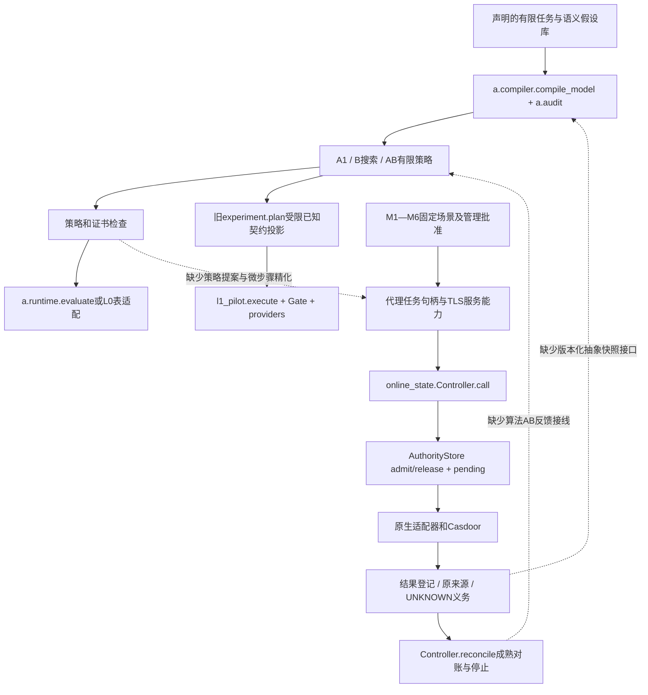

# 算法与运行层的真实连接

审查时间2026-11-06。事实来源为当前源码、M1—M6冻结入口、旧576校准源码和研究v1.2。调用边由源码定位支持，执行边另有轨迹，缺边不以图示补齐。

## 1 名称消歧

| 名称 | 实际对象 |
|---|---|
| 生命周期任务A/B、请求A0/A1/B0 | 逻辑任务与结果rid，分别有批准及材料来源 |
| 研究A、A1 | 有限假设库中的语义查询选择；auth_lifecycle.a.candidate.solve |
| 研究A4 | research_v12/a4.py:Cells的价值单元/策略重用，保留检查与单例精化 |
| 研究B、B4 | 凭据配置搜索；B4为零费用同语义路径类压缩及全局字典序展开 |
| 研究AB/AB1/AB3 | 有限模型中配置冲突/证书对后续获取的反馈；版本和scope分别登记 |
| main_topic_selection入口A、命题A-E | 初始根配置参数复杂度问题，区别于研究A查询选择器 |
| 密码学候选B | 已终止的辅助线候选，区别于研究B配置算法 |
| L0 BoundedController / 持久Controller | 前者执行有限W_h屏障；后者执行事务接纳与真实适配 |
| R_ctl / R_stop / R-I | 可信托管控制器、声明原生停止目标、有限参考求解器 |

## 2 可核查调用图

固定脚本之外，持久Controller确实根据批准、预算和对账证据决定拒绝、派发、隔离及CLOSED。该成熟运行逻辑不自动成为研究A的查询优化或研究AB反馈算法。

## 3 入口、结构与执行证据

| 边 | 函数与输入输出 | 谁决定/可见信息 | 执行证据和状态 |
|---|---|---|---|
| 有限源→L0 | a.compiler.compile_model(source)→bundle；a.audit.check_compilation | 声明worlds/probes/cleanups/budget/故障；分离源解释器检查 | 有限测试与旧a_ab验证；MODELED_CONNECTED |
| A/B/AB联合计算 | a.candidate.solve；b.search.solve；research_v12 joint.solve/FullB | 使用信念、允许动作和完整B；不取隐藏真值作选择 | 合成/有限研究运行；未接当前持久服务 |
| 有限策略→表执行 | controller.BoundedController.step、a.runtime.evaluate | 按观察更新K；评分器实际分支独立保存 | L0回归和分支核对；TABLE_EXECUTION_ONLY |
| 旧算法→原生校准 | experiment.planning.plan→delivery.configuration/setup/plans；scripts/l1_pilot.execute | 已知单世界，无probe；提取ok分支，缓存可复用配置 | 576运行，B曾决定配置；A/AB查询和具体反馈激活0 |
| M1→运行层 | online_state.acceptance.run_trace | 固定七类场景和故障位置 | 21槽20通过/1初始化中止 |
| M2→原生 | native_acceptance.run_case | 固定发行/刷新/撤回/处置/恢复顺序 | 4原生轨迹、原报警/修订/本地补核分开 |
| M3/M4→对账 | reconciliation_acceptance.run_case；unidentified_acceptance.run_case | 固定查询时点，运行层验证来源/剩余能力 | 标识点读与授权组织枚举各2条 |
| M5/M6→隔离运行 | isolation_acceptance.run_scene；native_isolation.run_case | 固定攻击、合法调用和恢复；真实受限进程 | M5合成12场景；M6原生2条 |
| 句柄→接纳/派发 | services.Controller.call→storage.AuthorityStore.admit/release | 身份来自已认证能力；request含rid/handle/task/account/audience/generation/operation/payload | 原子预算、来源、pending、放行顺序已有本地/原生证据 |
| 结果→义务 | Controller.record_result→AuthorityStore.record | 原rid/attempt/digest/origin，批准当前性 | RESULT_AVAILABLE/QUARANTINED/DISPATCHED_UNKNOWN |
| 对账→关闭/UNKNOWN | Controller.reconcile→CasdoorProvider.reconcile_enumeration→save_reconciliation | 仅获准接口与运行账本；评分私有真值不进入 | M4/M6具体条件实例通过；G0/G9成熟覆盖 |

当前online_state包没有导入a.candidate、b.search或research_v12求解器来选择动作。research_v12.bootstrap读取保留的研究基础与当前auth-lifecycle有限模块，它没有连接online_state。代码定位详见CODE_LOCATIONS.json及CLAIMS A01/A04/A05。

## 4 六个直接答案

1. M1—M6的高层动作由验收程序及可信测试配置固定。Controller和provider负责准入、安全判断与接口适配，评分器负责事后评价。
2. 研究A查询选择在M1—M6中未激活。旧576校准也明确query_needed_profile=false，不能据其推断H-A收益。
3. 研究B曾在旧known-contract-single-path校准中产生delivery配置并由脚本执行；M1—M6批准与路径由验收代码构造。
4. AB在有限研究代码中存在反馈路径；当前数据没有表明它改变M1—M6后续动作。成熟对账CLOSED/UNKNOWN反馈与算法AB区分。
5. 有限source→L0审计、有限表间abstraction.check_relation/lift_policy已经存在；AuthorityStore/AS微步骤→该模型的精化未建立。
6. 当前事务持久化、在线恢复、托管、OS隔离与本批对账关闭由成熟G1/G3、G0/G9及固定原生profile支撑。

## 5 最小缺口规格（本轮不实现）

仅对现有模型可表达子域定义以下接口：

- RuntimeSnapshot：profile/model摘要、authority_version、task/account/caller、批准实例/代次、余预算、pending(rid/attempt/digest/phase/origin)、已知材料引用、义务和合法观察；排除原文材料及评分真值。
- ModelEnvelope：将快照保守映射到已冻结的有限K、目标L/R/E、剩余决策步h与动作/观察映射；不支持的重叠效果、新批准或非原子配置返回UNKNOWN/需重建模型。
- PolicyProposal：模型与快照版本、证书scope、动作模板、批准绑定、预期全部Post、保守成本、接收观察与义务规则。调用只能建议，当前事务仍原子核验。
- RuntimeObservation：绑定原rid/attempt/version，区分本地拒绝、已放行未知、原生返回、隔离、处置和条件关闭；反馈到有限K的映射须覆盖所有允许微步骤结果。

有限configure原子动作与多次原生发行/接纳并不相同；一次模型动作可对应多次RPC/HTTP，中途崩溃和迟到结果须被映射。现有r/h、Q、budget slots和HTTP总额分开记账。来源和原生效果域完整性也不能从同名字段推出。

在没有上述关系前，旧策略证书不进入原生派发许可，M6运行通过也不充任H-S的抽象保持证明。若未来恢复端到端算法主张，再按该最小接口补证；本轮阶段收口不扩展算法模型或编写新的算法候选。
