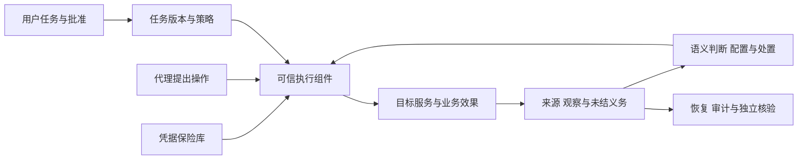

# 面向用户与 AI 智能体的全生命周期密码与凭据管理技术调研报告

资料与检索截止：2026 年 11 月 9 日。研究目录：`D:/毕业设计`。

## 摘要

用户将账户任务交给 AI 智能体后，凭据管理需要同时处理秘密保存、任务批准、工具执行、授权续期、撤销、恢复与审计。本文基于当前项目的论文、设计文稿、实验说明和较新裁决开展系统化技术调研。全目录清点发现 30,625 个候选文件；348 份 PDF 按字节归并为 241 个不同来源对象。核心目录的 45 篇论文共 1,072 页，均通过本次结构预检。其中 14 篇开展模型或机制片段的定点分析，其余采用首页或摘要级归纳；另处理 8 份草案、15 项项目证据及定向补充来源。

现有研究已经覆盖身份与托管、账户绑定、任务级授权、信息流与宿主控制、授权历史、异步效果和私密凭据状态。研究责任主要落在这些能力到真实服务合同的可靠映射，以及信息、状态、费用和证据范围之间的组合。项目中，静态多尝试归属与部分关闭判定可由标准流处理；条件性参数上界、严格代价分离和原生应用分别有证据要求。区块链可承担跨核验者共享的历史承诺，源事实、完整创建机会及原生失效仍需服务和采集证据。报告据此提出可靠合同映射、有副作用补证、跨设备增量核验、恢复一致性和实际授权询问五类限域方向，并保留同条件成熟组合覆盖的出口。

关键词：AI 智能体；密码与凭据管理；任务授权；选择性撤销；生命周期证据；安全补证。

## 1 研究背景与问题定义

### 1.1 从密码保管到代理持续使用

密码管理器通过密码生成、加密保存、网站匹配和自动填充支持大量账户的日常使用。通行密钥、API 密钥和 OAuth 令牌进一步扩展了管理对象。客户端解锁保险库、目标网站完成认证、服务维持登录会话分别对应不同状态。管理访问结束时，需要继续追踪登录后的材料与派生能力。[O01]、[O02]、[O03]

AI 智能体还会根据网页、文档和工具结果选择后续动作。长期秘密可以留在可信组件中，代理仍可能要求超出当前任务的调用。账户身份有效、材料尚可使用、动作符合批准和业务结果已经终止，需要各自的判断依据。SUDP、PAuth、CaMeL 和 AID-Guard 分别从秘密使用、任务约束、信息流和效果提交处理这些问题。[P01]、[P02]、[P13]、[P05]

当前项目最新 R2 材料将课题定位为面向用户与 AI 智能体的全生命周期密码与凭据管理系统。创建或导入、保存、组织、使用、共享、更新、轮换、到期、撤销、删除、备份恢复和审计属于整体范围。A、B、AB 是认证语义感知、配置与补证子问题；区块链定位为辅助证据核验。本文据此组织主线，理论和独立密码分析按自身合同保留。[L01]、[L02]

### 1.2 核心场景与研究问题

设代理甲读取项目资料并在笔记服务生成摘要，代理乙持续检查同一资料账户。用户撤回甲，同时要求乙继续工作。系统应说明两项任务实际使用的账户、访问路径、原生材料、操作范围和接收方，以及撤回时哪些状态已经结束、哪些请求仍待确认。

本报告的核心问题是：系统如何将用户批准连接到真实凭据、服务会话和业务效果，并以可追溯证据支持使用、选择性撤销、恢复及独立核验？其中哪些能力已有成熟组合，哪些具体责任仍需新的可靠映射、定理或实证？该问题直接对应项目的设计、校准和最新定位记录。[L08]、[L09]、[L13]、[L01]

### 1.3 研究边界与方法

本次先递归清点文件，再按来源和版本追踪重要结果。依赖缓存、编译环境、版本库和本次输出退出候选统计。PDF 与 Word 按 SHA256 识别完全相同副本；论文继续按标题、DOI 和 arXiv ID 核对。241 是不同 PDF 字节对象数，含版本与报告，核心论文数量另计。

调研采用主题分类、代表性片段核读、跨来源比较与定向补充。45 篇核心论文采用同一编号，14 篇重点分析威胁、机制和边界；8 份草案保留版本与状态。结构预检只支持文件结构及物理页定位，全文机器提取、定点阅读、完整证明认证和实验复现分别登记。

本次属于具有清点、检索和核验记录的系统化技术调研。它保留数据库覆盖与阅读范围，尚未建立穷尽性 PRISMA 检索或元分析条件。数字来自论文原文或既有项目文件，作者实验、本地记录与本文推断分别标注。

### 1.4 概念与验收对象

| 概念 | 本报告含义 | 需要检查的对象 |
|---|---|---|
| 认证 | 验证主体控制与身份关联的认证因素 | 登录、凭据与身份绑定 |
| 授权 | 确定给定条件下允许的操作 | 主体、资源、参数与期限 |
| 凭据托管 | 在可信边界内保存并受控使用材料 | 密钥、密码、令牌及暴露路径 |
| 授权根 | 在声明模型中支撑访问或委托的来源 | 派生、合取和独立支持 |
| 原生效果单元 | 按服务授权或失效关系定义的单元 | 关联材料、接受路径与副作用 |
| 未结义务 | 尚需查明、处置或证明终态的责任 | 迟到创建、预留与未知效果 |
| 证据完整性 | 所声明记录域与创建机会得到充分覆盖 | 源采集、枚举、版本与作用域 |
| 分离声明 | 输入族、指标、最强通用方法和预测差距 | 同能力下的必要额外代价实例 |

上述模型量采用项目已登记定义，实际含义随明确合同固定。[L08]、[L14]

## 2 相关技术基础

### 2.1 凭据与会话具有不同生命周期

密码和通行密钥主要用于认证；会话 Cookie 承接持续访问；API 密钥用于程序接口；访问令牌与刷新令牌分别承担资源访问和后续签发。修改或撤销一个对象，会影响哪些其他对象，应由服务合同与资源接受规则确定。HashiCorp Vault 的动态秘密租约及撤销为生命周期提供成熟基础。[O03]、[O04]、[O05]、[O15]

RFC 7009 定义令牌撤销，并包含适用时同一授权授予下其他令牌的关联失效。RFC 7662 提供内省查询，RFC 9396 通过 `authorization_details` 表达细粒度授权，RFC 9700 汇集 OAuth 安全最佳实践。部署中的缓存、离线校验和传播时间需另行核对。[O04]、[O05]、[O06]、[O07]

Audience Injection 研究展示了多端点客户端断言的接收方混淆。2026 年 11 月发布的 RFC 10070 已更新相关要求：客户端认证 JWT 的 `aud` 使用授权服务器 issuer identifier 作为唯一值。授权授予断言具有另行规定的用途分支，显式 `typ` 也有自身建议和兼容性条件。系统接入应按断言用途与规范版本核验。[P33]、[N02]

### 2.2 三类停止目标

| 目标 | 完成条件 | 验收位置 |
|---|---|---|
| L 本地停止 | 撤回提交后，受控入口拒绝目标任务的新调用 | 当前任务版本与全部受控入口 |
| R 原生失效 | 指定材料在声明接受路径和后代范围内失效 | 服务原生处置与资源端验证 |
| E 效果停止 | 指定边界后，目标范围的受保护效果停止提交或释放 | 业务提交端、队列、取消或围栏 |

用户可以只要求其中一项，也可以要求组合。已经发生的读取或写入属于历史效果，补偿需要独立业务合同。保留乙则要求其继续完成获准任务，并具有独立于已撤回甲的有效依据。[L08]、[P03]、[P05]

1Password for Agents 的安全文档将保证范围落在凭据存储、批准、交付和填充，登录后的行为依赖代理和网站。Nango Agent Sessions 则示范按连接、工具和期限限制任务入口，并在终止或过期后拒绝请求。所有访问都经过中介、目标仅为 L 时，任务会话是应认真采用的直接基线。[O08]、[O09]

Google 的撤销说明和 Microsoft Graph 的 `revokeSignInSessions` 展示了较大关联范围及传播条件。不同代理标识、不同材料字符串与独立撤销范围分别需要证据。[O10]、[O11]

### 2.3 可信执行与可能状态

模型负责提出操作，批准通道记录用户决定，可信执行组件按当前政策落实调用，服务端决定原生授权与效果。保险库、代理运行时、宿主资源和目标服务分别具有边界。AWS AgentCore、Entra Agent ID 与阿里云 Agent Identity 已提供工作负载身份、代理归属、凭据取得与审计能力，接入后仍需绑定真实下游关系。[O16]、[O17]、[O18]

证据不足时，可以维护与观察相容的可能状态集合。一个获准动作需要对相关状态保持安全，并保留合法结束与清理路径。DRD 提供为决定选择测试的通用思路，shielding 和多成本 POMDP 分别提供部分可观测安全与费用约束工具。具有副作用的认证动作还需要显式后继和义务。[P09]、[P10]、[P11]、[L14]

图中是研究职责关系，组件是否完成及其部署位置按项目实际证据验收。[L08]、[L01]

## 3 国内外研究现状

### 3.1 技术路线与发展联系

核心研究可按八条路线组织。主类按核心贡献登记，一项工作仍可与其他类别互补。

| 路线 | 核心代表 | 主要解决对象 |
|---|---|---|
| 身份表示与秘密托管 | SUDP、Vault 中介、SAGA、认证委托立场稿 | 代理归属、材料交付和代用 |
| 账户绑定与协议安全 | OASIS、Cross-app、Audience Injection | 应用用户、租户、连接器与断言 |
| 任务授权与最小权限 | PAuth、Task Shield、Progent、ASTRA、CASA | 任务范围、参数与权限变更 |
| 授权历史 撤销与效果 | ResidualAuth、ACG、AID-Guard、Root-Scoped、HBHC | 未来权威、依赖和在途效果 |
| 执行边界与信息流 | CaMeL、AgentBound、Tracked Capabilities、AgentSpec | 数据流、宿主资源与代码效果 |
| 形式化与决策 | DRD、shielding、POMDP、RAG 与 tactics | 状态、观察、预算与可行性 |
| 私密证据与审计 | DECO、Garble-Then-Prove、私密策略、PRC、APEX | 来源、政策和状态查询隐私 |
| 评测与系统综述 | GrantBox、MCPTox、MCP Landscape | 真实工具、元数据攻击与覆盖 |

对应论文的逐项来源和比较分别见下文及附录的核心文献地图。[P01]、[P07]、[P02]、[P04]、[P13]、[P09]、[P24]、[P36]、[P38]

早期的决策区域、账户图和访问控制提供了状态、测试与委托基础。近年的系统将控制移到确定性组件，并逐渐增加任务参数、版本依赖、效果提交和恢复责任。该演进让“增加身份标识”“把秘密放进保险库”“按工具名授权”等宏观功能具有较强既有覆盖。[P09]、[P12]、[P08]、[P19]、[P22]、[P01]、[P43]

### 3.2 国内相关研究

通信学报 2026 年的智能体去中心化身份综述，已讨论委托链、动态权限、生命周期与可撤销授权。软件学报 2025 年的去中心化可问责属性认证工作给出匿名问责构造。通信学报 2022 年的空间信息网络批量认证工作通过验证端票据检查与撤销数据分发管理资格。它们分别支持技术分类、既有协议组合与撤销接口分析。[CN01]、[CN02]、[CN03]

这些资料对本课题的直接启示是，DID、链上承诺、属性证明和批量撤销已有多种具体方案。新贡献需落实到选定系统合同、可靠来源和完整成本。CN02 的历史章节记录还提示其性能口径排除了序列化、合约调用和部分网络费用，部署比较应补齐对应边界。[L15]

### 3.3 代理协议与证据提案

| 来源 | 关注对象 | 状态及主要边界 |
|---|---|---|
| D01 委托链 | 逐跳衰减、父子绑定与验证 | 个人草案，撤销状态新鲜度另有机制 |
| D02 显式撤销 | 按代理标识批量和级联处置 | 个人草案，实际传播与效果需实现 |
| D03 授权证据 | 批准、收窄和拒绝的结构化依据 | 个人草案，证据真实性依来源 |
| D04 Mission | 任务对象与后续令牌签发 | 个人草案，已发材料按资源端规则继续处理 |
| D05 Dialog binding | 对话上下文与请求、响应凭据 | Internet-Draft，工作组采纳状态本轮待核 |
| D06 委托协议组合 | Token Exchange、DPoP、RAR 等组合 | 个人草案，按部署前提使用 |
| D07 Evidence binding | 代理凭据、预期证据服务与回执 | 个人草案，伴随既有身份工作 |
| D08 Revocation closure | 授权纪元、围栏与关闭状态 | 个人草案，未决范围保持 UNKNOWN 或 PARTIAL |

表中的 D 编号对应本地 8 份文本及官方 Datatracker 核对。[D01]、[D02]、[D03]、[D04]、[D05]、[D06]、[D07]、[D08]

Authority Histories 还提出可重放的签名授权历史，包含未结责任、外部锚定和可选零知识证明。这些内容构成区块链辅助核验的重要近邻。提案的规范性语言表达建议合同，实际互操作和部署保证仍需实现证据。[O14]

## 4 代表性研究与核心技术

### 4.1 秘密使用许可与任务操作约束

SUDP 让请求方提出规范化操作，用户通过认证器签发新鲜许可，托管方验证并使用秘密。操作描述、绑定和有效条件在批准与执行端采用同一序列化。域分离、认证器密钥、包裹密钥和逻辑端到端通道进入保证条件。作者给出的七项性质中，六项由协议承担，运行时内存保密通过硬件根运行环境组合。亚毫秒结果属于协议部分开销，批准仪式与完整任务负担还需相应计量。[P01]物理页 1、6。

PAuth 则从用户任务导出逐服务符号切片，并把运行时操作值放入服务签名的 envelope。服务检查某个具体操作是否由任务蕴含，代理可采用任意内部策略。作者假定任务无歧义、所需 API 存在，权威服务对自己的数据负责，事务价格锁定等业务争议留给服务合同。AuthBench 上 100 个良性任务获准、634 个对抗调用阻断，支撑所测任务与攻击设置。[P02]物理页 1、4。

两者分别组织秘密代用和任务约束。集成时应统一批准对象、参数来源和提交边界，避免一层批准所指操作与另一层实际调用出现差异。RAR 等细粒度表达能力也应进入 OAuth 比较。[O06]

### 4.2 状态历史与选择性修复

ResidualAuth 以全部未来授予、撤销和使用序列定义历史等价。两个历史即使当前可达性相同，也可能在后续撤销后要求不同决定。若存在 K 个未来可区分类，精确监控需要区分这些状态，固定长度编码按 `ceil(log2 K)` 位计量。指数状态数量与所需比特数量分别解释。[P04]物理页 4。

作者还用受限配对诊断区分信息获取与使用：四个模型获得可信当前 Allow/Deny 结果后达到 15 至 16 对正确，单靠 256-token 摘录为 0 至 2 对。其他诊断同时观察到无效重建和有效记忆上的错误决定。系统因此应分别验收必要状态、可访问接口、在线维护和实际使用。[P04]物理页 1、4。

ACG 将用户权威、环境证据与派生结果表示为版本化 DAG。节点记录值、版本、可用性、授权及引用父版本；依赖闭包限定动作需要的子图。INHERIT、BOUNDED 和 CONFIRM 各有明确授权来源。修订后选择性失效相关部分，再寻找所需修复，执行前继续核对版本。它与项目 AB 的证据反馈直接相关，最小修复的语义应按其固定规则比较。[P06]物理页 4。

### 4.3 从准入到提供方效果

AID-Guard 将一次不可变请求绑定到一个 provider-atomic 效果。提交时复核批准请求及当前状态；结果歧义期间保留原预约；终态或带交付围栏的无效果证据后，才释放或交给一个后继。提议者可以完全受控，可信批准根、确定上下文、线性化权威库和独占效果边界承担保证。其清单核验无法自行发现遗漏效果路由。[P05]物理页 3。

作者报告 210 次 Stripe 契约试验符合登记结果，并在 40 个后继时序、30 个竞态和 10 个崩溃恢复时序中保持无重复效果。严格 exact-manifest 配置降低良性效用，说明安全、精确范围和任务完成应联合评价。这些是作者限定集成的结果，本文未重跑。[P05]物理页 1。

Root-Scoped Quiescence 使用 root-epoch 原子、最小充分根集合的反链、提供方局部围栏与通道收支，区分旧根支持和独立授权。证书既核对围栏前承诺，也排除围栏后旧根支撑的新保护效果。已证开放路径返回 NOT_QUIESCENT，缺失或冲突证据返回 INDETERMINATE，只有 QUIESCENT 可以作为释放证书。[P03]物理页 8。

其 17 个 provider-free 用例和检查器变异拒绝支持所列协议路径。全局空闲、历史读取擦除、物理效果回滚与业务目标完成分别在其保证范围之外。把协议用于真实服务，需要完整载体清单和原生 fence 或对应接受边界。[P03]物理页 1、8。

### 4.4 新鲜度、宿主与类型控制

HBHC 将凭据有效性绑定到父心跳，验证方使用缓存公钥和本地时钟检查，撤销窗口受 `Wmax+Δh+ε` 约束。停父进程、子密钥受损和网络分区分别建模。父心跳私钥外泄后，对手可继续生成心跳，需要网络更新验证端公钥。其离线保证依赖受保护父密钥与时钟偏差条件。[P17]物理页 6。

CaMeL 从可信任务生成控制与数据流，隔离组件解析外部内容，值携带来源和允许读者。即使工具序列保持不变，污染文件名或接收方仍会触发解释器的数据流策略。AgentDojo 的 77% 安全任务完成与未防御 84% 属于同论文的任务指标。[P13]物理页 1、4。

AgentBound 的 AgentManifest 与 AgentBox 在宿主层限制 MCP 服务器可访问的文件和网络。其 296 个服务器和 80.9% 政策生成准确率说明生成与执行是两项责任。符合资源政策的语义滥用，仍需要其他任务机制。[P29]物理页 1、6。

Tracked Capabilities 让代理在 Scala 3 安全子语言中表达操作，捕获检查跟踪能力和局部纯性。未检查转换、反射和 unsafe 模块等逃逸受到限制，底层工具安全及模型服务无状态属于基础设施前提。动态解释器、静态类型和宿主控制可以针对同一任务组合，也应共同核对旁路。[P30]物理页 4。

### 4.5 动态政策与意图证书

Progent 用工具名及参数上的符号规则表示允许集，每个调用经过确定检查。模型提出政策更新后，SMT 判断允许集是收缩还是扩张，前者可以自动采用，后者经过明确批准。集合包含检查的可靠性与初始政策是否忠实于任务分别有责任。所用 v3 在 2026 年 5 月修订，首次提交年为 2025 年。[P43]物理页 1、3。

Intent-Governed Authorization 从可信请求导出短期证书，收窄 manifest，并检查资源范围、payload 效果和路由。OpenPort 底座提供 draft、preflight hash、状态见证及幂等。作者的 306 次端到端试验中，零已完成不安全效果与仍存在的未执行不安全草稿并存；后者比率为 0.0909 至 0.2727。更严格规范化进一步降低风险，同时付出效用代价。[P45]物理页 1、4。

### 4.6 私密状态与证据

DECO 和 Garble-Then-Prove 研究经 TLS 取得的数据来源及相关性质证明。多方私密策略工作保护各方政策内容，APEX 为加密资源提出受限委托模型。它们提供不同证明关系，接入时需固定输入来源、信任、输出泄漏及中止责任。[P14]、[P15]、[P16]、[P28]

PRC 通过 PIR 与 MPC 组合，让客户端取得数据库中特定记录的认证，同时保护查询索引。作者报告十亿级凭据下的亚秒请求及在线费用，比较时还需计入预处理、数据库维护和网络。物理页 7 使用 any-trust 假设，至多 n−1 个撤销权威受损；数据库状态复制在作者范围之外。实时非撤销状态还需要客户端或验证方能接触相应权威。[P24]物理页 2、5、7。

## 5 不同技术方案的比较

### 5.1 按完整合同选择组合

| 用户需求 | 有利的已有方案 | 继续核对的条件 |
|---|---|---|
| 秘密留在受控边界 | Vault 中介、SUDP、成熟保险库 | 运行时、日志、通道和具体操作绑定 |
| 限定当前任务参数 | PAuth、Progent、Intent 证书 | 任务解释、来源、政策扩张与效果界 |
| 限制外部数据流 | CaMeL、Tracked Capabilities | 能力传播、可信原语和语言逃逸 |
| 限制 MCP 宿主访问 | AgentBound、代理 ABAC | 文件与网络覆盖、直接调用及嵌套路径 |
| 修订后保留无关授权 | ACG、ResidualAuth 所需状态 | 依赖完整性、版本和未来撤销语义 |
| 丢响应后恢复 | AID-Guard、持久工作流 | 提供方幂等、终态、围栏与原预约 |
| 结束长期委托 | Root-Scoped、HBHC、原生撤销 | 效果清单、接受路径、时钟及密钥 |
| 私密证明状态或历史 | PRC、SCITT、认证结构和 ZK | 记录域完整性、来源与新鲜度 |

相关来源分别为 [P18]、[P01]、[P02]、[P43]、[P45]、[P13]、[P30]、[P29]、[P25]、[P06]、[P04]、[P05]、[P03]、[P17]、[P24]、[O12]。

P27 对限时超图委托、RBAC 和所实现的 Macaroon 基线重放轨迹并比较。其 39 个载荷与敏感度加权半径支持该实验。Macaroons 原始设计本身具有衰减和上下文 caveats，因此比较结果应限定到作者实际实现及配置。[P27]、[N03]

### 5.2 指标的可比性

| 工作 | 原指标或分母 | 本报告解释 |
|---|---|---|
| Task Shield | GPT-4o、AgentDojo：ASR2.07%，效用 69.79% | 安全与任务效用共同保留 |
| GrantBox | 真实工具受控攻击场景，平均 ASR84.80% | 体现真实权限评测设置 |
| MCPTox | 45 服务器、353 工具、1348 案例、20 模型 | 元数据投毒与具体模型结果 |
| CapChain | 150 条件，Salient 层 4.67% | redactor 触发率 |
| AgentSpec | 代码、具身和驾驶域的不同结果 | 规则、领域和分母分开 |
| ProbGuard | 降低 65.37%不安全行为，保留基线 80.4%完成 | 阈值、预测和干预的效用取舍 |
| ASTRA 与 CASA | 任务-scope 及多轮匹配 | 语义准确与执行安全分开 |
| Elastic Least Privilege | 概念、租约和预算模型 | 实现及有效性仍为研究议程 |

对应来源：[P23]、[P36]、[P38]、[P37]、[P32]、[P39]、[P40]、[P41]、[P42]。这些结果具有不同攻击能力与评分目标，本文按原条件呈现，采用同任务、同版本和同指标后再比较数值。

### 5.3 跨论文联系

任务约束与效果协议具有互补范围。PAuth 将部分事务条件留给服务，AID-Guard 显式管理提交和歧义；CaMeL 与 Tracked Capabilities 分别采用解释器和类型；PRC 与 HBHC 分别关注匿名状态查询和层级资格新鲜度。共享“授权”名称并不自动带来相同的被保护对象，应先写出输入、权威来源和可观察结果。[P02]、[P05]、[P13]、[P30]、[P24]、[P17]

## 6 项目研究基础与证据评估

### 6.1 已有实现与原生记录

auth-lifecycle 和 research_v12 保留有限模型、候选、精确参考、证书检查及优化对照。M1 至 M6 则检验成熟控制面、来源、材料托管、pending、恢复和隔离。当前持久层由固定场景程序调用 Controller，A/B/AB 选择器的完整接入和运行状态精化仍待建立。[L08]、[L10]、[L11]

| 记录 | 实际分母与结果 | 适用范围 |
|---|---|---|
| M1 | 21 槽，20 通过、1 初始化中止 | 指定在线状态与故障域 |
| M2 | 4 个原生样本 | 来源和 pending；原始报警、修订与补核分列 |
| M3 与 M4 | 各 2 个原生样本 | 标识前提及组织额外授权 |
| M5 | 12 项合成场景 | 权限和隔离边界 |
| M6 | 2 条联合原生轨迹，各 43 项检查 | 固定服务流程与组合；回归 148 和 157 按版本分开 |

表中为项目历史记录，本文核对其说明与后继总报告，未重跑。[L08]、[L11]

pilot02 有 288 对、576 次方法运行。六方法各 96 次，均为 20 合法完成、56 拒绝、20 UNKNOWN。三组主要成本比均为 1.00，完成率差均为 0。失败惩罚使用 C_Q=65、C_G=9。A 查询和 AB 具体反馈激活为 0，因此该数据是已知契约对照。[L09]

记录还保留 156 项未结条件：132 项停止目标在批准撤回条件下尚未满足，24 项未知创建材料在所登记离线策略下仍可验证。故障运行中 240 次到达并触发事件，144 次在触发点前结束。实际方法请求 744 次，基础设施与独立测量另计。R-J 补充比较给出 A1 的 Q=5、参考 Q=3，差异来自重复门控调用。上述信息共同限制性能与安全外推。[L09]

### 6.2 多尝试关闭的标准流基础

最新材料令 I 为有限尝试集、T 为目标尝试、c_i 为可靠创建上界、U 为互异创建见证、E 为来源相容边、D 为有可靠持续失效证据的材料。所有目标创建和派生机会需封口或计入容量，真实来源位于容量可行映射集合 F 内。[L14]的 C1 至 C7。

令

$$
C_T=\sum_{i\in T}c_i,\qquad
d_T=\min_{f\in F}|D\cap f^{-1}(T)|,\qquad
H_T=C_T-d_T.
$$

若 F 为空，系统返回证据冲突，后续判据要求 F 非空。在源模型包含真实执行的前提下，H_T 上界同时覆盖已见可用目标材料与迟到创建余量。两部分使用同一个 f，保持来源和剩余容量的相关性。H_T=0 给出声明范围内关闭；必要性还需要容量世界可实现、未使用槽位可独立产生单位等更强条件。[L14]的 P1。

标准最小费用流可以求 d_T。每份见证以容量 1 分配到相容尝试，尝试以 c_i 限制总归属，将“已处置材料归属目标”的边计费用 1。整数流对应可行映射，残量势支持最优性检查。容量按二进制计费，图建立、求解和核验均纳入成本。[L14]的 P2；[L15]

三个手工例说明不同情况。两份已失效目标材料即使仍有交换来源，容量饱和时也可关闭；两来源与两可用材料完全交叉时，四种静态删除计划都无法同时关闭甲和保留乙；目标容量 2 而只见 1 份材料时，处置已见材料后仍有一项余量。这些结果分别支持充分证据、共同信息障碍与未结责任。[L14]的 E1 至 E3。

对 k 个独立歧义对，只允许逐材料可信来源查询时，每个成功路径至少查询每对一次；逐对方案恰用 k 次。该下界同样约束候选，标准组合已经最优。研究价值应继续在真实映射、有副作用的序列或新的费用结构中精确定义。[L14]的 E6、E7。

### 6.3 参数理论与严格分离

M_r 采用共同初始绑定、已有独立可撤销根、单任务原子重绑及一次首次停止请求等合同。MT-1 将半径一列表模板拟合整理为确定性精确 `2^{O(w log(w+2))}poly(N)` 上界，并在确定性 ETH 下给出指数阶匹配。输入含共享模式、逐行固定标签、列表和静态域，完整读取和输出计费。[L03]

项目同时保留基本 w-FPT 与 P14 的 `2^{O(w²)}poly(N)` 强参考。两个指定分离族后来被更强组合处理；共同 ETH 下界无法独自产生基线相对候选的额外必要代价。当前严格实现实例继续待建立。原生应用还需原子重绑与旧支持退役等接口，当前 Casdoor profile 未完成该精化。[L04]、[L03]、[L11]

高型计数和固定标签正规形等结果按给定可行标签、计数表和成本域保留。它们与未知解定位、可信组件数或真实请求数之间，需要新的成本保持映射。[L11]、[L12]

### 6.4 授权询问与密码学支线

本地归一化授权询问采用二元等幅效用、已知正参照、确定性自适应策略和绝对值不超过η的对抗加性误差。在 0≤η<1 的合同下，项目稿给出 `Q(d,η)=Θ(1+dη)`，单问条件为η<1/d；η≥1 时精确终止判定不可实现。查询次数尚未包括问题描述、理解、证书和实际交互费用。[L05]

补充的 Damaschke 阈值群测允许两个阈值之间任意回答，目标是带一定误分类的集合恢复。该直接近邻支持进一步核对提问语言、误差与目标的归约，机构摘要本身还不足以完成全部定理覆盖判断。[N01]、[L06]

FI 支线分析固定 Jurkiewicz–Prabucka 发表版本和原游戏权限，在 Ord 规范化及独立采样条件下，使用更新关系的仿射支撑给出区分概率和共同正确参数族。其当前定位为独立密码分析候选。作者性能代码、具体参数完整正确性、应用优先权与本凭据系统的接口对应仍各有责任。[Q01]、[L07]

## 7 现有研究局限性

### 7.1 已有机制需要可靠合同

任务切片、政策图、能力标签和围栏都对已给定语义发挥作用。真实工具可能后台刷新、创建作业或在错误返回前产生材料，合同需要覆盖这些后继。完整源分析与执行覆盖的责任应与既有核验算法区分。[P02]、[P06]、[P05]、[P29]、[L14]

### 7.2 多组件与多来源的状态关系

普通身份平台与保险库可以确定主体或取得资格，下游真实会话和授权根仍需映射。代理可写业务字段还可能改变后续授权谓词。不同任务、独立支持、未知后代和恢复责任应进入统一记录。项目最新来源把静态流子域与原生映射缺口分开，避免将来源歧义一概写成新算法困难。[L01]、[L14]、[L15]

### 7.3 证据历史与真实效果

SCITT 支持签名声明、透明记录和独立审计，安全讨论明确保留声明准确性与发行者选择性提交问题。透明日志与链检查点因此需要源采集、参与完整性和当前服务证据配合。只锚定哈希还可能公开时间、顺序和跨任务关联，隐私分析需覆盖这些元数据。[O12]第 8、9.1 至 9.3 节；[O13]

### 7.4 评价与研究本身的边界

大量研究仍采用受控任务、合成轨迹或单平台 profile。概率预测、结构性拒绝、政策生成和实际业务效果需要分别评价。真实用户偏好、长期撤回行为和跨平台恢复还需要对应需求与数据。[P21]、[P23]、[P36]、[P37]、[P38]、[P39]、[L09]

本次采用 45 篇核心集合与定向外部补充，14 篇的深度限定在已标明片段。部分国内章节复用项目阅读范围。两个外围 PDF 为空或截断，原件保留，其本地内容退出实质证据。CN04 正文仍待取得。所有这些限制均进入来源与事实核验表，后续来源可能改变局部覆盖判断。[L15]、[CN04]

## 8 研究空白与潜在方向

### 8.1 真实接口到生命周期合同

研究对象是含登录、刷新和业务效果的冻结工具，从源码及原生接口提取覆盖真实后继的合同。可检查目标包括合法动作保持、错误接受、未知状态与清理责任。强基线应包含程序分析、效果系统、验证工具和人工合同维护。该方向直接支撑系统主线，候选增量须落在完整可靠性与费用。[L08]、[L14]、[P26]

### 8.2 有副作用的补证与处置

静态来源查询可以利用流和 DRD；刷新或试探性动作会创建材料，需有状态模型。可以固定两至三笔未知创建，研究同预算下的补证、配置、停止和清理总费用，保持乙的合法可用性。通用信念规划、缓存和增量流获得同样结构，先判断其最有利组合是否已覆盖。[L14]、[L15]、[P09]、[P10]

### 8.3 跨设备增量核验

当前链辅助优先场景是用户在新设备核验甲的撤销结果，同时保留乙和未结事项。先固定已确认检查点、未锚定尾部、记录域和披露合同，再比较签名日志加独立见证、透明日志、SCITT 与链上检查点。主要指标可为一次任务核验的总证据传输量，包含初始记录、更新和维护。[L01]、[L02]、[O12]、[O14]

链组件可以提供共同历史位置，新增源事实仍需对应观测。E2 交换来源的两个世界在相同锚定下保持相同观察，因此该例支持共同信息边界。若成熟组合达到同级合同与费用，能力可以作为工程辅助交付；若剩余精确引理和严格差距成立，再讨论辅助创新资格。[L14]、[L01]

### 8.4 恢复一致性与实际授权询问

恢复方向将对象划分为直接恢复、隔离待核和需要重新批准或轮换，保留全部原 pending 义务。旧备份、当前权威、外部确认前缀和原生状态分别提供事实。评价主指标可选择必要重新批准次数，或固定该批准条件下的补证费用。[L02]、[L08]

授权询问方向先完成阈值检测的定理级映射，再固定可执行的人类回答模型。复杂彩票、可弃权、相关误差和私密政策会改变合同。查询数量、理解正确率、错误授权和任务完成应联合计量。[L05]、[L06]、[N01]、[P21]

### 8.5 实现前的统一分离门

每个候选都先给出具体输入族、主要指标、当前最强适用通用方法和预测差距，并至少构造一个通用方法必要代价更高的实例。双方共享信息、批准、结构、缓存、预处理、服务能力及费用边界。较慢的显示上界、共同复杂性下界和某个朴素程序的大搜索树，分别保持其证明范围。[L04]、[L01]

当前 G1 至 G5 均以分析合同和来源映射为先。理论、协议和系统功能可以保留各自价值，新候选机制的实现资格仍由严格实例决定。本次新增程序仅处理资料清点、提取、编排与引用检查。

## 9 调研结论

当前课题可以围绕一个完整生命周期系统形成连贯研究：用户批准任务，可信组件使用材料，服务形成会话和效果，撤回与恢复保留来源及未结义务，审计端再按明确范围核验。现有文献已经提供各层的重要机制，系统研究应说明它如何组合这些能力，以及哪些可靠映射和证据仍需完成。

项目已经积累有限模型、原生校准、成熟控制面、限域数学和负结果。静态流子域已有强覆盖，T3/T+的条件界与实现分离分别评价，FI 支线按特定原游戏对象保留。最新辅助优先项是跨设备生命周期核验的同合同纸面对照，先确定源证据、信任、新鲜度与总费用，再据结果选择工程功能或进一步研究命题。[L01]、[L03]、[L04]、[L07]、[L14]

## 附录 核心文献地图与资料边界

45 篇核心论文均保留于主报告参考文献。阅读层次和数据定位见对应来源项。八条路线的完整编号如下。

| 路线 | 论文编号 |
|---|---|
| 身份表示与秘密托管 | [P01]、[P18]、[P19]、[P22] |
| 任务授权与最小权限 | [P02]、[P21]、[P23]、[P27]、[P31]、[P35]、[P40]、[P41]、[P42]、[P43]、[P45] |
| 授权历史 撤销与效果 | [P03]、[P04]、[P05]、[P06]、[P17]、[P44] |
| 账户绑定与协议安全 | [P07]、[P20]、[P33] |
| 形式化与决策 | [P08]、[P09]、[P10]、[P11]、[P12] |
| 执行边界与信息流 | [P13]、[P25]、[P26]、[P29]、[P30]、[P32]、[P37]、[P39] |
| 私密证据与审计 | [P14]、[P15]、[P16]、[P24]、[P28] |
| 评测与系统综述 | [P34]、[P36]、[P38] |

本报告使用 AI 辅助完成目录清点、文本处理、资料核验、技术综合与写作。同一执行者按阶段完成内容审查，另用确定性检查核对引用和路径；外部人工同行、证明助手及跨模型独立评审仍待取得。原始输入保持原状，本次无候选机制实现、原生认证请求或历史实验重跑。

## 参考文献

以下采用统一来源编号和作者年题录，保留原始入口、版本、阅读范围与核验状态。已核验指本次所引明确事实的核验范围，全文证明与复现实验各自登记。CN04 属于待核线索。

[P01] Xiaohang Yu, Hejia Geng, Xinmeng Zeng, William Knottenbelt（2026）。SUDP: Secret-Use Delegation Protocol for Agentic Systems。arXiv v4。 DOI：`10.48550/arXiv.2604.24920`。 [原始入口](https://arxiv.org/abs/2604.24920v4)。核验：已核验；范围：首页或摘要与物理页 1,6 的定点片段。

[P02] Reshabh K Sharma, Linxi Jiang, Shuo Chen, Zhiqiang Lin（2026）。Beyond OAuth: Task-Scoped Authorization for AI Agents via Natural Language Slices。arXiv v2。 DOI：`10.48550/arXiv.2603.17170`。 [原始入口](https://arxiv.org/abs/2603.17170v2)。核验：已核验；范围：首页或摘要与物理页 1,4 的定点片段。

[P03] Genliang Zhu, Chu Wang（2026）。Authorization Revocation for Long-Running AI Agents: Root-Scoped Quiescence under Delegation and Asynchronous Execution。arXiv v1。 DOI：`10.48550/arXiv.2609.21284`。 [原始入口](https://arxiv.org/abs/2609.21284v1)。核验：已核验；范围：首页或摘要与物理页 1,8 的定点片段。

[P04] Moonwon Choi, Seokho Jeong, Sian Choi, Seunggeun Lee（2026）。ResidualAuth: What Authorization State Must Language Agents Preserve under Revocable Delegation?。arXiv v2。 DOI：`10.48550/arXiv.2609.08062`。 [原始入口](https://arxiv.org/abs/2609.08062v2)。核验：已核验；范围：首页或摘要与物理页 1,4 的定点片段。

[P05] Yingzhe Tong, Leyu Dai, Songhui Guo（2026）。AID-Guard: Stateful Authorization for Delegated Agent Effects。arXiv v1。 DOI：`10.48550/arXiv.2608.21159`。 [原始入口](https://arxiv.org/abs/2608.21159v1)。核验：已核验；范围：首页或摘要与物理页 1,3 的定点片段。

[P06] Qingzhuo Wang, CaiYi Wang, Jinglu Meng, Ruiyang Qin, Kunyu Peng, Zhihua Wei, Wen Shen（2026）。Authorization Closure Graph: Minimal Repair for LLM Agents with Evolving User Instructions。arXiv v1。 DOI：`10.48550/arXiv.2609.32428`。 [原始入口](https://arxiv.org/abs/2609.32428v1)。核验：已核验；范围：首页或摘要与物理页 1,4 的定点片段。

[P07] Kaixuan Luo, Xianbo Wang, Pui Ho Adonis Fung, Wing Cheong Lau（2026）。Demystifying the (In)Security of OAuth-based Account Linking in Connector Ecosystems。IEEE S&P。 DOI：`10.1109/SP63933.2026.00128`。 [原始入口](https://mobitec.ie.cuhk.edu.hk/connector-oauth-security/)。核验：已核验；范围：首页或摘要与物理页 1,4 的定点片段。

[P08] F. Murphy, S. Radomirović（2026）。Verifying Account Ecosystems With Graph Transformations。IEEE EuroS&P。 DOI：`10.1109/EuroSP68448.2026.00038`。 [原始入口](https://doi.org/10.1109/EuroSP68448.2026.00038)。核验：部分核验；范围：首页或摘要；封面文献另读第二页。

[P09] Shervin Javdani, Yuxin Chen, Amin Karbasi, Andreas Krause, J. Andrew Bagnell, Siddhartha Srinivasa（2014）。Near Optimal Bayesian Active Learning for Decision Making。AISTATS PMLR33。 [原始入口](https://proceedings.mlr.press/v33/javdani14.html)。核验：部分核验；范围：首页或摘要；封面文献另读第二页。

[P10] Steven Carr, Nils Jansen, Sebastian Junges, Ufuk Topcu（2023）。Safe Reinforcement Learning via Shielding under Partial Observability。AAAI。 DOI：`10.48550/arXiv.2204.00755`。 [原始入口](https://arxiv.org/abs/2204.00755v2)。核验：部分核验；范围：首页或摘要；封面文献另读第二页。

[P11] Alexander Bork, Joost-Pieter Katoen, Tim Quatmann, Svenja Stein（2025）。Multi-Cost-Bounded Reachability Analysis of POMDPs。UAI PMLR286。 [原始入口](https://proceedings.mlr.press/v286/bork25a.html)。核验：部分核验；范围：首页或摘要；封面文献另读第二页。

[P12] Luca Arnaboldi, David Aspinall, Christina Kolb, Saša Radomirović（2024）。Tactics for Account Access Graphs。ESORICS2023 论文集。 DOI：`10.1007/978-3-031-51479-1_23`。 [原始入口](https://doi.org/10.1007/978-3-031-51479-1_23)。核验：部分核验；范围：首页或摘要；封面文献另读第二页。

[P13] Edoardo Debenedetti, Ilia Shumailov, Tianqi Fan, Jamie Hayes, Nicholas Carlini, Daniel Fabian, Christoph Kern, Chongyang Shi, Andreas Terzis, Florian Tramèr（2025）。Defeating Prompt Injections by Design。arXiv v2。 DOI：`10.48550/arXiv.2503.18813`。 [原始入口](https://arxiv.org/abs/2503.18813v2)。核验：已核验；范围：首页或摘要与物理页 1,4 的定点片段。

[P14] Fan Zhang, Deepak Maram, Harjasleen Malvai, Steven Goldfeder, Ari Juels（2020）。DECO: Liberating Web Data Using Decentralized Oracles for TLS。CCS 扩展版 v4。 DOI：`10.1145/3372297.3417239`。 [原始入口](https://arxiv.org/abs/1909.00938v4)。核验：部分核验；范围：首页或摘要；封面文献另读第二页。

[P15] Xiang Xie, Kang Yang, Xiao Wang, Yu Yu（2024）。Lightweight Authentication of Web Data via Garble-Then-Prove。USENIX Security。 [原始入口](https://www.usenix.org/conference/usenixsecurity24/presentation/xie-xiang)。核验：部分核验；范围：首页或摘要；封面文献另读第二页。

[P16] M. Sheikhalishahi, I. Stork, N. Zannone（2021）。Privacy-preserving policy evaluation in multi-party access control。Journal of Computer Security29(6)。 DOI：`10.3233/JCS-200007`。 [原始入口](https://doi.org/10.3233/JCS-200007)。核验：部分核验；范围：首页或摘要；封面文献另读第二页。

[P17] Saurabh Deochake（2026）。Heartbeat-Bound Hierarchical Credentials: Cryptographic Revocation for AI Agent Swarms。arXiv v1。 DOI：`10.48550/arXiv.2605.20704`。 [原始入口](https://arxiv.org/abs/2605.20704v1)。核验：已核验；范围：首页或摘要与物理页 1,6 的定点片段。

[P18] Kenney 等（2026）。API Secrets Should Never Become Tokens in the LLMs Vocabulary A Threat Analysis of API Credential Handling in LLM Agent Systems and an Empirical Evaluation of a Vault-Mediated Execution Boundary。arXiv v1。 DOI：`10.48550/arXiv.2609.33371`。 [原始入口](https://arxiv.org/abs/2609.33371v1)。核验：部分核验；范围：首页或摘要；封面文献另读第二页。

[P19] Georgios Syros, Anshuman Suri, Jacob Ginesin, Cristina Nita-Rotaru, Alina Oprea（2026）。SAGA: A Security Architecture for Governing AI Agentic Systems。NDSS。 DOI：`10.14722/ndss.2026.230869`。 [原始入口](https://www.ndss-symposium.org/ndss-paper/saga-a-security-architecture-for-governing-ai-agentic-systems/)。核验：部分核验；范围：首页或摘要；封面文献另读第二页。

[P20] Kaixuan Luo, Xianbo Wang, Pui Ho Adonis Fung, Wing Cheong Lau, Julien Lecomte（2025）。Universal Cross-app Attacks: Exploiting and Securing OAuth 2.0 in Integration Platforms。USENIX Security。 [原始入口](https://www.usenix.org/conference/usenixsecurity25/presentation/luo-kaixuan)。核验：部分核验；范围：首页或摘要；封面文献另读第二页。

[P21] Yuhao Wu, Ke Yang, Franziska Roesner, Tadayoshi Kohno, Ning Zhang, Umar Iqbal（2026）。Towards Automating Data Access Permissions in AI Agents。IEEE S&P；预印本 2511.17959。 [原始入口](https://arxiv.org/abs/2511.17959)。核验：部分核验；范围：首页或摘要；封面文献另读第二页。

[P22] Tobin South, Samuele Marro, Thomas Hardjono, Robert Mahari, Cedric Deslandes Whitney, Alan Chan, Alex Pentland（2025）。Position: AI Agents Need Authenticated Delegation。ICML Position PMLR267。 [原始入口](https://proceedings.mlr.press/v267/south25a.html)。核验：部分核验；范围：首页或摘要；封面文献另读第二页。

[P23] Feiran Jia, Tong Wu, Xin Qin, Anna Squicciarini（2025）。The Task Shield: Enforcing Task Alignment to Defend Against Indirect Prompt Injection in LLM Agents。ACL Long Papers。 DOI：`10.18653/v1/2025.acl-long.1435`。 [原始入口](https://aclanthology.org/2025.acl-long.1435/)。核验：部分核验；范围：首页或摘要；封面文献另读第二页。

[P24] Kasra EdalatNejad, Sebastian Faust, Jonas Hofmann, Philipp-Florens Lehwalder, Thomas Schneider（2026）。Do You Need a Receipt? Anonymous Credential Revocation at Continental Scale via Private Record Certification。USENIX Security。 [原始入口](https://www.usenix.org/conference/usenixsecurity26/presentation/edalatnejad)。核验：已核验；范围：物理页 2、5、7 的摘要与相关片段。

[P25] Rohith Uppala（2026）。Prompts Don't Protect: Architectural Enforcement via MCP Proxy for LLM Tool Access Control。EMNLP Industry。 DOI：`10.48550/arXiv.2605.18414`。 [原始入口](https://arxiv.org/abs/2605.18414)。核验：部分核验；范围：首页或摘要；封面文献另读第二页。

[P26] Aarya Doshi, Yining Hong, Congying Xu, Eunsuk Kang, Alexandros Kapravelos, Christian Kästner（2026）。Towards Verifiably Safe Tool Use for LLM Agents。ICSE 2026 NIER；本地模板字段与正式题录分列。 DOI：`10.1145/3786582.3786839`。 [原始入口](https://arxiv.org/abs/2601.08012)。核验：部分核验；范围：首页或摘要；封面文献另读第二页。

[P27] Hassan Karim, Sai Sitharaman, Deepti Gupta, Danda B. Rawat（2026）。Securing Autonomous Clinical Agents: Time-Scoped Hypergraph Delegation for Controlling Patient Data Access。IEEE ICDH。 DOI：`10.1109/ICDH72779.2026.00047`。 [原始入口](https://doi.org/10.1109/ICDH72779.2026.00047)。核验：部分核验；范围：首页或摘要；封面文献另读第二页。

[P28] Jean Snyman, Chris Culnane, Ioana Boureanu, Gerault David（按本地首页顺序登记）（2025）。Protocols and Formal Models for Delegated Authorisation with Server-Side Secrecy。ACM ASIA CCS。 DOI：`10.1145/3708821.3736217`。 [原始入口](https://doi.org/10.1145/3708821.3736217)。核验：部分核验；范围：首页或摘要；封面文献另读第二页。

[P29] Christoph Bühler, Matteo Biagiola, Luca Di Grazia, Guido Salvaneschi（2026）。AgentBound: Securing Execution Boundaries of AI Agents。FSE Proc ACM Software Engineering。 DOI：`10.1145/3808103`。 [原始入口](https://doi.org/10.1145/3808103)。核验：已核验；范围：物理页 1、4、6 的相关片段。

[P30] Martin Odersky, Yaoyu Zhao, Yichen Xu, Oliver Bračevac, Cao Nguyen Pham（2026）。Securing Agents With Tracked Capabilities。ACM CAIS。 DOI：`10.1145/3786335.3813127`。 [原始入口](https://doi.org/10.1145/3786335.3813127)。核验：已核验；范围：首页或摘要与物理页 1,4 的定点片段。

[P31] Kaiyue Yang, Yuyan Bu, Jingwei Yi, Yuchi Wang, Biyu Zhou, Juntao Dai, Songlin Hu, Yaodong Yang（2026）。When Lower Privileges Suffice: Investigating Over-Privileged Tool Selection in LLM Agents。Findings EMNLP。 [原始入口](https://aclanthology.org/2026.findings-emnlp.2059/)。核验：部分核验；范围：首页或摘要；封面文献另读第二页。

[P32] Haoyu Wang, Christopher M. Poskitt, Jun Sun（2026）。AgentSpec: Customizable Runtime Enforcement for Safe and Reliable LLM Agents。ICSE。 DOI：`10.1145/3744916.3764546`。 [原始入口](https://doi.org/10.1145/3744916.3764546)。核验：部分核验；范围：首页或摘要；封面文献另读第二页。

[P33] Pedram Hosseyni, Ralf Küsters, Tim Würtele（2026）。Audience Injection Attacks: A New Class of Attacks on Web-Based Authorization and Authentication Standards。IEEE S&P。 DOI：`10.1109/SP63933.2026.00116`。 [原始入口](https://www.sec.uni-stuttgart.de/institute/team/Hosseyni/)。核验：部分核验；范围：首页或摘要；封面文献另读第二页。

[P34] Xinyi Hou, Yanjie Zhao, Shenao Wang, Haoyu Wang（2025/2026）。Model Context Protocol (MCP): Landscape, Security Threats, and Future Research Directions。本地 2025 预印本；2026 正式 DOI 定位，版本差异未完整比对。 DOI：`10.1145/3796519`。 [原始入口](https://arxiv.org/abs/2503.23278)。核验：部分核验；范围：首页或摘要；封面文献另读第二页。

[P35] Sakuna Harinda Jayasundara, Nalin Asanka Gamagedara Arachchilage, Giovanni Russello（2026）。AGentVLM: Access control policy generation and verification framework with language models。Journal of Information Security and Applications。 DOI：`10.1016/j.jisa.2026.104379`。 [原始入口](https://doi.org/10.1016/j.jisa.2026.104379)。核验：部分核验；范围：首页或摘要；封面文献另读第二页。

[P36] Zhang 等（2026）。Evaluating Privilege Usage of Agents with Real-World Tools。FSE Companion。 DOI：`10.1145/3803437.3805554`。 [原始入口](https://arxiv.org/abs/2603.28166v2)。核验：部分核验；范围：首页或摘要；封面文献另读第二页。

[P37] Tuck Wai Choong, Wen-Bin Hsieh, Jenq-Shiou Leu（2026）。CapChain: A Capability-Token Access Control Architecture with Verifiable Provenance for Multi-Agent LLM Systems。Applied Sciences。 DOI：`10.3390/app16157776`。 [原始入口](https://doi.org/10.3390/app16157776)。核验：部分核验；范围：首页或摘要；封面文献另读第二页。

[P38] Zhiqiang Wang, Yichao Gao, Yanting Wang, Suyuan Liu, Haifeng Sun, Haoran Cheng, Guanquan Shi, Haohua Du, Xiang-Yang Li（2026）。MCPTox: A Benchmark for Tool Poisoning on Real-World MCP Servers。AAAI；本地题名含 Attack。 DOI：`10.1609/aaai.v40i42.40895`。 [原始入口](https://ojs.aaai.org/index.php/AAAI/article/view/40895)。核验：部分核验；范围：首页或摘要；封面文献另读第二页。

[P39] Haoyu Wang, Christopher M. Poskitt, Jiali Wei, Jun Sun（2026）。ProbGuard: Proactive Runtime Monitoring for LLM Agent Safety via Probabilistic Prediction。ASE 2026；本地 arXiv2508.00500v4 与正式题录分列。 DOI：`10.1145/3832783.3837413`。 [原始入口](https://arxiv.org/abs/2508.00500v4)。核验：部分核验；范围：首页或摘要；封面文献另读第二页。

[P40] Majed El Helou, Chiara Troiani, Benjamin Ryder, Jean Diaconu, Hervé Muyal, Marcelo Yannuzzi（2025）。Delegated Authorization for Agents Constrained to Semantic Task-to-Scope Matching。arXiv2510.26702v1。 DOI：`10.48550/arXiv.2510.26702`。 [原始入口](https://arxiv.org/abs/2510.26702v1)。核验：部分核验；范围：首页或摘要；封面文献另读第二页。

[P41] Majed El Helou, Benjamin Ryder, Chiara Troiani, Jean Diaconu, Hervé Muyal, Marcelo Yannuzzi（2026）。Hybrid Inspection and Task-Based Access Control in Zero-Trust Agentic AI。arXiv2605.02682v1。 DOI：`10.48550/arXiv.2605.02682`。 [原始入口](https://arxiv.org/abs/2605.02682v1)。核验：部分核验；范围：首页或摘要；封面文献另读第二页。

[P42] Simon Parkinson, Zhipeng Wang, Mustafa Mustafa（2026）。Towards Elastic Least Privilege for Agent Planning。arXiv2610.40981v1。 DOI：`10.48550/arXiv.2610.40981`。 [原始入口](https://arxiv.org/abs/2610.40981v1)。核验：部分核验；范围：首页或摘要；封面文献另读第二页。

[P43] Tianneng Shi, Jingxuan He, Zhun Wang, Hongwei Li, Linyu Wu, Wenbo Guo, Dawn Song（2025；所用 v3 修订于 2026-05-14）。Progent: Securing AI Agents with Privilege Control。arXiv2504.11703v3。 DOI：`10.48550/arXiv.2504.11703`。 [原始入口](https://arxiv.org/abs/2504.11703v3)。核验：已核验；范围：首页或摘要与物理页 1,3 的定点片段。

[P44] Bardia Mohammadi, Laurent Bindschaedler（2026）。The Irreversibility Budget: Fleet-Level Risk Accounting and Admission Control for Agent Operating Systems。arXiv2609.00275v1。 DOI：`10.48550/arXiv.2609.00275`。 [原始入口](https://arxiv.org/abs/2609.00275v1)。核验：部分核验；范围：首页或摘要；封面文献另读第二页。

[P45] Genliang Zhu, Chu Wang（2026）。Intent-Governed Tool Authorization for AI Agents。arXiv2606.22916v4。 DOI：`10.48550/arXiv.2606.22916`。 [原始入口](https://arxiv.org/abs/2606.22916v4)。核验：已核验；范围：首页或摘要与物理页 1,4 的定点片段。

[D01] Rafael Asor（2026）。Verifiable Attenuated Delegation for AI Agent Chains。个人 Internet-Draft；进行中的工作。 版本：`draft-asor-wimse-agent-delegation-chain-03`。 [原始入口](https://datatracker.ietf.org/doc/html/draft-asor-wimse-agent-delegation-chain-03)。核验：部分核验；范围：标题与摘要定位。

[D02] Meiling Chen, Li Su（2026）。OAuth 2.0 Agent Authorization Explicit Revocation。个人 Internet-Draft；进行中的工作。 版本：`draft-chen-oauth-agent-revocation-01`。 [原始入口](https://datatracker.ietf.org/doc/html/draft-chen-oauth-agent-revocation-01)。核验：部分核验；范围：标题与摘要定位。

[D03] Dapeng Liu, Judy Zhu, S. Krishnan, Aaron Parecki（2026）。Authorization Evidence and Audit Trail for OAuth 2.0 Access Tokens。个人 Internet-Draft；进行中的工作。 版本：`draft-liu-oauth-authorization-evidence-02`。 [原始入口](https://datatracker.ietf.org/doc/html/draft-liu-oauth-authorization-evidence-02)。核验：部分核验；范围：标题与摘要定位。

[D04] Karl McGuinness（2026）。Mission-Bound Authorization for OAuth 2.0。个人 Internet-Draft；进行中的工作。 版本：`draft-mcguinness-oauth-mission-02`。 [原始入口](https://datatracker.ietf.org/doc/html/draft-mcguinness-oauth-mission-02)。核验：部分核验；范围：标题与摘要定位。

[D05] T. Reddy, Z. Sarker（2026）。Binding Agent Dialogs to WIMSE and OAuth Credentials。Internet-Draft；已读正文，工作组采纳状态待核。 版本：`draft-reddy-wimse-oauth-dialog-binding-00`。 [原始入口](https://datatracker.ietf.org/doc/html/draft-reddy-wimse-oauth-dialog-binding-00)。核验：部分核验；范围：标题与摘要定位。

[D06] Kieran Sweeney（2026）。Credential Delegation Protocol for AI Agents in Multi-System Environments。个人 Internet-Draft；进行中的工作。 版本：`draft-sweeney-wimse-credential-delegation-02`。 [原始入口](https://datatracker.ietf.org/doc/html/draft-sweeney-wimse-credential-delegation-02)。核验：部分核验；范围：标题与摘要定位。

[D07] Shameer Thaha, Shaibi Shamsudeen（2026）。Evidence Binding for AI Agent Credentials。个人 Internet-Draft；进行中的工作。 版本：`draft-thaha-wimse-agent-evidence-binding-03`。 [原始入口](https://datatracker.ietf.org/doc/html/draft-thaha-wimse-agent-evidence-binding-03)。核验：部分核验；范围：标题与摘要定位。

[D08] Deonté Watts（2026）。Revocation Closure and Authority Epochs for Agent Delegation。个人 Internet-Draft；进行中的工作。 版本：`draft-watts-oauth-agent-revocation-closure-03`。 [原始入口](https://datatracker.ietf.org/doc/html/draft-watts-oauth-agent-revocation-closure-03)。核验：部分核验；范围：标题与摘要定位。

[L01] 项目研究记录（2026）。最新系统范围修订。本地研究工件。 [原始入口](D:/毕业设计/research_main_innovation/main_topic_selection/ae_multi_attempt_revocation_review_2026_11_09/RESEARCH_DECISION_R2.json)。核验：部分核验；范围：全文。

[L02] 项目研究记录（2026）。区块链辅助候选与最强组合。本地研究工件。 [原始入口](D:/毕业设计/research_main_innovation/main_topic_selection/ae_blockchain_auxiliary_review_2026_11_09/CANDIDATES_AND_DECISION.json)。核验：部分核验；范围：全文。

[L03] 项目研究记录（2026）。半径一列表模板主定理。本地研究工件。 [原始入口](D:/毕业设计/research_main_innovation/main_topic_selection/ae_main_theorem_package/MAIN_THEOREM.md)。核验：部分核验；范围：全文。

[L04] 项目研究记录（2026）。严格分离门裁决。本地研究工件。 [原始入口](D:/毕业设计/research_main_innovation/main_topic_selection/ae_strict_separation_gate/DECISION.md)。核验：部分核验；范围：全文。

[L05] 项目研究记录（2026）。有界误差授权询问定理。本地研究工件。 [原始入口](D:/毕业设计/research_main_innovation/main_topic_selection/ae_robust_consent_exploration_2026_11_08/ROBUST_QUERY_THEOREM.md)。核验：部分核验；范围：全文。

[L06] 项目研究记录（2026）。授权询问直接前作比较。本地研究工件。 [原始入口](D:/毕业设计/research_main_innovation/main_topic_selection/ae_robust_consent_exploration_2026_11_08/PRIOR_ART_COMPARISON.md)。核验：部分核验；范围：全文。

[L07] 项目研究记录（2026）。FI 原游戏密码分析裁决。本地研究工件。 [原始入口](D:/毕业设计/crypto_fi_original_game_decision/FINAL_THEOREM_AND_CONTRIBUTION.md)。核验：部分核验；范围：已读所列正文范围。

[L08] 项目研究记录（2026）。持久层闭合状态。本地研究工件。 [原始入口](D:/毕业设计/mainline_research_closure_v1/VERDICT.md)。核验：部分核验；范围：全文。

[L09] 项目研究记录（2026）。原生校准结果。本地研究工件。 [原始入口](D:/毕业设计/auth-lifecycle/docs/experiments/RESULTS.md)。核验：部分核验；范围：本会话前轮全文复用。

[L10] 项目研究记录（2026）。v1.2 反方审查。本地研究工件。 [原始入口](D:/毕业设计/research_v12/REVIEW.md)。核验：部分核验；范围：本会话前轮全文复用。

[L11] 项目研究记录（2026）。研究历程总报告。本地研究工件。 [原始入口](D:/毕业设计/研究成果总报告_2026-11-08/AI智能体授权与凭证管理研究历程及成果总报告_2026-11-08.docx)。核验：部分核验；范围：正文定点与章节索引。

[L12] 项目研究记录（2026）。探索进展与创新方向。本地研究工件。 [原始入口](D:/毕业设计/探索进展与创新方向_2026-11-09/AI智能体授权研究探索进展与创新方向_2026-11-09.docx)。核验：部分核验；范围：正文与来源索引定点核读；部分表格仅机器提取。

[L13] 项目研究记录（2026）。学位论文证据映射。本地研究工件。 [原始入口](D:/毕业设计/thesis_draft/THESIS_MAP.md)。核验：部分核验；范围：全文。

[L14] 项目研究记录（2026）。多尝试模型与案例。本地研究工件。 [原始入口](D:/毕业设计/research_main_innovation/main_topic_selection/ae_multi_attempt_revocation_review_2026_11_09/PAPER_MODEL_AND_CASES.json)。核验：部分核验；范围：全文，包括 C1 至 C7、P1 至 P4 与 E1 至 E7。

[L15] 项目研究记录（2026）。多尝试来源覆盖。本地研究工件。 [原始入口](D:/毕业设计/research_main_innovation/main_topic_selection/ae_multi_attempt_revocation_review_2026_11_09/SOURCE_AND_COVERAGE.json)。核验：部分核验；范围：全文，包括来源、覆盖与失败下载记录。

[O01] National Institute of Standards and Technology（2025）。Digital Identity Guidelines Authentication and Authenticator Management。NIST SP800-63B-4。 [原始入口](https://pages.nist.gov/800-63-4/sp800-63b.html)。核验：部分核验；范围：认证因素与会话相关规定。

[O02] Bitwarden（持续更新）。Bitwarden Security Whitepaper。官方产品文档。 [原始入口](https://bitwarden.com/help/bitwarden-security-white-paper/)。核验：部分核验；范围：客户端加密、密钥管理与共享保护。

[O03] FIDO Alliance（持续更新）。Passkeys。官方技术说明。 [原始入口](https://fidoalliance.org/passkeys/)。核验：部分核验；范围：公钥凭据、同步与设备绑定。

[O04] T. Lodderstedt, S. Dronia, M. Scurtescu（2013）。OAuth 2.0 Token Revocation。RFC7009。 [原始入口](https://www.rfc-editor.org/rfc/rfc7009.html)。核验：已核验；范围：摘要与第 2 节，令牌及适用关联材料失效。

[O05] J. Richer（2015）。OAuth 2.0 Token Introspection。RFC7662。 [原始入口](https://www.rfc-editor.org/rfc/rfc7662.html)。核验：部分核验；范围：令牌状态与上下文查询。

[O06] T. Lodderstedt, J. Richer, B. Campbell（2023）。OAuth 2.0 Rich Authorization Requests。RFC9396。 [原始入口](https://www.rfc-editor.org/rfc/rfc9396.html)。核验：部分核验；范围：authorization_details 细粒度表达。

[O07] T. Lodderstedt, J. Bradley, A. Labunets, D. Fett（2025）。Best Current Practice for OAuth 2.0 Security。RFC9700。 [原始入口](https://www.rfc-editor.org/rfc/rfc9700.html)。核验：部分核验；范围：OAuth 安全最佳实践。

[O08] 1Password（2026）。About the Security of 1Password for Agents。官方安全说明。 [原始入口](https://support.1password.com/1password-for-agents-security/)。核验：已核验；范围：Accepted risks 与保证范围。

[O09] E. Oyibo（2026）。How to Give AI Agents Access to User Accounts without Exposing OAuth Tokens。Nango 官方教程。 [原始入口](https://nango.dev/blog/how-to-give-ai-agents-access-to-user-accounts-without-exposing-oauth-tokens)。核验：已核验；范围：Agent Sessions 工具、连接、终止与过期。

[O10] Google（持续更新）。Using OAuth 2.0 for Web Server Applications。官方开发文档。 [原始入口](https://developers.google.com/identity/protocols/oauth2/web-server)。核验：部分核验；范围：撤销及关联授权说明。

[O11] Microsoft（持续更新）。user revokeSignInSessions。Microsoft Graph v1.0。 [原始入口](https://learn.microsoft.com/en-us/graph/api/user-revokesigninsessions?view=graph-rest-1.0)。核验：已核验；范围：刷新令牌、Cookie 和传播延迟。

[O12] H. Birkholz, A. Delignat-Lavaud, C. Fournet, Y. Deshpande, S. Lasker（2026）。An Architecture for Trustworthy and Transparent Digital Supply Chains。RFC9943 SCITT。 [原始入口](https://www.rfc-editor.org/rfc/rfc9943.html)。核验：已核验；范围：第 5 至 7 节及 9.1 至 9.3，透明记录、真实性和选择性提交边界。

[O13] B. Laurie, E. Messeri, R. Stradling（2021）。Certificate Transparency Version 2.0。RFC9162 Experimental。 [原始入口](https://www.rfc-editor.org/rfc/rfc9162.html)。核验：已核验；范围：Merkle 包含与一致性证明；实验性 RFC。

[O14] Ramesh Rampertab（2026）。Replayable Authority Histories for Auditing Automated Agents。个人 Internet-Draft00。 [原始入口](https://datatracker.ietf.org/doc/html/draft-rampertab-audit-agent-authority-history-00)。核验：已核验；范围：摘要、第 9 至 12 节定位，历史、未决责任及可选零知识证明。

[O15] HashiCorp（持续更新）。Lease Renew and Revoke。Vault 官方文档。 [原始入口](https://developer.hashicorp.com/vault/docs/concepts/lease)。核验：部分核验；范围：动态秘密租约与撤销。

[O16] Amazon Web Services（持续更新）。Obtain Credentials。AgentCore 官方文档。 [原始入口](https://docs.aws.amazon.com/bedrock-agentcore/latest/devguide/obtain-credentials.html)。核验：已核验；范围：工作负载与用户身份用于凭据取得。

[O17] Microsoft（2026）。Agent Identities Service Principals and Applications。Entra Agent ID 官方文档。 [原始入口](https://learn.microsoft.com/en-us/entra/agent-id/agent-service-principals)。核验：已核验；范围：蓝图、sponsor 与代理审计。

[O18] Alibaba Cloud（2026）。What Is Agent Identity。官方产品文档。 [原始入口](https://www.alibabacloud.com/help/en/agentidentity/what-is-agent-identity)。核验：已核验；范围：工作负载身份、Token Vault 和取得策略。

[N01] Peter Damaschke（2006）。Threshold group testing。General Theory of Information Transfer and Combinatorics，LNCS4123，707–718。 [原始入口](https://research.chalmers.se/en/publication/24449)。核验：部分核验；范围：机构题录与原始摘要；完整定理与证明待取得。

[N02] M. B. Jones, B. Campbell, C. Mortimore, F. Skokan（2026）。Updates to OAuth 2.0 JSON Web Token (JWT) Client Authentication and Assertion-Based Authorization Grants。RFC10070，November2026，Standards Track。 [原始入口](https://www.rfc-editor.org/rfc/rfc10070.html)。核验：已核验；范围：第 1、4 至 6 节相关条款。

[N03] Arnar Birgisson, Joe Gibbs Politz, Úlfar Erlingsson, Ankur Taly, Michael Vrable, Mark Lentczner（2014）。Macaroons: Cookies with Contextual Caveats for Decentralized Authorization in the Cloud。NDSS2014。 [原始入口](https://research.google/pubs/macaroons-cookies-with-contextual-caveats-for-decentralized-authorization-in-the-cloud/)。核验：部分核验；范围：作者机构题录与摘要，会议入口交叉核对。

[CN01] 薄兆一、王旭、张栋、李融、卓书果、陈慧慧、任奎（2026）。面向智能体网络的去中心化身份体系综述。通信学报 47(8)，249–265，2026。 DOI：`10.11959/j.issn.1000-436x.TXXB260262`。 [原始入口](https://www.joconline.com.cn/zh/article/doi/10.11959/j.issn.1000-436x.TXXB260262/)。核验：部分核验；范围：本次官方题录与摘要；原文章节范围复用 L15：题录、PDF 第 5 至 7 页与第 12 页，即印刷 253 至 255、260 页。2.2、2.3、3.1 与 3.2.2。其他内容按定位处理。。

[CN02] 陶静怡、张亮、阚海斌（2025）。基于区块链和去中心化可问责属性认证的众包方案。软件学报 36(4)，1844–1858，2025。 DOI：`10.13328/j.cnki.jos.007208`。 [原始入口](https://ebook.xml-journal.net/rjxb/2025/04/files/basic-html/page438.html)。核验：部分核验；范围：本次官方题录与摘要；原文章节范围复用 L15：官方电子期刊印刷 1844 题录摘要、1848 模型与算法接口、1855 比较和实验条件。正文其余部分尚未精读。。

[CN03] 张应辉、胡凌云、李艺昕、宁建廷、郑东（2022）。空间信息网络中基于动态撤销机制的安全高效批量认证方案。通信学报 43(4)，164–176，2022。 DOI：`10.11959/j.issn.1000-436x.2022063`。 [原始入口](https://www.joconline.com.cn/zh/article/doi/10.11959/j.issn.1000-436x.2022063/)。核验：部分核验；范围：本次官方题录与摘要；原文章节范围复用 L15：官方 PDF 网页正文摘要、4.3 至 4.5，印刷 169 至 171 页。。

[CN04] 王晨旭等（2025）。基于区块链的动态多云多副本数据完整性审计方法研究。计算机学报，2025，48(2)，题录线索。 [原始入口](https://cjc.ict.ac.cn/online/onlinepaper/wcx-2025218105947.pdf)。核验：待核验；范围：仅原登记题录线索。

[Q01] Mariusz Jurkiewicz, Kamila Prabucka（2025）。Unidirectional Key Update in Updatable Encryption, Revisited。Fundamenta Informaticae194(4)，Article4；arXiv2410.03948v4。 DOI：`10.46298/fi.14425`。 [原始入口](https://arxiv.org/abs/2410.03948v4)。核验：部分核验；范围：本次首页与版本定位；原游戏分析取自 L07。
