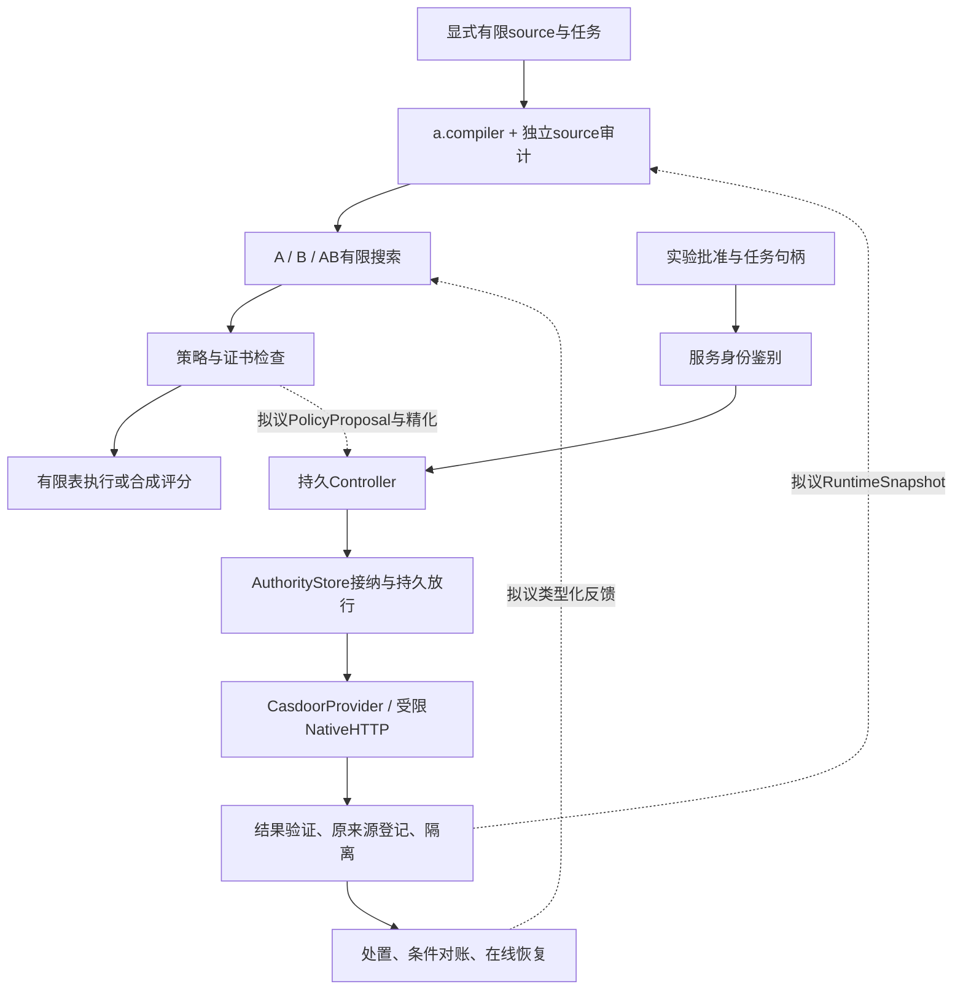

# 实际架构与连接审查

版本G1-r01；只读。结论：有限研究链与持久原生链分别存在；当前入口之间缺少版本化知识快照、可执行策略提案及微步骤保持证明。产品层处于后续建设阶段。[S01、S03、CODE]

## 1. 两条实际链

实线含源码支持；各条执行证据按下表限定。虚线为待建立接口。图中的批准入口来自历史验收配置及管理角色，用户批准UI仍需产品交付。

| 环节 | 源码符号与定位 | 实际作用 | 已有证据/边界 |
|---|---|---|---|
| 有限编译 | `a/compiler.py:compile_model`，1—66 | 显式world/probe/cleanup展开为有限模型 | `a/audit.py:check_compilation`独立解释有限source，未证明真实provider |
| L0决策 | `schema.py`、`semantics.py`、`candidate.py`、`controller.py:BoundedController` | 非空K、允许动作、预算与决策步h | 同观察后继取并集；模型边界停止 |
| A | `a/candidate.py`、`a/evidence.py`、`a/runtime.py` | 任务相关补证与条件证据 | MODEL_CONDITIONAL只覆盖登记假设；运行评分真值独立 |
| B | `b/model.py:prepare`、`b/search.py:solve`、`b/engine.py` | 配置凭据、支持路径与环境 | native footprints必须分区；重叠相关单元超出当前语法 |
| AB/v1.2 | `research_v12`及原A/B桥 | 有限scope反馈、证书重用和检查 | 原反例、修订、强通用预处理覆盖保留 |
| 旧原生投影 | S03连接图；S09校准 | B配置曾进入known-contract单路径脚本 | 576运行中A查询和AB反馈激活0 |
| 鉴别与准入 | `online_state/services.py:293`起Handler；`storage.py:197` | Bearer能力对应服务身份；origin由批准绑定 | caller由服务鉴别产生，正文自报不授权 |
| 持久派发 | `storage.py:227`；`services.py:81` | 先原子放行，后外部调用 | 一rid一次本地send=true；原生幂等/效果上界另证 |
| 原生使用 | `native_provider.py:41`；`native_http.py:117` | issue/refresh/userinfo固定调用 | 显式启用；固定账户、字段和路由；无研究选择器 |
| 登记处置 | `storage.py:261,310`；provider dispose | 验证绑定，失效批准结果隔离，逐材料处置 | 处置检查AT UserInfo和AT内省；实际刷新另计 |
| 对账恢复 | `services.py:162`；`storage.py:346`；`reconciliation.py` | 点读/专用组织枚举、条件收据、重读当前权威 | 单未知创建及冻结source前提；当前多尝试流未接入 |

本轮静态import检查与Controller正文共同支持“这些现有入口未调用研究求解器选择动作”。此证据覆盖锁定的选定源码与入口，动态部署扩展另需审查。[evidence/STATIC_IMPORT_INSPECTION.json]

## 2. 实际持久状态和线性化点

`AuthorityStore.call`在本地事务中读取、解密完整应用状态，执行一次变更，写回完整密文和事件投影。mutations使用`BEGIN IMMEDIATE`；单活OS锁、受信任宿主、WAL/FULL和受保护密钥属于当前profile前提。当前schema为2；迁移兼容早期0/1。每次提交的逻辑读写与加密费用随完整状态大小增长。[storage.py:47—159]

| 阶段 | 事实与后继 | 撤回/故障含义 |
|---|---|---|
| grant | 绑定caller/task/account/audience/generation、operations、budget、material | approval_op重放返回原句柄，旧批准保持旧状态 |
| QUEUED | admit验证绑定；reserved增加 | 相同rid正文重放为DUPLICATE；异正文CONFLICT |
| DISPATCHED_UNKNOWN | release重核批准和source；生成attempt_id/release_version；reserved减、spent增 | 放行后发送前故障与已生效丢响应均保留责任 |
| RESULT_AVAILABLE | 绑定rid/digest/origin/attempt/version，且当前批准有效 | 原响应只归原批准；后续使用仍需当前准入 |
| QUARANTINED | 撤回或迟到结果的材料进入可信托管隔离 | 隔离停止受控任务使用；指定原生失效另证 |
| DISPOSAL_UNKNOWN等 | 先持久处置尝试，再执行原生请求、登记观察 | 不确定响应保留责任；同处置ID重放不会再次send |
| DISPOSED/条件CLOSED | 满足源码检查与profile源前提 | 仅声明材料/attempt范围；其他业务效果单列 |

每批准满足`reserved + spent ≤ limit`。UNKNOWN的spent继续保留。当前本地幂等防止同rid重发，传输、代理、SDK和AS端重复效果需要自己的容量合同。

## 3. 秘密、权威与可见信息

| 主体/边界 | 持有或接收 | 可支持的结论 | 仍需单列的责任 |
|---|---|---|---|
| 可信托管/适配器 | 初始登录材料、client秘密、AT/RT/ID token束 | 登记profile内代用及来源检查 | 任意网站会话、秘密副本、跨端保管 |
| AuthorityStore | 加密应用状态、批准、请求、材料引用/密文及义务 | 当前事务准入、在线恢复依据 | 完整产品保险库、主密码、密钥恢复 |
| 受限代理 | 自身服务能力、任务句柄及获准结果投影 | 通过受控RPC提出请求 | 恶意宿主、管理员、绕行入口在TCB之外 |
| 运行者 | 获准查询及自身账本；可选inbox/标识日志 | 只按运行可见证据决策 | 评分私钥、AS真值、封存响应保持隔离 |
| 评分者 | 事后测量与封存真值 | 轨迹符合性评价 | 其信息不回流算法输入 |
| cache/view.json | 展示投影 | 辅助恢复显示 | 当前准入仍以在线权威为准 |

loopback RPC使用TLS与能力鉴别；`native_http.py:195`访问固定`http://127.0.0.1:18081`。两条链路的信任与传输条件分别登记。M6隔离只证明其登记Windows单机/单活/可信权限边界中的有限符合性。

## 4. 历史证据分母

| 批次 | 原始/后继结果 | 采用范围 |
|---|---|---|
| M1 | 21槽，20PASS，1初始化ABORTED | 持久协议与故障处理；不抹去中止 |
| M2 | 4条；原3PASS/1评分报警；保留原件后离线修订4PASS | M2-03仍有A1运行UNKNOWN；中断期接纳补核独立、原生0新增 |
| M3 | 2条条件CLOSED | 预启标识日志、精确点读、单效果容量 |
| M4 | 2条条件CLOSED | 专用组织整体读授权、单页容量/来源条件；共享组织问题保留 |
| M5 | 12/12合成隔离 | 原生0 |
| M6 | 2条各43检查；一条KNOWN_DISPOSAL，一条CLOSED | 原生84=环境19+方法23+测量20+清理22；源到二进制构建未证明 |
| 旧校准 | 288对/576运行；六方法各96，均20完成/56拒绝/20UNKNOWN | 成本比1.00；A/AB激活0；H-A/H-B/H-AB仍NOT_TESTED |
| 历史回归 | 96、M6的148版本、closure的157版本分别保存 | 本轮只读26源码匹配，新增回归0 |

M2原生114=环境20+方法29+测量33+清理32。旧校准方法请求744、总原生5652；156未结条件、240触发、144未到达故障点使用各自定义和分母。合成测试、原生轨迹、离线语义读取和初始化槽位分别记账。[S05—S09]

## 5. 架构层待补边

G1需补：真实微步骤到有限状态的源合同；权威版本快照到非空K的保守构造；建议到Controller的二次准入；类型化观察和终态映射；预算/成本映射。当前有限检查器支持有限表间关系，bindings仅检查callable，返回`external_adapter_proof=NOT_PROVED`。[abstraction.py:1—69]

完整产品另需：用户界面和真实批准、保险库条目、生成导入、解锁/复制、编辑版本、填充与站点会话、共享续期、备份密钥恢复、归档删除等。各项拟议合同见02；这些工程缺项与研究贡献分别验收。
