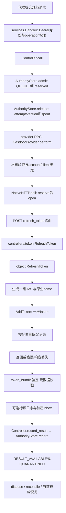

# Refresh真实调用图与字段

源码根：`D:/毕业设计/auth-lifecycle/src/auth_lifecycle/`，Go根见00。定位均绑定evidence中的源码哈希。以下图为已读实际调用关系；合同构造与A/B/AB接线另见07。

## 1. 函数链与持久边界

| 位置 | 实际动作 | 持久化/安全含义 |
|---|---|---|
| `online_state/protocol.py:normalized_request` | 请求仅含rid/handle/task/account/audience/generation/operation/payload；refresh payload为source_rid | caller由已鉴别身份提供，正文不能另选来源caller |
| `services.py:293—339` | 能力token映射身份、按配置授权operation、strict_json | 此处证明范围依配置与可信调用者；任务批准UI另交付 |
| `services.py:133—151` | admit→release→provider perform→record | 同步RPC响应可能丢失；每个“未知”保留原责任 |
| `storage.py:197—225` | 同rid同体DUPLICATE，异体CONFLICT；检查grant和预算 | QUEUED、reserved+1在一事务提交 |
| `storage.py:227—259` | 重核active/窗口/同origin source_rid可用；生成attempt/version | DISPATCHED_UNKNOWN、reserved−1/spent+1与send=true原子提交 |
| `native_provider.py:77—107` | 验证AT/RT、account/client；一次refresh HTTP调用 | 非200/传输或解析错误为UNKNOWN，签名失败由服务边界处理 |
| `native_http.py:101—113,189—232` | 先INSERT账本，再构造Request/open；记录结果及审计 | reserve与AS效果之间没有原子事务 |
| `routers/router.go:384` | POST refresh路由 | handler dispatch次数属于传输/框架合同 |
| `controllers/token.go:444—485` | 验证OAuth，一次调用object.RefreshToken，再响应 | 原生请求不带rid/task/caller/attempt；无对应端点幂等键 |
| `object/token_oauth_util.go:562—705` | 父RT记录/有效性、应用/资源/scope/用户检查，生成新束 | 创建前拒绝路径；检查之后仍可发生并发撤回 |
| 同文件719—758 | 一次AddToken；DPoP update可失败；轮换时DeleteToken父记录 | 新建和父删除为分开的数据库动作；删除bool被忽略，只判断err |
| `object/token_jwt.go:634—788` | 一次name；AT/RT相同记录jti；ID token独立jti；签名后返回 | ID token字符串和jti不另计一项Token表插入 |
| `native_provider.py:113—149` | token_bundle→可选标识journal/inbox→返回 | 记录只覆盖实际已收并验证结果，不能追补没收到的历史响应 |
| `storage.py:261—308` | 原绑定record；当前active决定可用/隔离；revoke取消QUEUED | 迟到结果永归原批准；无来源迁移 |
| `services.py:162—217`、`storage.py:346—415` | 窗口、查询、处置、乙检查、保存收据 | 当前只支持唯一未知refresh等特定条件 |

## 2. 字段字典

| 字段 | 生成/可信来源 | 持久时点 | 安全作用与限制 |
|---|---|---|---|
| rid | 请求方标识，经格式检查 | admit | 本地请求幂等键；AS看不到 |
| caller | 服务能力鉴别，再与grant相等 | grant/origin/admit | 绑定执行身份；可信配置决定含义 |
| handle | grant生成随机句柄 | grant提交 | 当前批准引用；仍需caller及全部绑定匹配 |
| task/account/audience/generation | 批准入口，后续请求须相等 | grant与request.origin | 本地任务/账户/客户端/代次；不凭AS签名自动生成任务来源 |
| source_rid | 请求指定，权威重新查找 | request正文 | refresh/userinfo只读同origin且RESULT_AVAILABLE的材料 |
| digest | canonical(caller,request)摘要 | admit | 同rid异体冲突；不负责源实现真实性 |
| attempt_id | 首次成功release随机生成 | release提交 | 本地外部责任身份；provider和record携带 |
| origin | 从grant复制grant_id及身份元组 | admit | 不接受请求方替换；迟到/恢复保持 |
| release_version | 权威下一事务版本 | release提交 | 本地顺序与结果绑定；不等于AS提交时间 |
| actual_sends | NativeHTTP.requests表匹配COUNT | 每次open之前reserve | 预记账外发机会；物理发送/处理/创建需另证 |
| reserved | 权威维护 | admit+1；release或取消−1 | 当前QUEUED预留；不同于已发送数 |
| spent | 权威维护 | release+1 | 已放行调用占用；无论最终发送/创建是否发生，继续保留 |
| material/derived | 可信适配器验签、账户/client/issuer/time校验 | inbox及record | 证明材料验证范围；JTI到原生单位/来源仍需绑定 |

`release_version`绑定的是放行，record返回的version是后续提交，两者分别使用。当前recover公开投影省略request正文、source_rid和operation等，研究快照还需受权原请求/专门投影才能恢复这些字段；不能仅按同名元数据假定接口已具备。[storage.py:25—42]

## 3. 七种事件的蕴含边界

令L为持久放行，H为预记账机会，S为客户端完整请求调用，A为到达端点，P为handler处理，C为新记录提交，O为可信观察/登记，V为当前仍可用。P_direct下有计数上界`C≤P≤A≤S≤H≤L≤1`，具体计数定义及每一步前提见04。TCP数据段重传不另算完整应用请求。

L不能单独推出H/S/C；H不能单独推出S；S不能推出A；A可被路由/校验拒绝；P可创建前失败；C不保证客户端观察；O不保证当前有效（可能撤回、到期或隔离）；V不要求客户端已登记（丢响应子代可仍有效）。可靠绑定的原生新记录/响应可以提供创建下界，前提与材料定义分别核验。相应反例见08。

provider的perform没有按attempt做独立原生去重检查；self.results用于inbox/lookup。故调用链的“一次perform”依赖可信Controller和无RPC重发/绕行，不能从provider字段本身推得。
