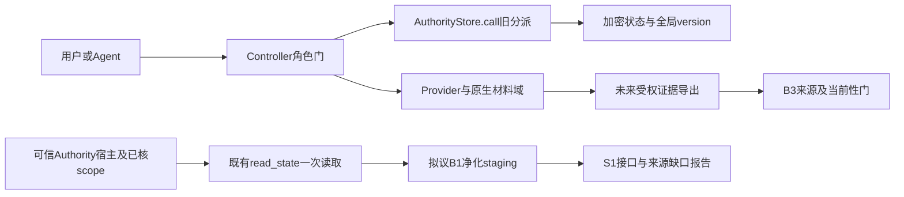

# 真实侧接口与权限审计

完整逐接口字段见`S3B_READONLY_INTERFACE_MATRIX.json`。以下事实来自源码；当前运行实例和真实材料未读取。

## 调用关系与可信读取位置

`read_state`一次SELECT取得version/ciphertext，再用外部key解密，能给出同一行的(a,W)。它包含完整私密材料，没有独立调用者鉴权；适用位置为已经可信、已初始化的Authority进程内部。`execute`会记日志、fsync并消耗operation预算，读取的数据库世界副作用与遥测副作用分别管理。[C01:93–120]

构造AuthorityStore会创建目录、连接rw数据库、配置PRAGMA、自动迁移/初始化并写marker/config。B1的读取适配器须接受已存在的可信reader，避开构造器、旧call分派和reconciliation_context。[C01:47–91,122–159]

## 当前可取字段

内部state已存grant的scope、operations、limit/reserved/spent/active，request的原始规范请求、digest、origin、phase、attempt/release_version和result字段，以及disposals和reconciliation_windows。`operation`与`source_rid`在保存的request正文中，公开request_projection省略了二者。`result_ref`和完整typed O/o/instance并无现成生产接口。[C01:190–259,261–415]

对原请求的校验应在可信读取域内按现有算法重算。随后只导出请求元数据和有出处的校验记录。完整正文包含grant handle；它在原调用合同中受caller/task等绑定，属于敏感调用能力。B1净化输出统一省略handle，普通任务授权也不能取得其他grant的handle。[C03:54–71;C08:140–170]

## 权限边界

现有服务以配置Bearer和operation whitelist识别角色；Authority分支没有把认证identity传给`AuthorityStore.call`。lab默认Authority端仅配置controller角色，属于受控原型服务能力，尚无完整的多用户/组织级S3权限模型。[C02:297–320;C16:78–101]

必须分离：自己的任务状态、指定Authority scope、命名Native材料状态、组织集合、数学归档、O转换、真实Native资格与凭据撤销。当前target grant已撤回，与当前管理者仍可读取历史或归档是不同权限判断。

Controller.status只过滤approvals、requests和obligations，disposals保留原投影列表；该列表含origin等私密元数据。这是静态可见的跨scope风险。新导出须对disposals、windows、receipt摘要和聚合信息一起做scope检查；无法获准读取的竞争来源用缺口表达，避免借全局计数补出他人信息。[C01:41–43;C02:94–102]

## Provider证据

Inbox可按五元查到已收到的操作结果，但返回包含真实Token的完整材料。当前内存results按attempt_id覆盖；重复perform并无原生幂等保证。完整证据适配需考虑同attempt的全部保留记录和native_sequence。[C04:35–52,114–149]

Identifier Journal位于响应接收、验签/材料构造之后，Inbox又更晚。任何较早的创建、响应丢失或日志中断都可能没有对应条目。不存在Journal/Inbox项只支持UNKNOWN，无法给出AS未创建的结论。[C04:104–141]

Journal不直接记录operation/source_rid，需要通过完整tuple连接Authority原请求。JWT验证函数会校验签名及iss/sub/aud/exp/nbf；`validate_material`单独主要核结构/字段等式，持久derived字段的名字也不足以提供新的验签出处。[C06:13–80]

`reconcile_query`涉及client secret、NativeHTTP及命名点读；`reconcile_enumeration`涉及独立组织范围权限和集合完整性前提。二者都会消耗原生预算并写本地证据，保持在B1开发/离线测试之外。私有HTTP审计是包含form/Token/响应的材料域，评分器解密接口不能作为普通AI证据源。[C04:151–224;C05:161–251]

## 最小接口选择

先开发内部`read_dsat_authority_snapshot(reader, scope, trusted_read_context)`。它导出本地事实与显式缺口即可独立成立，Provider证据适配不是其前置条件。当前没有足够证据让它直接构造完整S1真实bundle。公开RPC、组织读取、真实解密调用及Provider适配须分别评审。
