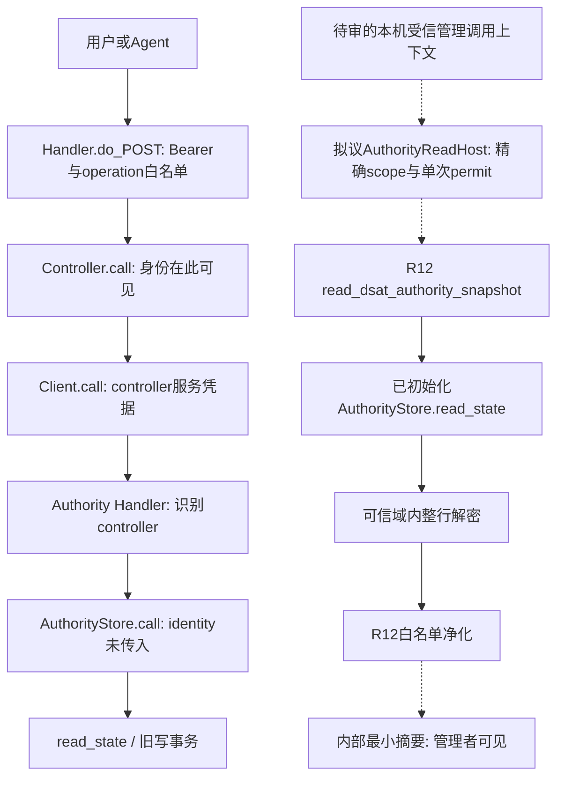

# 可信宿主、身份与调用图

本稿结论来自锁定源码。真实运行进程、配置、数据库、密钥和调用身份本轮均未检查。

## 1. 宿主选择

Controller 的 `self.authority` 是 `Client(authority_url, authority_token, certificate, log)`。[S02:43–56] 它具有配置赋予的服务级调用能力；默认 lab 为 controller 配置 grant/admit/release/record/revoke/recover。[S04:78–101] 这些能力缺少任务级 B1 读取授权和本地 Store 引用。Controller 构造还取得单活锁并自动 recover，产生缓存和日志写入。[S02:22–39,70–79]

`serve("authority", root)` 在本进程创建并持有 `implementation=AuthorityStore(...)`。[S02:277–283] 因此 **Authority 进程内部** 是最小秘密处理域。首次真实 B1 调用应复用其已初始化引用，保持 key、完整 state 和请求 handle 在此域内。

现有进程内部缺少可直接调用新宿主的管理回调。`implementation` 是 serve 的局部变量，外部 CLI 无法直接取得引用。向运行中 Python 进程注入代码、调试器附加和借旧 recover 传递完整 state 均不在本方案内。H1 先验证内部组件；H2 另审进程内调用挂载点及部署激活。

## 2. 现有链与拟议链

实线为现有源码关系；虚线为本轮规格，尚未接线。拟议链保持 HTTP/RPC 路由数量不变，Agent 暂无 B1 新入口。

## 3. TRUSTED_HOST_CALL_GRAPH 逐节点

| 节点与定位 | 身份/权限 | 秘密与内存 | 磁盘/网络 | Agent 与失败处理 |
|---|---|---|---|---|
| `Handler.do_POST` [S02:297–324] | 配置 Bearer 比较、operation 白名单；来自传输上下文 | 读授权头及 JSON | 后续 transport 日志 fsync；本节点接受本机 TLS | Agent 可到 Controller 获准旧操作；固定拒绝/UNKNOWN |
| `Controller.call` [S02:81–151] | 受 Handler 身份；call 分支将 identity 作为 caller | 规范请求含 handle；Authority/Provider client 持服务 token | RPC；部分路径日志/缓存/业务写 | status 仅部分集合过滤；当前新 B1 禁用此出口 |
| `Client.call` [S03:122–144] | 固定服务 Bearer；受信 loopback TLS | 请求正文及响应暂存 | 网络与可选 rpc 日志 | 传输异常固定码；最多读 1MiB 响应 |
| Authority Handler [S02:301–320] | 识别服务角色并核 operation；旧 call 没有 identity 参数 | 权限配置只在服务内 | transport 日志 | 缺少 B1 scope/主体传递 |
| `AuthorityStore.call("recover")` [S01:127–133] | 假定上游可信，无独立 scope 守卫 | 锁内整行读取，再旧 state_projection | 1 次 SQL 遥测/key；无世界 DML | 导出范围宽，缺原请求校验所需信息 |
| 其他旧 call [S01:134–159] | 旧操作语义 | handler 可改 state | BEGIN/UPDATE/event INSERT/COMMIT | 正常拒绝或重复也可能 a+1；与 B1 分派隔离 |
| 拟议 `AuthorityReadHost.read_summary` | 本机已验证管理主体＋精确单 tuple 读取 permit | 宿主持有 reader/policy；请求无权自报资格 | 本方法仅允许受计费的读取遥测和净化证据文件 | 新模块尚未实现；鉴权失败在源读取前固定拒绝 |
| `TrustedReadContext.from_host` [S05:134–165] | 已授权宿主是前提；工厂本身仅封装绑定 | 保存 reader、scope、非秘密引用 | 无 I/O；禁止序列化 | 信任同进程代码；普通 JSON 无法获得上下文类型 |
| `read_dsat_authority_snapshot` [S05:417–468] | context 与 reader 同一对象、scope 子集、读取配额 | 在 reader.lock 内读取、净化、摘要和大小检查 | 由 reader.read_state 决定遥测/key副作用；无网络 | 固定错误 envelope；world 写入口未出现 |
| `read_state → cipher` [S01:103–120] | 本进程持有数据库/密钥访问资格 | 每次从外部 key_path 读 32 字节，AES-GCM/JSON 解码整份 state | SELECT；日志 fsync；key 文件读 | 完整解密结果仅供可信模块；新宿主禁止 repr/raw异常出口 |
| `_project → _finish → StagingSnapshot` [S05:222–414,168–209] | 所有 collection 受 scope 过滤 | 规范原请求、重算摘要、比对 handle/grant/origin；新建输出 | 纯 CPU/内存 | handle/body/material 留在源域；Schema闭合与保守缺口 |
| 拟议摘要出口 | 受权管理者只获预定白名单 | B1全净化对象仍限内部；摘要深拷贝 | 单份受限审计记录；无新 RPC/外部缓存 | Agent可见字段本轮固定为空；输出权限不足时丢弃结果 |

## 4. H1 身份与最小权限规格

H1 新内部模块接受宿主预先注册的 reader 和策略提供者；调用方只提交指定执行引用及精确 scope。内部守卫完成以下有序操作：

1. 核验 `VerifiedLocalCaller` 由受信宿主发行，绑定 principal、管理调用通道、process epoch 和认证事实引用。普通 dict、actor 字符串或正文布尔标志只作为待校验数据。
2. 核验独立的 `staging_read_metadata` 权利；指定 account、audience、task、caller、generation **五项精确相等**。业务 grant 的 active/operations 只决定业务能力。历史查看是否允许由独立读取策略明确授予。
3. 首期 tasks/callers/generations 均为 singleton。R12 的 ReadScope 列表采用笛卡尔积匹配；将两个获准 tuple 展平成三个集合会扩大范围。禁止这种转换。多 tuple 支持另审逐 tuple 合并及所有费用。[S05:94–131]
4. 权限记录还绑定 reader 对象、host epoch、目的、输出字段集、有效期、最多一次使用和授权记录版本。调用正文中的 reader 路径、key 路径、grant/rid 选择器及字段扩展全部拒绝；本期授权对象是一个完整精确 tuple，R12 无单独 grant/rid 过滤参数。
5. 在同一宿主策略锁内核当前权限和单次使用状态，再按固定顺序取得 reader.RLock。检查连接空闲、运行登记与预算；调用原 R12 适配器一次。锁顺序为 policy → reader；旧路径或新回调若存在反向取得顺序，停止接线。
6. permit 的单次消耗属于宿主临时控制状态，失败后仍保持已使用；它与 Authority 世界状态分别计费。权限撤回在策略锁上排序。若撤回先完成，读取前拒绝；若读取先完成授权点，其输出属于当时许可的历史读取。网络交付后的撤回和已取得数据回收另有合同。
7. 返回前仅构造最小摘要；保持完整 B1 对象在 Authority 可信域。异常、取消和序列化故障输出固定码，丢弃全部正文；自动重试 0。

`VerifiedLocalCaller` 和策略发行链属于待实施接口，H1 仅用离线身份提供者替身。现有 lab 的 Bearer 配置证明原型中的服务认证规则，其生产部署真实性和 per-task 权利仍待 H2 取证。H1 通过只能证明组件按输入的受信事实执行守卫。

## 5. 用户与 Agent 边界

目前 user 的 status/recover 具有原型管理范围；Agent 的 status 依 caller 过滤 approvals/requests，disposals 保留原投影。[S02:94–102;S01:41–43] 因此旧 status 不作为本次新读取授权或出口。

H1/H2 首期限定管理宿主内部；Agent 仅继续使用既有获准任务操作。Agent 提交其他 task、account、generation、rid、grant 或伪造身份时，新宿主在读取前拒绝。后续对 Agent 开放需要独立身份转交、全部嵌套字段授权、撤回后缓存控制及调用费用审定。

R12 按字段与来源 tuple 过滤。全局 a、读取时长和资源拒绝仍可能携带跨任务活动侧信道；当前范围没有强跨租户非干扰保证。首期管理摘要权限明确包含本地 revision 与所需成本观察，避免将其自动公开给 Agent。

## 6. 当前性和重放

read_state 给出同一行 SELECT 所见的 `(a,W)`；B1 的摘要还绑定 scope、来源 locator、host 引用和读取时钟。SQL a 位于 AES-GCM AAD 之外；主机、数据库完整性和回滚排除属于信任前提。[S01:21,114–120]

`authority_instance`、o、SQL schema version 在 R12 输出中保持 null。locator、PID、boot 和路径 hash 分别只是定位/运行观察材料。旧结果可作为某次读的档案；取得新输出仍需当时权限。内容 hash、来源标签和单次 permit 均不足以赋予 Native 当前性或防数据库整体回滚的密码学保证。
