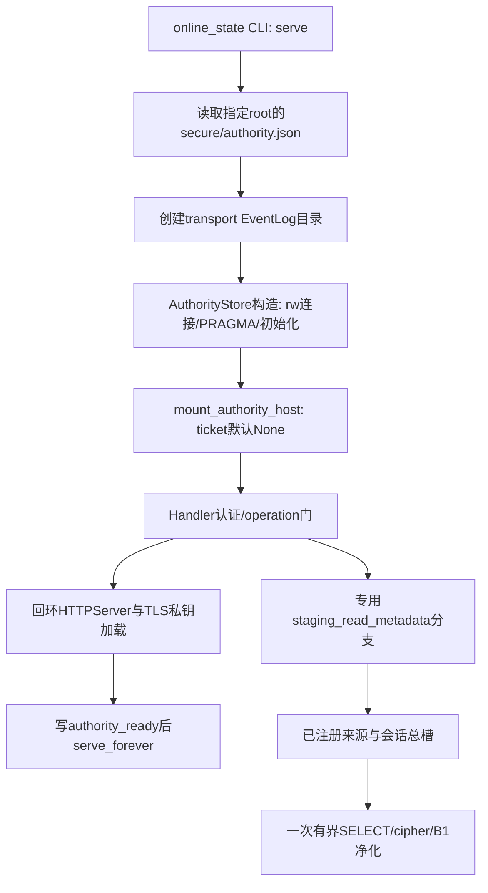

# D1生命周期、挂载与独立副作用

## 实际调用图

入口只是源码支持。当前CLI调用serve不传authority_mount_ticket；裸命令启动只能得到默认未挂载实例，不能声称完成H2激活。[C07:37–39；C01:277–297]

## 真实启动副作用

| 阶段 | 可能行为 | 授权边界 |
|---|---|---|
| import | services/storage/materials导入cryptography；定义本身不应创建Store | 实际环境/依赖需确认，本轮未导入 |
| 读配置 | 读取指定角色配置，可含Bearer/TLS私钥引用 | D1只准全新测试root生成文件，不借旧配置 |
| EventLog | mkdir，首次emit时append/flush/fsync | transport/database_ops路径与费用单列 |
| Store连接 | mkdir，rw SQLite，WAL、同步、busy_timeout和autocheckpoint配置 | 启动具有逻辑/物理副作用 |
| Schema/状态 | 低版本自动执行SQL文件；缺行可能genesis INSERT | 已有库/生产迁移禁止；新库初始化需明确同意 |
| key | genesis encrypt调用cipher，重新读32字节state key | D1新key使用与P2 key使用分别审批 |
| marker/config | initialized.touch、storage_configuration.json.tmp/replace | 即使已有Schema2也会写 |
| 网络 | 绑定回环端口，TLS load_cert_chain读TLS私钥/证书 | 仅一个指定Authority监听器；不启动Controller/Provider |
| 运行 | ThreadingHTTPServer可为请求建线程，ready写PID/port | D1须限制管理入口关闭，P1不触发RPC |
| 停止 | 原serve缺显式外部shutdown/connection-close包装 | 需要拥有进程的安全停止/异常清理，不做全局kill |

静态数目：现有构造器在全新Schema0且成功genesis路径约有**12次显式execute尝试**：6次配置/结构PRAGMA、3条schema1初始化语句、1条schema2语句、1次version存在性SELECT、1次genesis INSERT。genesis对新state key逻辑读取1次，TLS私钥逻辑加载另1次。失败会留下已发生操作，不重置费用。Schema2且已有状态行的路径约7次execute、仍写marker/config；启动不属于纯读取。[C02:47–120；C10/C11]

新库初始化和已有库迁移分开：仅在研究者批准的排他新root中，才可申请创建新Schema2。当前旧ctor确实调用名为migration.sql/migration_2.sql的文件完成0→2初始化；该事实不能藏在“无生产迁移”描述中。若研究者要求这些文件也完全不执行，应先实现直接创建新Schema2的专用准备器，再另批运行。已有库、已有数据或未知marker一律停止。

## 合成目标准备责任

genesis为空grants/requests，因而没有可供未来P2核验的目标rid。R16 JSON seed与codec spy也不是文件型AES-GCM库。需要独立列明准备方法：

- 优先由受审新root准备器从已批准合成输入构造一次初始明文、用新key加密后写入新库，并记录seed出处。只准备测试数据，不能冒充实际AS出生历史。
- 如选择旧grant/admit/release/record RPC来准备，则这些普通调用会read_state解密、变更a/event/预算，必须另批请求数、解密数和写入；D1默认范围不暗含这些操作。

准备器尚未存在，具体seed SQL/key/输出预算未冻结，D1总操作预算因此为UNRESOLVED。已知ctor的12次不能作为包含seed、ACL、TLS和日志的总费用。D1不自动授权整行解密已有世界，P2的MAX_SESSION_READS=1从其批准阶段开始单独管理。

有限operation_limit还需为初始化、已批seed和未来一次读＋至少6次旧writer余量共同计费。不能将总额度设为12后宣称P2仍可读；实际数值必须在seed/启动程序和批准预算明确后冻结。

## 挂载衔接条件

R16提供可传opaque ticket的进程内hook和专用分支；当前真实部署仍缺：

1. 研究者批准文件/进程身份到真实运行Admission的可信构造器；现有API名为authorize_offline，epoch从参数传入。
2. D1阶段的非读取、dormant来源登记：既绑定Store/connection/lock，又不发行P2读权。现有mount要求scope/grant/rid和enabled ticket；ticket撤回后直接拒绝挂载，不能把它冒充完整dormant部署模式。
3. 有界、非秘密runtime metadata导出：现有ready只有role/pid/port/boot，Authority无boot属性，不能提供可信epoch、挂载状态、DB/key引用和加载清单。
4. 拥有进程的启动/停止及清理、实际服务依赖与版本绑定。

D1应保持P2_read_enabled=false；Agent/旧controller无读取权，不能为了检验挂载而临时放开真实B1或附赠P2许可。实际来源登记与单次授权分阶段，首次会话只有在后续P2批准后才建立。

## 会话门的部署责任

当前K为(connection对象,authorization_id,epoch字符串,canonical scope)，进程级锁注册一次，所有permit共享claimed，reader_started限制一次。新issuer或显示别名不改变同K；重连/异常/超时不会自动rearm。A1证明与反例修复范围沿用。

真实部署需额外保证：唯一Authority/Store拥有指定DB；别的connection或进程不能被同一批准当作新source重新挂载；epoch由受信启动器按实际启动生成并绑定OS进程创建时点、部署清单；重启后旧P2文件无效。进程退出会清空内存注册表，不能把它解释为持久防重放。当前Authority无类似Controller.SingleActive的拥有锁，需在专用部署桥中补齐。

## 最小缺失代码与部署方式

只列未来受审差异，本轮文件全部保持原字节：

- 新runtime桥模块：启动Admission、每启动epoch、dormant来源描述、非秘密元数据、安全单活/清理、合成新库准备边界。
- 新专用Authority启动脚本：严格manifest、只用新root/一个服务、完整副作用记录、默认P2关闭；可选源码hook把Store构造后的唯一引用交runtime桥。
- 新P1a检查脚本；仅必要时再实现P1b元数据脚本。不得把现有实验或评分器直接当作这些入口。

候选源文件位置列于D1_DEPLOYMENT_PLAN，均尚未存在，需独立代码实施批准。源检出部署优先于未经验证wheel：当前pyproject只列migration.sql，不能假设发行包必含migration_2.sql。

## 停止/回退

未来仅可停止D1创建、PID/创建时点/可执行文件相符的Authority进程，隐藏窗口启动；优先受控关闭并wait，超时强制终止仅限该拥有进程且需批准。不得按进程名停止Python、扫描/终止其它服务或删除旧目录。

新root失败后保留受保护密钥/DB/日志与净化失败记录，标UNREADY/QUARANTINED；禁止自动复用半初始化库、迁移、补key、拷贝旧库、切换端口或自动重启。删除/销毁新测试密钥和数据另行授权，不以回退覆盖历史证据。
