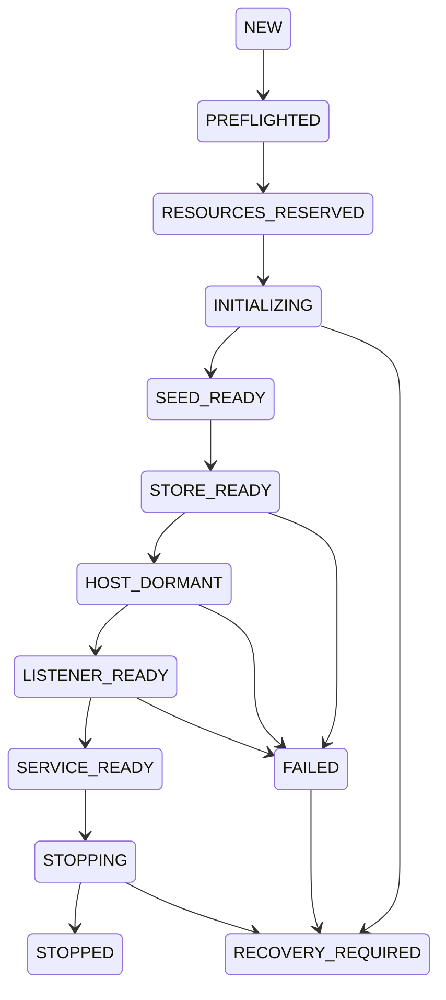

# 生命周期、故障与清理协议

本稿为规格及纸面分析。28 个故障点、全部未来用例当前均为 NOT_RUN。完整字段见 `D1B_LIFECYCLE_STATE_MACHINE.json` 与 `D1B_FAILURE_AND_CLEANUP_MATRIX.json`。

## 状态机

图展示主要边；JSON 补齐各状态的失败出口。SEED_READY 单列数据库与外层 receipt 已完成、服务尚未启动的状态。任何边均保持 P2 关闭。

每个动作受 source/config/OS/实例能力和预算约束。状态文件只作受信执行下的记录，单独一张 SERVICE_READY 文件无法证明进程仍存活；成功判断还需当前拥有的 child handle、创建时点、epoch、监听和有界 TLS 接纳事实。

## 四个协议不变量

**I1：先登记、后暴露。** 资源获取成功后，在下一项可失败操作前登记拥有者。Store 的 connection 特别在 ctor 返回前登记。server 对象使用延迟 bind，先登记 socket 再 bind/listen/TLS；原子获取函数内部自行覆盖“已打开而尚未返回”的异常。

**I2：先关闭权限、再关闭资源。** 任意退出路径先令 LiveContext 退役、接纳关闭、P2=false，然后关闭 accepted socket/listener、Store connection、日志/控制句柄，实例锁最后释放。关闭后 context 保留 CLOSED 状态，无重新绑定或发许可路径。

**I3：持久提交与运行资格分层。** DB COMMIT 只证明 SQLite 事务提交。seed receipt、Store marker、runtime Ready、stop receipt 分别对应不同阶段。记录不完整时进入 RECOVERY_REQUIRED，禁止自动补 marker、生成新 key 或覆盖旧库。

**I4：不确定操作按已消耗处理。** 启动许可在创建子进程前持久 claim；创建/ACK 结果不确定时额度保持消耗。未来 P2 的 claim 继续先于读源，失败、日志丢失和超时均保持消耗。恢复只恢复记录，权限保持空。

在有限异常模型下，各不变量由每次受控获取/阶段转移保持。OS 崩溃后内存 finally 可能无法运行，此时依赖句柄释放与持久 pending 检测；持久完整性受可信文件系统和同 SID 前提限制。当前这是待通过 B1 故障注入核对的实现义务。

## 已定位的纸面故障反例

| 编号 | 完整关键轨迹 | 影响与最小修正责任 |
|---|---|---|
| PCE1 | AuthorityStore connect 成功 → PRAGMA 的 metrics.emit 抛错 → ctor 未返回 → services 未得到 implementation | 调用方资源栈无法自动发现该连接。strict ctor 必须即时登记连接，内部异常关闭；保持原业务方法 |
| PCE2 | Store 成功 → bind_store 成功 → listener bind 成功 → load_cert_chain 抛错 → 尚未进入 serve_forever 的 try | 当前 finally 覆盖不到此路径，Store/socket 可遗留。获取阶段统一置于 owned lifecycle 包络 |
| PCE3 | listener/TLS 成功 → write_json Ready 的 fsync 或 replace 抛错 → serve_forever 尚未进入 | 与 PCE2 同类，Ready 写入也属于启动资源协议 |
| PCE4 | 未进入 serve_forever，或在它返回后的同一线程调用 server.shutdown | CPython 文档要求 loop 正在另一线程运行，否则会等待。live 分支采用同步轮询和 server_close，shutdown 调用数 0 |
| PCE5 | 原 services 未为 Authority 取 SingleActive → 两个进程打开同一 DB，分别拥有不同连接和 R16 registry | SQLite 事务可串行化，内存一次槽仍各自独立。新实例需单活 handle＋完整 epoch 批准合同 |
| PCE6 | 以路径/PID 作为 stop 条件 → PID 被复用，或目录路径转向另一对象 | 停止可能误及其他实例。验证 root/file-ID、受控 handle/PID/创建时点/epoch，信息不足时保持 UNKNOWN |

这些轨迹为源码可达条件下的纸面分析。R19 live gate 当前关闭，故本轮没有声称实际触发了资源泄露或服务故障。

## 所有权与清理顺序

| 资源 | 创建/持有者 | 关闭与保留责任 |
|---|---|---|
| self/child/file 元数据句柄 | Windows provider | 获取函数内 finally；只读受控对象 |
| lock handle 及显式继承副本 | supervisor / child 各自一份 | 两方分别关闭，交接期间至少一份持续持有；最后释放单活 |
| 新键、证书、DB、源码与配置 | initializer | 正常/异常停止保留；仅登记 private 状态，自动持久删除 0 |
| 初始化 connection/transaction | initializer OwnedResources | 已开始未提交则 rollback 至多一次，再 close；提交不明时保留 DB/journal |
| ctor connection | strict ctor，随后交 outer owner | connect 后立即登记；ctor 异常内部 close；成功后资源栈幂等接管 |
| 同一个 Store/RLock | child lifecycle | 无并发业务时关闭 connection；只释放当前线程实际取得的锁，禁止跨线程随意 unlock |
| Dormant context/host descriptor | live issuer | 任意失败先退役，无许可、无读 |
| TLS context/accepted socket/listener | child server owner | 逐对象 finally，accepted 处理结束即 close；listener 全阶段 server_close |
| 日志和证据句柄 | 各创建者 | flush/close；错误聚合、固定类别外部 fallback；原始错误与清理错误分别保留 |
| owned child process handle | supervisor | 等待精确进程退出并关闭自身句柄；默认强制终止额 0 |

文件清理在路径白名单之外，还要求本次 create receipt、实际 file-ID、已关闭状态和当前根身份均匹配。路径存在性无法单独授权删除。归属不明时保留资源与人工审查记录。整个目录递归删除、删除 WAL/SHM、自动重新生成 state key 均保持禁止。

## 正常停止及停止重放

1. stop 读取该实例的非秘密操作记录，核对批准根/物理实例与精确运行 tuple。
2. 针对唯一 stop Event 通知。Event 以实例/epoch命名、受指定 SID/SYSTEM DACL 约束，创建时发现同名旧对象即拒绝；它只授予停止能力。
3. child 在有界轮询/handshake/request 超时边界停止接纳，退役 context、关闭 socket/connection、写 stop receipt，释放锁并退出。
4. supervisor 等待拥有的 child handle。确认已退出后报告 STOPPED。stop ACK 丢失可由同一身份的退出证据/receipt核对；无法确认时返回 UNKNOWN。
5. 超过 5s 时报告 RECOVERY_REQUIRED，保留进程身份及锁状态，强制 terminate 额为 0。后续人工受控处理另批。

重复 stop 在已确认同一 epoch 停止时为幂等成功；记录或身份有歧义时保留 UNKNOWN。停止操作不会创建新 epoch、重新开放会话槽或清除历史 claim。

## recover 的刻意收缩

recover 仅分类 NEW/PARTIAL/STOPPED/CURRENTLY_OWNED/UNKNOWN。它可在独立批准的范围内读取同一实例的所有权、初始化和生命周期记录，尝试固定 lock 的独占打开，核对相应文件身份。锁被占用时保持受控占用或未知，禁止盲目终止目标。

恢复 SQL、state key 读取、world 解密、自动启动、marker 修复、持久覆盖与持久删除均为 0。没有 key/DB 内容一致性证明时，结论写为来源引用一致或未验证。纠正半初始化、做密码学一致性读取及重新启动分别需要新的具体批准。

首次 B2 申请仅一个 prepare/initialize/start/stop 回合，recover 作为完整未来接口规格保留，实际运行不自动加入该回合。start 失败后保留已消耗许可，所有自动重试次数为 0。

## 28项故障覆盖

结构化矩阵逐项覆盖：路径/OS/源/依赖、目录创建和中断、连接/事务/commit-marker 间隙、key 与 TLS 写入、日志、Store→Host→Handler→listener→Ready、端口冲突、即时退出、停止异常/ACK 丢失/二次崩溃、旧 marker、双启动、复制、授权重放、issuer 重建与旧 epoch。每项含已提交状态、创建资源、可保留/删除对象、幂等恢复后置条件和 F01–F28 测试 ID，当前全部 NOT_RUN。
