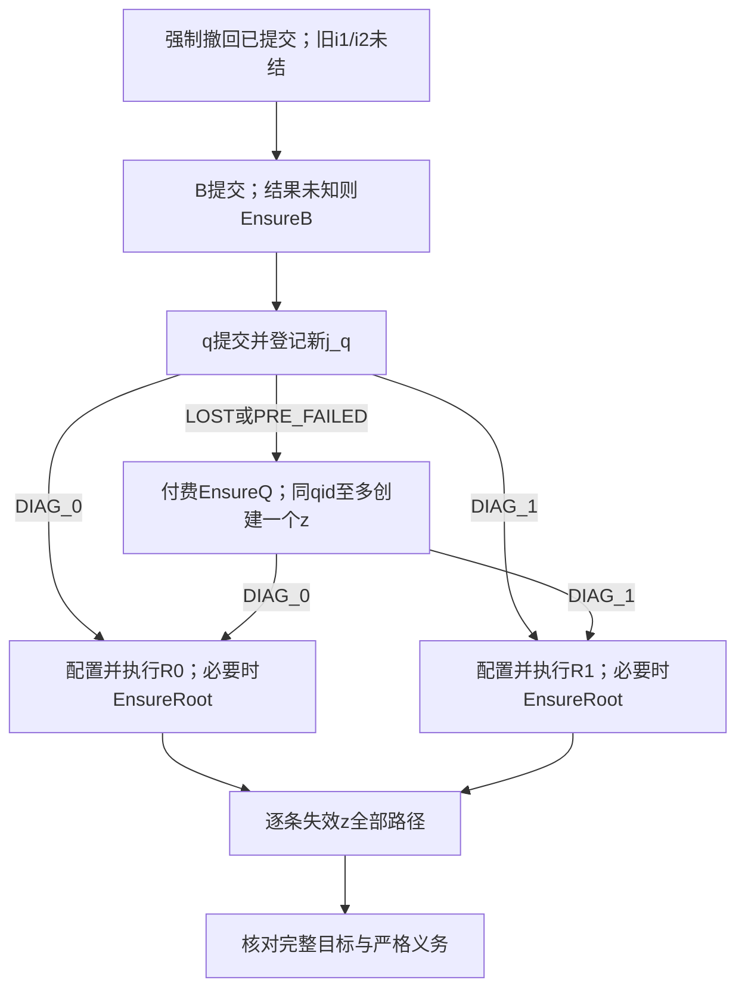

# 完整动态实例与手算最优值

以下为SYNTHETIC_CONTRACT静态实例，未运行求解器/穷举。初态为01全部46个状态因子；两旧机会费用2、取得p/b/管理批准前缀另计。统一H=24、新请求机会预算24、q额外创建风险预算1，所有方法同目标/信息/能力。旧gA已由强制前缀撤回，b在声明窗口内不允许被管理动作损害。

## 1. 公共动作与计费

| 能力 | 全部可见结果/实际效果 | 最坏外部机会费 |
|---|---|---|
| B Submit＋必要Ensure | OK，或LOST/PRE_FAILED后由Ensure返回这一次逻辑结果；Token创建0 | 1或2 |
| q Submit＋必要Ensure | DIAG_θ+z；LOST/PRE_FAILED时z0/1待决，Ensure在正例完成同qid；新增j_q容量1 | 1或2 |
| 正确Rθ Submit＋必要Ensure | A关闭终态回执；UNCERTAIN后Ensure确认/完成同cut | 1或2 |
| 八个A定向原语 | Fence i1/i2；p/c1/c2各AT/RT当前路径Disable；均保护b | 各1，总至多8 |
| Reconcile i1/i2（父读可另列） | 阶段快照/未知，不透露θ；每条只读对应项 | 每读1 |
| z处置 | λ条独立路径逐条Disable，A的RootCut不覆盖z | λ |
| Wait | 可能可信迟到，也可一直NONE；不保证被动消息到达 | native0，h/计算另计 |

八原语没有藏验证请求；它们在本**合成**profile承诺一次终态回执。若所用真实接口需要额外查询/恢复，按实际展开重算。Submit/Ensure必须分别收费，Ensure需已登记提交凭据。任何可见迟到均保原来源，不接收真实世界编号。

## 2. 主例I_INFO：λ=2，补证改变配置

### 2.1 后验与责任

q之前K含θ0/1及所有旧创建阶段。Probe先注册j_q：

| q观察 | 物理后继/后验 | 义务 |
|---|---|---|
| DIAG_0_Z | θ=0，z已创建并绑定；旧i可同时推进 | settle:i1/i2、close:p、close:z（旧i按证据另转） |
| DIAG_1_Z | θ=1，其余同上 | 同上 |
| LOST | θ仍0/1，z0或1；j_q仍可完成 | 原O＋settle:q/执行未知 |
| PRE_FAILED | θ仍0/1，尚未z；同qid可由Ensure执行 | 原O＋未完成j_q |

EnsureQ保证返回DIAG_θ_Z，保持同一j_q容量1；可信结果结其创建/来源部分，但close:z继续。若观察到额外新尝试/来源/不符回执则越界，不删去不利状态。

### 2.2 完整可行策略

先处理强制RevokeA；B操作可在甲仍未结时先完成：B_OK后记录成功，B_LOST/PRE_FAILED则EnsureB恢复结果并结exec:rB。随后做q；已得DIAG就直接用，未得则EnsureQ。DIAG_0选择Configure(R0)，DIAG_1选择Configure(R1)；仅执行与全K相符的Root控制，UNCERTAIN时EnsureRoot。最后逐条处置z两路径，取得各自证据，检查全部目标/严格义务后完成。

这条策略的所有正例契约后继均可完成。旧i1/i2在查询期间实际生成0/1/2个子代都由正确Root的前沿/材料覆盖处理，不用猜其实际值。配置只是选已有控制接口；没有免费取得新credential。B、q、Root结果只在取得相应证据后记成功。

### 2.3 逐分支费用

令b,q,r分别为该三项Submit是否需要Ensure的附加0/1，则

\[
Q_{future}= (1+b)+(1+q)+(1+r)+2=5+b+q+r.
\]

最坏三者都不确定时Q=8，最好全即时回执时5；旧机会2另加，总最坏10（尚不含更早p/b取得等前缀）。λ条z路径一般给最坏6+λ。

不用q时可选择U：两个creator Fence/证明，再按需要逐条失效p/c路径，最后B操作。最坏CC且p保留、无免费迟到时8+2=10，旧机会另加为12。确定一项不存在可省其路径成本，但不改变最坏界。

### 2.4 精确最优性下界

对所有合法观察策略而非固定顺序证明：

1. B原生成功必须有Submit，允许的LOST路径需要至少另一次有界恢复，因此最坏至少2。
2. 若未获取θ，在两个θ世界间所有非诊断安全观察可相同，R0/R1均有伤B世界，不能安全尝试。取初始CC、p保留、无被动迟到，六条A接受路径均活跃，分别至少一次Disable。为排除另一个相容V迟到创建，还需每i至少一份前沿/容量终态证据，Fence或Reconcile都收费1；路径ACK不披露存在/终态。因此A部分至少6+2=8，总至少10。
3. 若获取θ，令首次诊断响应LOST且没有免费迟到，至少2项请求；诊断完成一定有独立z，逐路径处置至少λ。A还需真实控制及其回执，最坏至少2（走U只更多）；B至少2。总至少6+λ。先做部分U或额外查询不能消除这些必须覆盖的费用，只可能已支付其中部分。

对应策略达到两类上界，故

\[
Q^*_{future}=\min\{10,6+\lambda\};\quad \lambda=2\Rightarrow Q^*=8.
\]

这项精确手算仅承担该合成接口/安全目标/机会费用的共同最优值；通用方法的额外必要计算代价需另证。精确G可执行同策略并达到8，候选请求值受相同最优下界约束。

## 3. 五项对照

| 实例 | 变化/完整后继 | 正确决策与值 |
|---|---|---|
| I_NOINFO：无信息价值 | q/Ensure只给GENERIC+z，θ始终0/1；所有副作用保留 | 不做q，Q*=10；q不会解锁正确R且增加创建/清理，完整q-first最坏至少14（λ2） |
| I_INFO：有信息价值 | 主例，DIAG_0/1解锁不同安全R | Q*=8，后续配置确实依赖观察 |
| I_SIDE：副作用抵消 | 同信息能力，z有λ=6条需失效路径，仍一个新材料单位 | q路线12，U路线10，G最优跳过q；λ4时并列10 |
| I_AMBIG：不可消歧 | 只允许R0/R1处理A，移除A定向U/路径关闭权限；q只GENERIC，其他读不露θ | 两θ观察等价、每个Root有一个伤B世界，无共同安全关闭策略；COMPLETE值∞，可B后安全退出 |
| I_B_INDEPENDENT：局部乙 | 在甲未知期间先B；实际Native profile可丢响应且无Ensure保证 | 一次合法准入/成功路径可以，B_UNKNOWN加exec:rB；不能计为完整目标成功；局部成本与全闭合分开 |

I_AMBIG对动作/权限不同作明确实例变更，不外推到所有服务。B源独立性、当前批准/窗口、预算和执行覆盖始终检查。

## 4. 无界失败对照

I_UNBOUNDED放宽所有有界恢复/终态承诺，允许每次有效调用均持续UNKNOWN或无效果。对任意有限H，存在未完成A或B的允许路径，精确G的COMPLETE值∞。SafeExit可保留O和已证C_local，但不作为低Q成功。

若仅q无法可靠获诊断，而A定向U/B恢复仍按正例，q失败后必须FenceQ并处置可能z再回退U，最坏不优于跳过q。不能拿“成功诊断分支便宜”替代全分支最坏费用。真实Casdoor若缺这些前沿/证据合同，按SOURCE_OR_REFINEMENT_GAP处理，不能由本数值推出实际可完成。

## 5. 资源与条件

q之前最坏活跃p/b/c1/c2共4个单元，q后可为5；它降低了本例Q却增加额外材料风险/清理。若先最小化G_ever，或额外风险预算为0，最优选择可回到无q。所有方法在同一目标下比较，不切换口径。

本例H24足以容纳B/Probe/Root各至多两请求、配置、本地证据和z处置；所有有界承诺都是合成输入。单次合成原语的完整可见结果及新增责任已列02，不代表实际网络无失败。未运行状态展开、策略搜索或最优求解程序。
