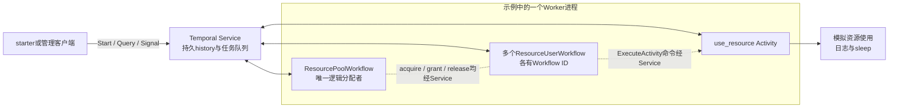
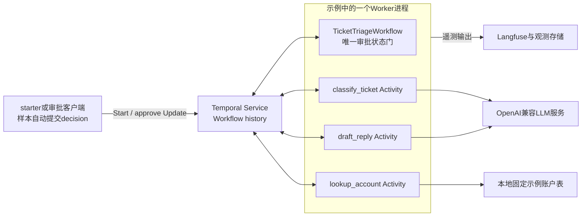

# 系统与授权权威拓扑

版本AT-CHECK-1，2026-11-05。本轮深入两个官方可执行示例：Temporal `resource_pool`与`langfuse_tracing/ticket_triage`。采用两级证据：L1为固定源码/配置/测试规定，L2为运行history/实测。L1已取得；L2未采样，也没有把README的预期trace写成实际日志。候选实现、测试/示例运行、模型和业务服务调用均为0。[sources/READING_LOG.md](sources/READING_LOG.md)

## 1. 固定版本和部署材料

官方仓库`temporalio/samples-python`归档commit：`c46e6156694e93a12d6e666cec1691fd02a067a7`，ZIP SHA256 `e57fb6bb8a173cfa4b2d0ba9e60fa6db2a7401844d8a368b05f9678f09b93227`。选定源码及测试保存在sources/samples_snapshot；归档完整保留。[SOURCE]

`uv.lock`固定Python SDK `temporalio=1.35.0`、OpenAI Python `2.54.0`及相关依赖。本轮另取得锁中指定的SDK源码包并核对SHA256，仅读API语义，未安装。`tests/conftest.py`默认启动隔离local环境，并将`dev_server_download_version`设为`v1.10.0`；SDK说明该字段为**Temporal CLI版本**，不能写成Temporal Server版本。原始demo仅要求本地Temporal server，未锁定实际服务器二进制及数据库部署。[SOURCE：LOCKED_RELEVANT_DEPENDENCIES.json；tests/conftest.py；sdk_snapshot/temporalio/testing/_workflow.py:100–158]

两个worker和starter都通过ClientConfig读取连接配置，默认`localhost:7233`。因此图中给出的是**源码规定的默认本地拓扑**；外部config/env可连接其他服务，本轮未读取用户配置，也未宣称该拓扑已部署。

观测部署的docker-compose固定了Langfuse worker/web的`3.224.1`标签；ClickHouse/MinIO没有版本tag，Redis为7，Postgres默认17，未指定镜像digest。它是一份固定版本的配置文件，尚非完整可复现运行环境锁。Langfuse这些存储均不承担批准判定。

## 2. 对象R：资源池

选择依据：官方目录含独立worker/starter、请求/响应dataclass、长驻分配Workflow、使用者Workflow、故障/continue-as-new及互斥测试，足以定位真实操作粒度。[SOURCE：resource_pool/及tests/resource_pool/workflow_test.py]

|角色/边界|源码事实|授权含义|
|---|---|---|
|客户端starter|创建一个pool和4个user workflow；两个资源；同一task queue|创建/管理权限来自Temporal连接配置，未配置逐任务用户批准|
|Pool逻辑权威|resources、waiters、release_key_to_resource；FIFO等候、找空闲资源、发grant、按key释放|是资源分配协调者；AcquireRequest只有workflow_id，没有人类批准、额度或任意任务约束|
|User Workflow|获得资源后在async context内执行两个Activity；可注入一次已完成Activity后的失败；可detach后continue-as-new再reattach|获得一段跨Activity的合作式占用资格|
|Worker进程|一个Worker注册pool/user Workflows和use_resource Activity|不同Workflow ID具有独立history，但样本没有给它们独立机器、凭据或管理域|
|Temporal Service|承载消息、任务和history；Worker中的状态可由history重建|中央服务保留为完整基线；本地RAM不是脱离服务的独立权威账本|
|资源效果|use_resource只日志和asyncio.sleep(3)|没有真实资源端PEP、租约检查或外部提交接口|

**故障与自主性。** Worker收不到新任务时不能据此产生新的池分配；已经取得的Activity attempt可能继续执行本地代码。持有已有锁时继续工作，与断连期间自行创造新权利分别登记。源码未给独立执行器离线审批/全局额度自治要求。[SOURCE/DERIVED]

`release_key`为释放关联句柄；handler按key查表，不校验业务用户身份。管理query可返回holder及关联key，README允许可信管理员据此手动释放。它不是独立密码学授权协议。资源端也未检查这个key：Activity只接收resource名字与iteration。[SOURCE：shared.py、pool workflow:54–78；resource_user_workflow.py:18–27]

## 3. 对象T：票据分流与审批

选择依据：官方源码明确给出批准schema、Update handler/validator、阻塞门及批准/拒绝测试，比“human-in-the-loop”名称本身提供更强证据。没有深入其他agent plugin。[SOURCE：ticket_triage/；tests/langfuse_tracing/test_ticket_triage.py]

Activity有序执行：`classify_ticket`完成后才调`lookup_account`；两者成功后检查审批门；批准才调`draft_reply`。相同span分组不等于并行执行。[SOURCE：workflows.py:47–75]

批准schema为`ApprovalDecision(approved: bool, reviewer: str)`。`approve` Update将其保存为`_approval`；validator仅在`approved=True`且reviewer为空时拒绝。Workflow handle/ID把Update路由至该Ticket，payload没有独立签名或人类身份凭证。源码未配置业务审批RBAC；Temporal连接层/namespace权限取决于部署。[SOURCE：activities.py:47–49；workflows.py:80–88；starter.py:94–97]

starter默认立即发送`approved=True, reviewer=demo-reviewer`，`--decline`可改为拒绝；这是**程序化官方示例输入**。测试也在start后直接Update。源码不要求decision一定在分类结果生成后到达，不能增加“人类必须先看过分类”的合同。[SOURCE：starter.py；tests的_run_workflow]

最终效果是返回草稿文本，状态名`replied`没有对应邮件发送或退款接口。测试模拟草稿中的“refund on the way”不是退款效果。LLM请求和Langfuse观测是外部I/O，均不成为新的批准权威。[SOURCE：activities.py:94–140；workflows.py:68–78]

## 4. 两级证据与实际独立性回答

|问题|资源池R|票据T|
|---|---|---|
|多个逻辑执行单元|有多个User Workflow/Activity|有一个Workflow及三个Activity角色|
|独立持久状态|各有history，由同一Temporal服务维护；没有独立本地账本配置|同样依赖服务history；没有互不信任副本|
|独立业务权限/批准主权|未提供|reviewer字符串不构成该证据|
|是否已有中央派发/状态门|有Pool+Temporal任务服务|有审批Workflow+Temporal任务服务|
|断连时新授权自治|无此合同|无此合同|
|最终效果原子性|只有模拟使用，没有资源端事务|草稿生成是外部LLM Activity，非跨服务原子提交|
|L1执行规格|代码、starter、tests和配置已取得|同左；官方test可mock外部LLM/遥测|
|L2实际记录|未取得或运行|README预期tree和test断言属于规格；没有实际history|

L1已足以建立带上述前提的需求模型。实测速率/延迟仍未知，L2缺失未被当作维持新理论候选的理由。
