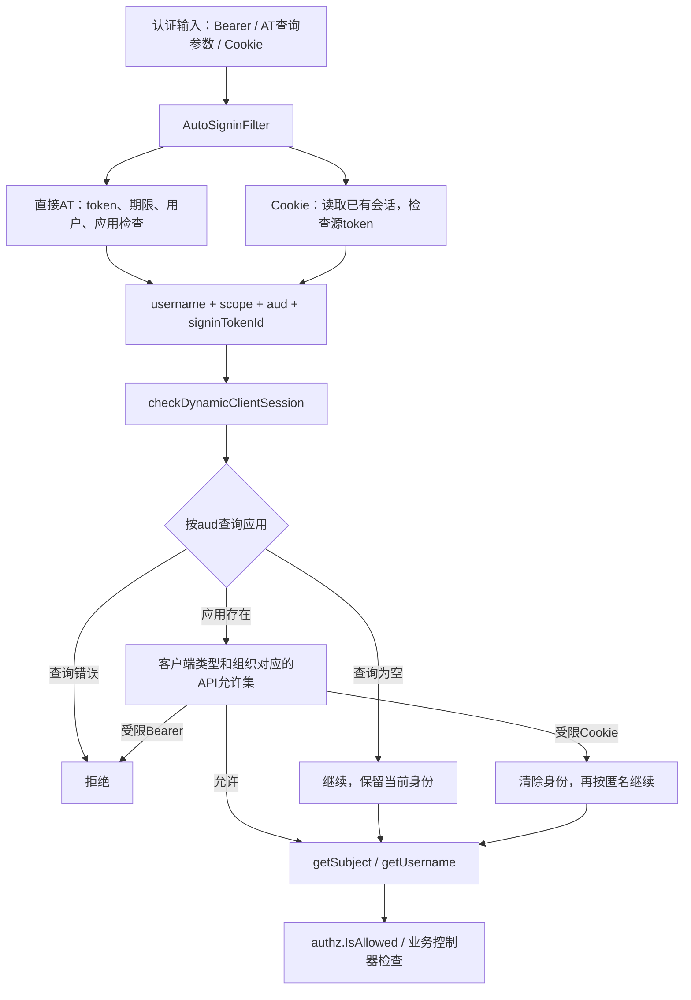

# 认证上下文的数据流与最小反例

## Material Passport

证据等级：源码数据流、原样函数的合成离线结果；真实部署效果待验证。原生源码行号指向`D:/毕业设计/research_main_innovation/ci01_contract_audit/sources/casdoor-v4.25.0/`，本轮只读副本在`sources/frozen/`。完整定位索引见[SOURCE_LOCATIONS.md](SOURCE_LOCATIONS.md)。

## 逐依赖追踪

|依赖|文件、函数、行号|已确认行为|
|---|---|---|
|过滤器顺序|main.go:117–120|AutoSigninFilter→CorsFilter→TimeoutFilter→ApiFilter|
|认证输入与持久化选择|routers/auto_signin_filter.go，AutoSigninFilter:50–61|先查accessToken/access_token参数，再查Bearer；Bearer调用skipSessionPersistence|
|源token、期限、用户|同文件:63–91；object/token.go:IsUserActive:123–137|查原生token记录、期限和当前用户；本轮存储为内存map|
|AT的应用依赖|AutoSigninFilter:112–120|查不到应用时写出错误并返回|
|身份及来源建立|AutoSigninFilter:122–130；routers/base.go:222–253,296–305|源token ID、用户名、scope、aud进入会话；当前请求另有requestCredentialUser|
|Cookie来源检查|AutoSigninFilter:134–138；base.go:255–284|存在有效源行则继续；失效/过期/缺失则清除六个绑定字段；源ID缺失早返回|
|受限类型|object/user_util.go:IsDynamicClient:1165–1167；authz_filter.go:691–707|由当前应用Tags和Organization决定；未从会话恢复固定类型|
|缺失应用分支|authz_filter.go:647–660|aud存在时查询应用；err拒绝，nil继续。nil与“普通客户端允许”共用通过分支|
|受限载体分流|authz_filter.go:662–675|当前凭据请求直接拒绝；Cookie清除来源身份并继续，以支持匿名登录页面|
|主体读取|authz_filter.go:getSubject:195–207、getUsername:140–173|在局部限制之后读取身份，处理SessionData到期；跨Origin Cookie写请求另有匿名化判断|
|最终API策略|authz_filter.go:566–579；authz/authz.go:IsAllowed:161以后|应用/用户权限、Casbin及CheckApiPermission参与最终授权；局部gate=true只表示继续|
|抽象操作定位|controllers/user.go:266–380；object/user.go:894–937|update-user有用户与字段权限检查，display_name在self字段列表；本轮以mock策略替代实际控制器，不调用它|
|独立登录转换|controllers/base.go:SetSessionUsername、clearSessionOidc:285–296|明确登录可以清除旧token限定；这是独立授权前提，不能仅由应用行消失推定|

## 正常上下文差异

完整应用记录＋受限客户端＋edit_display_name：Bearer分支写拒绝；Cookie分支清除username等字段后返回true。随后getSubject得到匿名，合成下游受保护操作拒绝。只比较函数返回值会把Cookie误报为放行；本轮同时检查身份和下游mock结果。M073等矩阵行及B01/B03保留该负控制。[用例](OFFLINE_CASES.json) [结果](TEST_RESULTS.json)

独立登录setter在合法新认证前提下清除来源限定，B16在应用缺失时仍可按新的身份上下文通过mock策略；该行为属于正常语义。测试没有提交密码或生成真实会话。

## 最小合成反例：M081

1. 内存应用`app-fixture`属于`fixture`，client_id=`client-fixture`，Tags=[dcr]；合成有效token记录属于`fixture/alice`，scope=openid、grantType=authorization_code。
2. 使用原样AutoSigninFilter的AT参数分支，在内存会话中建立username、aud、scope、signinTokenId。初始客户端允许集对edit_display_name返回false。
3. 保存这份内存会话，清空mock应用查询表中的对应应用。源token与用户保持有效；没有调用SetSessionUsername或加入独立凭据。
4. Cookie上下文进入原样AutoSigninFilter。clearSessionOfRevokedToken找到有效源行，保留会话。
5. checkDynamicClientSession读取aud，得到`application=nil, err=nil`，返回true且保留身份。
6. getSubject取得相同用户；声明的mock self策略允许抽象edit_display_name。最终记录ALLOW，预期为DENY。测试以失败退出保留差异。

这是一个源上下文完整的反例。它避免依赖伪造Cookie字段或猜测用户scope含义。M081、B02（CIMD）、B04（跨组织）共同定位同一个nil应用分支，构成一项源码发现的三个条件实例。

## 限制属性在何处发生变化

转换阶段保留了aud与源token ID，`TestConversionAttributePreservation`已核对。权限上界依赖的类型与组织通过当前应用记录重新取得；该记录缺失时，约束计算被跳过。会话中没有独立的客户端类别快照，源码也没有在nil分支从源token恢复或拒绝该受限身份。该依赖解释比笼统的“所有Cookie都扩大权限”更精确。

来源字段故障B12/B15也可使gate继续，但这些字段由夹具直接删除或改型，正常转换能够写入它们。本轮将其记为规范/可达性未决，不作为新的攻击路径。

## 离线与部署分界

测试调用了原样AutoSigninFilter、客户端限制函数、getSubject/getUsername和来源清理函数，依赖查询、session存储、响应输出及最终self许可使用mock。输入操作名只映射为策略键。没有HTTP发送、真实Cookie、真实用户资料修改、真实授权码交换或生产影响验证。

真实部署还需检查Beego输出终止语义、session持久化/过期、实际Casbin与API配置、目标控制器字段检查、Origin/CSRF约束及路由注册。历史C11提供普通客户端userinfo存活观察；其客户端类别及目标与本轮合成反例不同，不能直接填充这些部署缺口。[历史索引](HISTORICAL_C11_INDEX.json)
