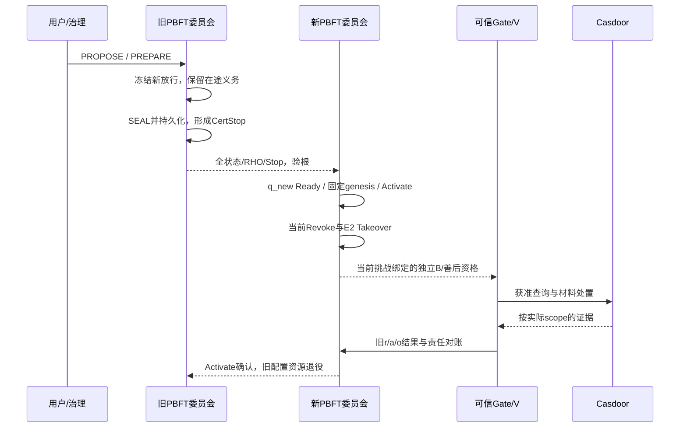

# D1-PBFT-SEAL/1：责任保全的顺序重配置实例

DCL-R3；2026-11-10。纸面规格，代码/机器验证/部署执行为0。继承D1的21业务转换与Casdoor profile，本文件具体化T20及跨域接管。条件完整性限本文模型；强G可采用相同实例。

## 1. 底座、成员与安全域

每个成员epoch e使用一个固定成员PBFT实例，采用原论文§4的公开签名版本、完整prepare/commit/view-change规则和确定性执行。它的view改变leader，本文epoch改变成员，二者分别编号。[PBFT服务与算法](https://static.usenix.org/events/osdi99/full_papers/castro/castro_html/node4.html)为同epoch线性化、checkpoint与view-change的成熟基础；本文件的顺序Seal/Transfer连接层另给证明，不把两个静态quorum直接拼成跨epoch定理。

`Cfg_e=(deployment,e,parent_anchor,members,public_keys,f_e,FD,app_schema,app_code_digest,governance_policy)`；固定`n_e=3f_e+1`，证书门限`q_e=2f_e+1`。最小实例旧委员会{q1,q2,q3,q4}、新委员会{q5,q6,q7,q8}，各f=1，可完全无交集。进程同管理员/控制平面时按相关故障域计，数量相异不证明独立。

这里Cfg中的parent_anchor专指**已知父配置身份CfgID_e**，新提案模板不含尚未生成的CertStop摘要。真正父Stop链接单独存于新genesis和Activate。客户端当前anchor包含配置身份与genesis/激活链，不能仅凭同一成员列表建立新历史。

每个委员会签名生命周期累计失陷数≤f_e；认证签名/哈希满足通常安全性。退役委员会密钥后来被凑齐伪造旧历史的移动攻击超出本模型。若需要此能力，另加已验证前向安全/密钥擦除方案；客户端从用户认可的近期anchor引导并持久pin当前最高已认可epoch，旧QC只表当时事实。

网络可乱序、重放、分区、长期延迟；安全不依墙钟。活性采用比PBFT所需足够强的最终同步、诚实节点公平执行、旧/新合法quorum可达、全状态/受权材料可用。新委员会永久失去quorum时允许安全停顿。原生P/V/Gt及其故障合同另外声明。

E1/E2是协调执行域，可以失陷；在CD25-BOUND中V/Gt为独立可信边界，E1/E2只持句柄。E1若见过完整密码/RT并能直连，切换CD25-LEAK，原生强关闭保持条件不足。PBFT副本保存规范化状态与秘密引用/密文，不获得未声明的秘密隐私保障。

## 2. 复制状态和证书

`A_e=(logical_state,mode,pending_reconfig,unique_child,business_dedup)`，logical_state完整包含R1/R2的grants、原代次、i/o、quota reserved/charged、requests/attempts、Obl、材料来源、Hist、CreatorCaps、证据与claims。mode为ACTIVE、PREPARING、SEALED；新epoch另有WAIT_ACTIVATE、RECOVERING。业务opid去重跨epoch保留，不能以新epoch命名空间重置批准或预算。

RHO新增：`parent_epoch/anchor`、`seal_position`、`next_cfg_digest`、`send_rights`（r/a、持有gate/boot、是否已消费/可能已发）、`late_result_route`、`pending_user_ops`（已持久记录者）、`closed_claims_with_invariants`、`cost_envelope`、`native_observation_watermarks`、`data_manifest`及数据/解密可用性。已通过检查的native handler以保守相位记录，不依其在checkpoint时是否已返回。

证书统一域分隔并绑定部署、epoch、类型、opid和规范body摘要，公开验签逐成员去重。

- `CertStop_e=(Cfg_e,seq,SealCmdDigest,state_root,rho_root,next_cfg_digest,signatures[q_e])`。正确节点仅在PBFT提交并执行Seal、持久保存全状态后签发同字段attestation。
- `Ready_j=(CertStopDigest,new_cfg_digest,state_root,rho_root,data_complete,code_schema,j)`；新节点取得全数据、验完整规范编码/摘要/授权与确定性迁移后才签。`CertReady`需q_new个同body签名。
- `CertActivate_new`为新PBFT第一条Activate从已确定genesis执行后的q_new个执行收据；它绑定父Stop与Ready。正常业务执行收据亦绑定当前epoch和具体结果。

摘要不递归：SealCmd不含自己的证书/输出state_root；执行后的状态记录SEALED和唯一child参数，外部attestation再计算state_root。RHO payload的root排除外部checkpoint证书；证书引用payload而非把自身纳入哈希。

state_root只覆盖完整逻辑应用状态，副本私钥、局部PBFT view/投票缓存不入共同根。旧副本自身的PBFT恢复记录仍须持久保存。CertStop可由Seal结果的q_e个签名执行收据组成，不要求恰逢PBFT周期性checkpoint；内部PBFT checkpoint/view-change照原算法执行。

本实例只改变成员/epoch与接管元数据，要求new app_schema、app_code_digest、业务治理/原生profile语义与old相同。v1拒绝借成员重配做未证明的代码/模型升级。确定性迁移F逐字段复制logical_state与business_dedup，保留完整父链；设置新epoch、mode=WAIT_ACTIVATE、pending_reconfig=⊥、unique_child=⊥。所有旧发送权/owner的历史字段保留，业务执行资格在Takeover前均未开放；第一条Activate将WAIT_ACTIVATE置RECOVERING。

承诺依赖顺序固定为：`CfgNew模板→CfgID_new→Seal状态S→H(S)与H(Proj_RHO(S))→CertStop→F(S)的genesis payload→GenesisDigest→Activate→CertActivate`。RHO投影仅含seal位置等标量及历史引用，自己的输出root/当前Stop证书在外部绑定；F的payload不含自己的GenesisDigest，Activate状态也不含自己的输出证书。这样配置链与状态根没有自指哈希。

## 3. 静态PBFT调用合同

每次状态命令先校验用户/治理/服务签名与业务守卫；按PBFT提交顺序执行后产生收据。随机nonce/ID由提案固定或确定性派生，时间事实由声明的可信输入提供。读“当前可用资格”采用带新challenge、caller、完整请求、预期anchor的有序授权命令，禁止拿历史QC作当前准入。

ACTIVE允许21转换的合法命令。PREPARING冻结Approve/Admit/Release/Successor及第二次重配置，但允许Revoke、Record、证据登记、只读和本次Abort/Seal。SEALED拒绝全部业务状态变更并返回带Stop的MOVED；它可重复提供已冻结数据/证明。

Gate对每个新放行使用当前有序授权并消费一次受保护发送权。崩溃后已经消费或可能已发送的旧权利保持UNKNOWN，不向新owner补发同一Casdoor创建。实际IO晚于Seal/Revoke的既有放行进入RHO在途范围。消息/QC重放本身无法创造第二次发送权；该保证依可信Gate持久防回滚与不重复发送，原生Bearer旁路另证。

## 4. 八步重配置

所有表中RSM提交均经该epoch完整PBFT；搬运数据本身不产生新资格。精确重试返回原记录/阶段，异正文同opid冲突。每一步的拒绝保持原安全状态。

|逻辑步/消息及字段|前置与状态转换/提交点|持久、重试、拒绝和恢复|
|---|---|---|
|1 RECONFIG_PROPOSE：rid、parent anchor、完整Cfg_new、schema/code/profile、治理批准|旧ACTIVE且pending为空，或为同rid同body精确重试；治理策略、故障域/配置类型、单child约束合格。旧PBFT登记提案|保存提案与审批。重复同body幂等；错parent/权限/并发提案拒绝；崩溃读旧当前状态|
|2 RECONFIG_PREPARE：rid、Cfg_new摘要、数据要求|旧PBFT将mode→PREPARING，冻结新放行|保存冻结点；现有reserved/charged/Obl保留。Seal前允许有序Abort恢复ACTIVE并重验当前批准；新rid只能在旧提案已合法Abort后提出|
|3 OLD_STATE_CHECKPOINT：SEAL(rid,next_cfg,profile)|仍PREPARING且提案匹配；旧PBFT执行mode→SEALED并设置unique_child。此后业务写只返回MOVED|持久全逻辑状态/RHO/去重表/数据清单；收集CertStop。Seal后不可Abort、不可重开旧epoch。崩溃恢复同Seal；迟到旧命令未提交则重定向|
|4 RESPONSIBILITY_TRANSFER：Stop、完整snapshot/RHO/对象清单、治理链|新节点逐字节/语义核验，初态只允许由该Stop导出的同一genesis；取得受权秘密引用的可用性|各节点存完整数据后Ready；缺行/义务/未知/历史/去重/证据对象或root不符拒签。恶意旧节点隐藏数据只阻活性；从其他正确持有者取数据|
|5 NEW_MEMBERSHIP_ACTIVATE：Stop、CertReady、genesis摘要|新PBFT所有正确节点已从同一固定genesis起步；第一条Activate核父链/Ready，提交新epoch RECOVERING|保存Activate/父链/pin。错genesis/newcfg/重复激活冲突拒绝。旧/新委员会无需交集，依旧Seal唯一child与新固定genesis连接|
|6 EXECUTOR_TAKEOVER：mid、E2/boot、RHO root、DeployCert、权限范围|新RECOVERING；当前用户批准/证书和V/Gt权限满足。新PBFT更新owner/mv，发善后/独立B所需当前资格，再置相应scope ACTIVE|保留原i/o/a/generation/quota/UNKNOWN；不复制出新业务机会。缺NativeCut时只给已证明安全的子权限；E2崩溃可在新委员会内更换owner，责任不删|
|7 EVIDENCE_RECONCILE：原r/a/o、release引用、native证据/phase|新epoch匹配旧请求与实际profile；经T06/12/16/19登记原来源/隔离/关闭|证据一次性、范围/新鲜度、S/U/L或原生截止守卫照旧；缺收据保持UNKNOWN。旧域返回可转发，原批准已撤回则隔离|
|8 OLD_CONFIGURATION_RETIRE：Stop、Activate摘要、新数据保留证明|旧配置已经SEALED，确认新epoch可靠接续后作资源退役通知；新epoch登记retire事件|退役只做资源生命周期，旧授权持续封禁。旧成员保留最低Stop/重定向/审计证据；GC不得消除验证链或恢复所需对象。缺后继证明保持封禁并延后GC|

治理Abort适用于提案已登记至Seal之前，清pending并保留所有业务状态/义务；相同已Abort的rid重试只返回历史ABORTED，重新提案使用新rid。Seal之后没有回退分支。

**原生世界在转交空窗内继续演化。** 激活只证明复制状态连续，Takeover必须使用`K_take=EnvClosure(F(K_seal))`覆盖空窗中允许的网络到达、handler推进、故障/披露和累计费用变化。旧NativeFacts保留观察水位，旧配置证书先标SUSPENDED，经过新成员/权限与该闭包验证后才能发新业务资格；闭包超模型能力时输出UNKNOWN。不能把Seal时的原生状态或成本标量当成接管时真值。

用户在PREPARING前/期间提交且已被旧PBFT确认的Revoke进入Seal状态。Seal之后旧端不返回LOCAL_REVOKE_COMMITTED，客户端携相同业务opid向新epoch重试，直到取得当前提交收据。在空窗内旧epoch已停新放行，新epoch尚未发资格。未取得提交收据的用户意图不能被表述成已原子撤销。

Seal之后即使新成员整体不可用，旧委员会也不能自行改选另一child；此做法排除双新历史，代价是可能长期停顿。下一次成员重配置须由已激活的当前委员会顺序完成；紧急越过失效新委员会的恢复属于另一个需独立证明/授权的协议。

## 5. 极端情况裁决

**B保留守卫保持原强度。** 本实例顺序冻结当前委员会的新放行。如果B唯一支持路径也依赖该委员会的即时Gate许可，PREPARING/SEALED空窗会使严格Support(B)失败，D2应拒绝该配置；不能把“Token尚存”改称原有前缀支持。若D2预先配置了独立、当前且持续满足原Support谓词的B路径，本实例才对该输入承诺严格B保留。独立根/执行门/权限/预算和备用成本全部计费，G同样拥有。允许短时执行暂停属于另一个显式工作负载合同，不用它证明原强目标已通过。

|情况|安全处理与活性条件|
|---|---|
|E1在checkpoint前崩溃|Q日志已有的release/UNKNOWN仍在；E1不参与构成Stop的必要quorum。原生未记录旁路按Hist/CreatorCaps保持缺口|
|E1在checkpoint后崩溃|新节点从Q的完整快照接续；E1本地缓存只作线索|
|新域接管后收到旧结果|核原r/a/o及旧release证明，在新epoch登记；不改origin、不因新owner重置预算|
|新旧配置同时服务|旧SEALED只提供证明/拒绝，新epoch从父Seal后才激活；旧已放行native IO仍算在途责任|
|两个有效历史/两个child|违反旧PBFT唯一执行或唯一child/新genesis规则；证明见PROOF_OBLIGATIONS_R3|
|成员完全无交集|允许，正确性依Stop链＋完整数据验根＋新固定genesis；各自静态人数界单独不足|
|旧E1保留Bearer|复制状态安全继续成立；原生停止依NativeCreationCut及材料/效果证据，缺口保持MODEL_BLOCKED|
|BFT节点隐瞒责任|完整状态来自确定性执行；篡改/缺对象验根失败。隐藏源于未登记原生行为时，仅账本证书无法检测全部外部事实|
|转交期间撤回A|按旧Seal前/后两种提交顺序处理；新资格总重验当前批准|
|长期分区|旧/新节点无法形成合格证书时停发；UNKNOWN持久保留，最终进展需网络/数据/合法quorum恢复|
|第二次重配置|PREPARING阶段同父提案冲突拒绝；Seal后仅当前已激活child能提出下一次|
|旧committee密钥后续累计泄露|超出静态签名生命周期故障模型；需近期anchor或额外前向安全机制，不能宣称已覆盖|

## 6. 顺序图与费用

纯委员会搬迁可以不新增native API，但整个研究任务的C_N仍计既有执行、查询、失败、处置、验证、B完成和清理。签名、共识消息、快照对象/密文传输、存储保留和停顿分别计费。强G可用完全相同流程或更强成熟重配置优化；本文不主张通信/延迟优势。
