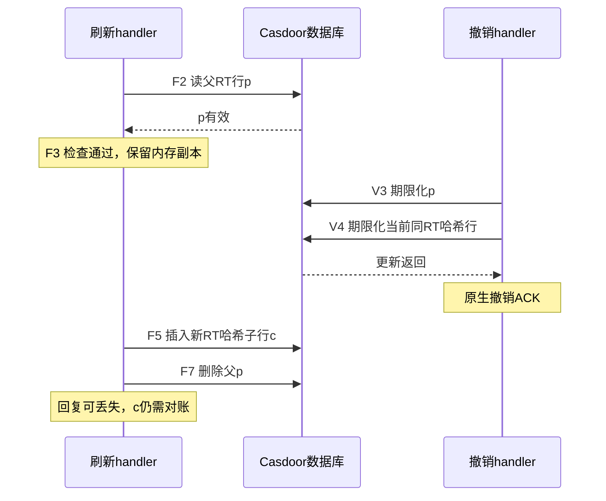

# 原生语义精化与21类转换映射：DCL-R2

2026-11-09。R1 的 T00–T20 保留；本表是 Casdoor profile 的规范约束。一般理想 P1/P2 继续作为能力需求，与实际 Casdoor 能力分开。

## 1. 具体状态与知识集

具体原生状态定义为 `x=(TokenRows,Users,Applications,Organizations,Sessions,ActiveHandlers,Network,AuditPending,AuditRows,RPState,History)`。ActiveHandlers 包含读取出的父Token/用户/应用副本及执行相位；Network 包含已发未到和已返回未收到的消息。删除数据库父行后，某 handler 中已通过检查的副本仍存在。

抽象状态新增：`InvocationPhase∈{MAY_NOT_ARRIVED,READ_VALID_PARENT,MAY_INSERTED,MAY_POSTWRITE_FAILED,RETURNED}`；`S_bound` 实际发送上界；`U(a)` 每调用新单位上界；`L(a)` 可靠归属且互异的已观察效果下界；`CreatorCaps` 旧域能够发起的新调用种类；`RTcohort` 共享哈希等价类；`AcceptancePath` 指定UserInfo/内省/外部RP；`AuditCoverage` 仅观察到的日志范围。

运行者通常观察不到 handler 相位，K 保留全部相容相位。响应/错误/超时只删去已有证据排除的状态；空集合、inactive 和删除 ACK 均保持可能在途 handler。超出登记发送/派生界的旧域能力使相关旧证书失效。

## 2. 转换映射

|T|真实调用/事件|可观察结果|R2约束与证明责任|
|---|---|---|---|
|00 Init/Join|本地权威/后续BFT配置；Casdoor源与二进制锁|版本/配置/哈希|Casdoor不提供本项目成员共识；依外部线性化Q接口|
|01 Approve|本项目grant登记|批准收据|任务批准与Casdoor客户端/用户身份分开；原生无task-generation记录|
|02 Admit|AuthorityStore.admit|reserved/QUEUED|先保留i/o/quota；真实语义等价编译仍条件化|
|03 Release|AuthorityStore.release；受保护发送槽|attempt/放行版本/charged|在发送前创建义务；发送槽约束可信执行门，恶意直连发送另计|
|04 NativeSend|password access_token 或两个 refresh 入口|可能无返回|本地k留在账本；Casdoor未按k去重，不传递虚构原生幂等保证|
|05 Result/Loss|F2→F9各微步骤与丢回复|OK/TokenError/传输异常|拆分AddToken、DPoP更新、父删除与响应；错误同样可能已插入|
|06 Record|原响应签名/材料校验、当前权威登记|RESULT/QUARANTINED|JWT jti只绑定新行；request→jti仍需受信响应日志或完整来源排除|
|07 Revoke|本地revoke后可另做原生revoke|LOCAL_ACK与独立原生观察|本地LP不等于V3/V4；原生200也兼容查无行|
|08 PrepareMove|冻结当前Q的旧owner资格|PREPARING、责任清单|不能停止已发包或已读有效父状态的handler|
|09 IsolateOld|V/Gt权限收回；已知token revoke；可选session/user处置|各自ACK、fresh接受观察|Hist保持；原生按行/cohort/session/user而非本地owner截止；失陷域仍有密码/RT则保留CreatorCaps|
|10 Fetch/Ready|转移Q完整状态与授权材料引用|READY/缺对象|包含ActiveHandlers的保守可能集、CreatorCaps、读范围；数据可用性另证|
|11 Activate|Q当前事务激活E2/善后/B子权限|ACTIVE或LIMITED|允许转移账本责任并继续独立B；A原生关闭保持待证；同一发送身份不授新刷新|
|12 QueryEvidence|get-token/get-tokens；必要时get-records|行/页/日志及范围元数据|精确读需已知ID；多页/日志缺口保持K；审计不承担Token提交全序|
|13 Terminalize|所审接口无按k终态化|UNSUPPORTED|Casdoor profile禁用该原生分支；单行revoke不可改写为FINAL_NO_EFFECT|
|14 ExactReplay|重复原始HTTP会重新进入Refresh/GetPasswordToken|新材料/invalid_grant/UNKNOWN|该profile禁用未知创建的自动重放；原调用重试失败仍不能排除第一次已生效|
|15 Successor|需终态无效果证书，Casdoor当前无法提供|无合格原生收据|同意图创建继任默认禁用；新用户批准仍继承旧未决预算/风险关系|
|16 Reconcile|点读/获准单页枚举→归属→逐行/RT cohort处置→读回|条件CLOSED或UNKNOWN|使用严格S/U/L上界和来源/作用域；核验B副作用，见定理SAT|
|17 ResumeB|B独立材料fresh UserInfo/其他已证明接口|成功或拒绝|B共享RT/cohort/user/app时检查副作用；新创建暂停和支持仍在分开|
|18 MoveFail/Retry|新mid/mv接管与查询重试|保留责任/带费UNKNOWN|仅重试协调/只读；原生撤销按实际effect重复核验，创建请求保持禁重发|
|19 Close|Q核验分类型证据后关闭|ATTEMPT_CREATION_CLOSED、NATIVE_ROWS_CLOSED等|每attempt饱和与全任务历史能力关闭分别判定；原生业务效果另证|
|20 Reconfigure|外部BFT配置链/部署变更|新cv证书|旧Obl/Hist/charge保持；原生名称复用/管理员改写属于I_post环境变化|

## 3. 六条指定原生轨迹

|轨迹|可能内部历史与观察|D1/D2判断|
|---|---|---|
|A 新RT已创建、回复丢失|F5 Insert子c成功，F7可成功/失败，F9丢失；Q仅UNKNOWN|可证明存在“已创建但未登记”的源码允许状态；可靠归属c后可对账；缺来源继续UNKNOWN|
|B 撤销前发送、ACK后关键执行|F2/F3读取父p并通过；V3/V4期限化p且ACK；F5随后插入新哈希c|在逐语句提交/并发handler前提下存在风险；父revoke无法独立证明创建截止|
|C 查询空、之后延迟刷新|F2/F3已通过；一次Find未见c；随后F5插入c。或原请求未到达且旧凭据仍可用|查空保持UNKNOWN；等待固定时间也需原生执行截止/最大延迟证据|
|D RTinactive而AT/会话仍可用|同一行成功revoke后，后续fresh同一行AT认证应拒绝；其他旋转子行、已通过认证请求、外部离线RP或独立会话仍可能继续|严格区分“同一行”“其他行”“在途”“其他接受方”。状态为作用域证据，不泛化成全部有效/失效|
|E 分页/过滤/保留|LIKE可能读取其他账户；count与Find/多页读不同时；审计异步且可清理|权限不足/集合不完整为UNKNOWN；M4/M6单页上界条件可建立该次范围完整性|
|F A撤回保留B|独立行新RT可逐行处置并保留B；共享RT cohort撤销、同user/app处置会波及B|按真实footprint可行/不可行/待证；本地两批准不自动产生原生隔离|

## 4. 源码反例 NC1–NC6

以下图仅表示NC1的一条源码允许并发顺序，运行实测数为0。图内事件引用同一DCL-R2/commit合同。

NC1 **撤销ACK后子行插入**：按B的序列，p.ExpiresIn在F3读取时>0，V后缓存p保持旧值；新RT哈希不同，V4扫不到未来c；F7删除p的affected计数未用于授权判定。c存在且用户/app仍活跃时可进入后续原生接受路径。证据：refresh:586/599/705/738/755，ExpireToken:353/360，DeleteToken:267。属于SOURCE_ADMISSIBLE_HISTORY；新原生复现为0。

NC2 **同父双刷新**：R1、R2分别先读有效p，两者再各插入c1/c2，随后各删除p；第二删除可affected=0而无error。每调用U=1继续成立，两个调用的总上界为2。轮换本身不构成原生至多一次。若DB或部署额外串行化整个handler，应另列合同并出证。

NC3 **错误回复后子行已存在**：F5成功后F6或F7失败；客户端收到错误仍可有c。初始发行也可能在AddToken后DPoP/CodeIsUsed更新失败。故HTTP错误与无效果分别处理。

NC4 **共享RT撤销连带B**：禁用轮换使p/c1/c2共享RT，A/B若使用该cohort，撤销其任一可定位行会期限化同哈希活动行。只重标任务来源无法改变此footprint。

NC5 **审计空缺**：Token Insert成功后进程在AfterExec/goroutine审计插入前崩溃；或记录因保留策略删除。get-records空观察兼容既有Token效果。正常情况下审计Object中的RT被遮盖，TokenWrapper也缺原生精确来源标识持久合同。

NC6 **非单调管理变更**：删除app保留Token行；在原有效期内重新建立满足查找条件的同名app，fresh接受路径可能重新可达。另有UpdateToken.AllCols可由具权管理者重设ExpiresIn。删除/期限化后的长效关闭需排除或模型化这些重新开放路径。此例为已审源码组合下的条件轨迹，实际部署重建行为尚待实验/完整配置对应。

## 5. 饱和关闭定理SAT与边界

对一组受控调用I，设可信证据给出发送上界S_i、每调用单位上界U_i，且L为已可靠归属的互异单位数。所有可能单位的剩余数上界为 `R=max(0,Σ S_i U_i−L)`。这里既要实例确实归属，也要源/传输合同覆盖所有创建者；只有满足L≤ΣS_iU_i的相容数据才可采用该式，超界表示模型冲突。

当R=0、所有这些单位在指定接受路径已证失效、旧材料无法再发新调用、全部其他创建者与重新开放路径已截止时，可关闭该范围的创建/材料责任。证明：若之后出现另一新单位，则互异总数至少L+1，违反总上界。该证明无需推断旧handler已经退出；它的后续微步骤仍由U覆盖。

L=0且S_iU_i>0时保留正余量。E1持可用密码/RT并能恶意绕行时，Q的预算仅约束受控放行，不能给绕行S有限上界；此时SAT前提缺失。该计数证明是标准上界饱和，最强G可直接采用，独立创新状态保持待核。

## 6. 补充入口反例 NC7

统一 token 入口 object/token_oauth.go:75–81 先检查 application.GrantTypes；专用 refresh 入口 controllers/token.go:471–477 进入 ValidateOAuth(true) 后直接调用 RefreshToken。后者只校验传入grant_type等于refresh_token，已审函数未重新检查application.GrantTypes。

因此在“从GrantTypes中移除refresh_token，同时保持app、user、cert、有效RT及其他条件”的源码状态中，统一入口会拒绝该grant，专用刷新入口仍有通过路径。它是该指定源码下的允许历史，原生实际复现为0。只观测统一入口被拒，无法证明两入口创建能力均截止。

此外 checkRefreshClientSecret:776–787 对未提供secret且原grant不在clientAuthenticatedGrantTypes的情况直接通过；该列表为authorization_code/token-exchange，另在撤销函数处理client_credentials。password发行的RT落入可省略secret的分支。旋转client_secret并保留原password RT时，不能据此推断RT失效。D2必须检查真实RT/DPoP/用户/app/cert路径，G同等获得这些源码事实。
