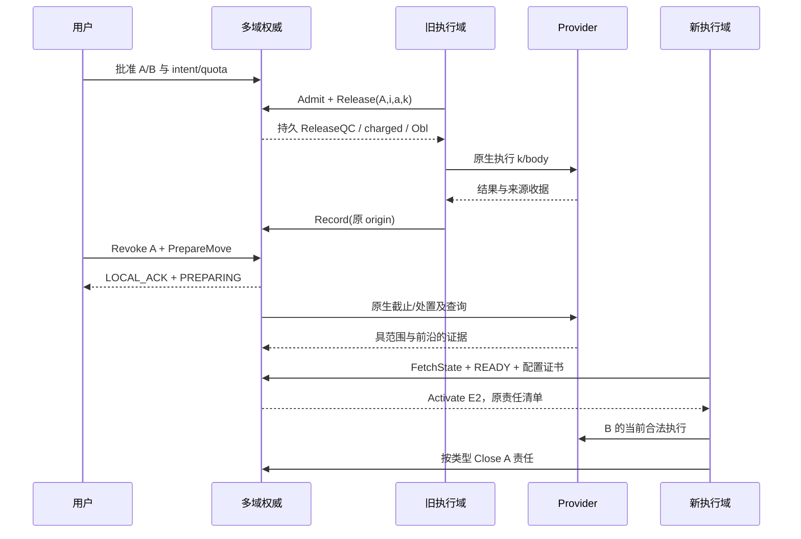
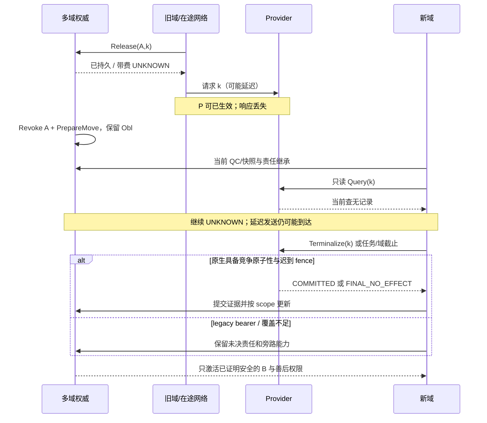

# D1-R1 带未决责任的跨域接管规格

2026-11-09。本文为纸面协议，安全模型见 PROBLEM_AND_THREAT_MODEL；依赖条件与未解责任见 SECURITY_PROPERTIES。当前状态 SPEC_DRAFT。

## 1. 标识、编码与数据

所有消息采用确定性、带类型/版本/长度的规范编码；签名包含协议域分隔、部署 ID、成员配置 ID、消息类型及完整正文。密文和秘密通过角色授权的保密通道交付，公共证明只含引用。服务身份由认证会话确定。

- `intent_id i`：U 的批准终端生成并由 Q 注册的业务意图实例；绑定 effect schema、操作、对象、参数摘要和 quota lineage。任意新 rid、nonce 或 owner 保持 i。语义等价效果跨 ID 识别依赖闭合的业务编译/登记目录；自然语言任意同义输入保持模型缺口。
- `origin o=(user,grant,task,account,audience,generation,quota)`：请求接纳时固定。迁移版本 `mv`、执行 owner `e`、配置版本 `cv` 与批准 generation 分开。
- `request_id r`、`attempt_id a`：Q 生成或检查唯一性；`native_key k=H(deployment,i,a,op,body)`，用原生要求的有界编码实现时需证明无碰撞及语义保留。
- `receipt_id`：原生或权威域的唯一收据，带本地顺序/因果父引用。两个不同域的序号只在各自域内比较。

批准 g 包含用户/调用方身份、任务、账户、受众、操作/参数界、代次、共享 quota 上限、期限策略、原生 profile、证据权限及清理预算。相同 i 对应一个业务机会槽。多次有意重复需用户批准的不同 i；共用总额度仍由相同 quota 计费。

## 2. 全局状态

权威状态

`S_Q=(cfg,cv,v,Grants,Intents,Quota,Req,Obl,Mat,Hist,NativeFacts,Owners,Migrations,Evidence,Claims)`。

|字段|内容|
|---|---|
|cfg/cv/v|成员集、故障域、配置链、提交位置 v|
|Grants|批准绑定、代次、有效/撤回、撤回版本|
|Intents|i→唯一正文/来源/quota、主尝试及唯一继任链|
|Quota|limit、reserved、charged；charged 计已放行业务机会槽，跨迁移保持|
|Req|r/i/a/k/body digest/origin/release(v,cv,mv)/owner/profile；阶段及结果引用|
|Obl|oid=(r,a,kind)、责任承担者、创建因果、可能能力/效果集、处理与证据状态|
|Mat|已知材料及派生来源；秘密引用、接受路径与 native domain|
|Hist|域在何时已/可能见过何种材料或有能力使用；事件历史只增|
|NativeFacts|带 scope/version/证据的当前原生状态，允许 UNKNOWN|
|Owners|每执行 scope 的 owner、mv、ACTIVE/PREPARING/FENCED；scope 明确到任务/原生共享域|
|Migrations|mid、旧新 owner、前态摘要、未决责任集合摘要、截止证据及阶段|
|Evidence/Claims|已接纳证据、一次性消耗、明确类型与范围的关闭声明|

请求阶段：`QUEUED → RELEASED_UNKNOWN → RESULT` 或 `QUARANTINED`；QUEUED 可 CANCELLED。另有 `FINAL_NO_EFFECT`、`REPLACED`。结果阶段与义务并行：结果可已查回，原生处置/异步效果责任仍未结。拒绝或超时消息同样作为观察保留。

环境状态 `S_E=(ProviderState,Network,ExecutorViews,Compromise)` 与 S_Q 组成真实全局 S。Q 的可见状态是保守知识集 K，须包含与合法观察一致的所有 S_E。网络内已放行请求会跨迁移继续存在。

## 3. 消息合同

|消息|发送→接收；必须字段|接收/回复|
|---|---|---|
|Enroll/Approve/Revoke|U→Q；opid、签名、批准/撤回正文、预期 cv|注册证明/GRANTED/LOCAL_REVOKE_COMMITTED/QC 或冲突|
|Submit|Agt→Q；opid、handle、i/r、正文、当前绑定|ADMITTED/EXISTING/REJECTED/CONFLICT|
|Release|E/Gt→Q；r、摘要、owner/mv/cv、配置证书引用|ReleaseQC 含 a/k/origin/v/body/profile 或拒绝|
|NativeExecute|Gt→P；k、原正文、原生身份/条件和必要资格证明|原生结果/拒绝/无响应；登记原始响应来源|
|Record|E/Gt/R→Q；r/a/k/origin/release、结果与来源证据引用|RESULT/QUARANTINED/CONFLICT/UNKNOWN|
|PrepareMove|管理授权者→Q；mid、scope、E1/E2、目标部署与证书摘要|PREPARING QC、完整责任清单摘要|
|FenceNative|R→P/可信 gate；mid、旧 scope/epoch、请求/材料集合范围|带完整性条件的 fence receipt，或 UNKNOWN|
|FetchState/Ready|E2↔Q/V；mid、QC checkpoint、对象清单根、材料密文/可用性证明|接收确认、缺失对象表或 READY|
|Activate|E2→Q；mid、接收摘要、D2 证书、截止证据、预期状态|ACTIVE QC 或需重评|
|Query/Terminalize|R→P；r/a/k、授权范围、nonce、profile|COMMITTED/FINAL_NO_EFFECT/UNKNOWN 及 scope 证据|
|Close/RetrySuccessor|R→Q；oid/i、对应证据、当前授权、单继任约束|typed CLOSED/继任引用/UNKNOWN|
|Reconfigure|治理授权者↔旧新权威；新成员与故障域、检查点/责任摘要|由所选 BFT 重配置接口完成配置链|

Q 命令以 `(deployment,opid,type)` 去重。相同 opid 同正文返回原收据及当前状态投影，异正文冲突。接收当前性通过当前 Q 线性化命令或经验证的读屏障；历史 QC 仅验证当时提交事实。

复制命令必须确定性执行。随机 ID/nonce 在提案中固定并经唯一性校验，或从已排序命令与计数器确定性派生；各副本分别读取本地随机数/墙钟会造成状态分歧。批准期限涉及时间时，所选 profile 须规定可信时间输入及误差界。原生密钥材料留在托管域，公共摘要避开低熵密码的可猜测承诺，采用受保护引用/标准随机化承诺并同等计费。

请求/intent 去重墓碑、已关闭责任和配置链按声明恢复期限持久保存。有限幂等/fence 保留只支持其有效区间内的结论；若消息允许任意迟到而原生身份可在保留过期后重新接受，协议须永久退休旧身份/命名空间，或证明通道已经截止，才能给出无期限唯一性与关闭。

## 4. 转换关系

下表的 LP=线性化点；Q-commit 为具 QC 的状态机提交，P-commit 为原生合同的提交/终态点。每个 Q-commit 持久化全部列示字段与事件，并由 quorum 保存可恢复数据。原生与 Q 分属事务域。

|转换|前置条件|后置条件、LP、幂等与失败|
|---|---|---|
|T00 Init/Join|用户认可 genesis、成员身份/故障域及所选共识配置|Q-commit cfg；新成员先取已认证状态再服务；缺状态维持只读/停发|
|T01 Approve|U 有效签名，作用域/预算可解析，当前用户密钥|注册 g/i/quota；Q-commit；重复 approval op 返回原实例，新的 grant 保持共享 quota 规则|
|T02 Admit|当前 g 有效、请求匹配 origin、i 已注册、剩余额度、当前配置可用|QUEUED 与 reserved 同 Q-commit；同 i 同正文返回原机会槽；来源/正文冲突拒绝|
|T03 Release|QUEUED、当前 g/owner/mv/cv/策略证书与原生前提合格|同 Q-commit 创建 a/k、spent slot、Obl(OUTCOME/DERIVATION)、outbox，reserved 转 charged；历史任意重放保持一槽|
|T04 NativeSend|ReleaseQC 已验证、原生参数一致、Gt 处于允许 profile；首次或合格精确重放|发送 k/body，发送事实与潜在材料使用预先持久登记；P-commit 依 P；网络失败转 UNKNOWN；Q 提交与发送间崩溃保留责任|
|T05 NativeResult/Loss|P 可接受、拒绝、延迟、派生并回包；允许丢包|环境步只改变 Provider/网络；Q 在缺证据时保留全部可能结果，timeout 只产生观察|
|T06 Record|匹配 r/a/k/body/origin/release，材料/结果来源证据合格|Q-commit 记录结果/派生引用；g 当前有效且资格满足才可 RESULT，否则 QUARANTINED；Obl 按种类继续存在|
|T07 Revoke|U/预授权治理者的有效撤回命令|Q-commit 置 g revoked、取消其 QUEUED、隔离结果、冻结新 Release；回复 LOCAL_ACK 仅承诺 C_local；所有已放行 Obl 保留|
|T08 PrepareMove|授权迁移、E2 目标可认证；同 scope 无冲突迁移|Q-commit mv+1、PREPARING，冻结旧 owner 的新 Release，生成含全部旧 Obl 的检查点；E1 响应可作辅助，失联可继续准备|
|T09 IsolateOld|T08 已提交；profile 明确截止路径|可信 V/Gt 拒绝新旧域材料释放；R 请求 P 终态化 key/撤销旧能力/epoch 栅栏；分别保存实际 receipt；本地隔离成功仍保留历史明文路径|
|T10 Fetch/Ready|E2 验证当前配置链与 checkpoint，有权限取得完整引用数据|E2 收妥全部未决义务、来源和 quota 状态并签 READY；Q 验证数据可用；缺对象/歧义返回 UNKNOWN，保持 PREPARING|
|T11 Activate|当前 mid/版本；D2 对现态 K 可行；共享资源冲突已解决；所需截止证据满足 profile|Q-commit owner=E2、ACTIVE、Obl 全部重指派，保留原 i/o/a/k/charge；原生关闭证据不足可仅激活“对账＋独立 B”子权限，A 保留 UNKNOWN|
|T12 QueryEvidence|R 持范围内只读/善后授权；目标身份和证据 profile 明确|P 返回带身份/快照/范围的观察；Q-commit Evidence 并更新 K，缺完整性/因果前提只收观察；调用预算单独扣费|
|T13 Terminalize|P1 的 k 终态操作，或具体效果截止接口可用|P-commit 与效果竞争；已提交返回原结果；无效果终态返回覆盖迟到 k 的 FINAL_NO_EFFECT；丢回复只可查证，Q 保留 charge|
|T14 ExactReplay|原 grant/intent 仍获当前提交资格，原 k/body 严格相同，幂等保留仍覆盖全部延迟交付|记录重放发送但保持同一机会槽和尝试身份；P 依稳定幂等合同处理；撤回 A 只允许只读查回/处置，重放创建需要当前合法授权|
|T15 Successor|原 k 已原生 FINAL_NO_EFFECT 且未来交付被 fence；原 i 当前仍有相同来源的合法执行资格|一次 Q-commit 消耗证据、原尝试 REPLACED，创建至多一个新 a/k，quota slot 原样转移；A 撤回后该分支停用；继任的未知效果仍进入 Obl|
|T16 Reconcile|查回结果/已知材料/历史能力与派生上界已保守合并|Q-commit 按原来源登记并隔离，执行获准原生处置；每项处置的发送/失败也产生日志和责任|
|T17 Preserve/ResumeB|B 独立当前批准和原生支持成立，当前 owner/cert 有效|B 经 T02–T06 继续；A 结果保留 A 来源；共享对账暂停可能降低 B 短时可用性，目标 B 完成依公平与独立路径|
|T18 MoveFail/Retry|mid 失败、E2 崩溃、证据迟到或发生新披露|保持旧 Obl、charge 与封禁；替换目标用新 mid/mv，重新计算 K；截止确认可重查；旧原生身份终态保持到声明期限|
|T19 CloseObligation|证据准确覆盖 oid 的所有可能创建/接受/效果路径；未来重试、旁路及派生有上界并已截止；当前版本稳定性/前沿条件满足|Q-commit 单独关闭匹配 kind；OUTCOME CLOSED、NATIVE CLOSED、EFFECT CLOSED 各自类型化；历史 charge 与来源审计保留|
|T20 Reconfigure|旧新成员权限验证；采用所选 BFT 的认证重配置，不另造任意双 quorum 规则|停发/联合阶段按所选实现；新配置从旧配置最终检查点接续，包含所有 Obl/Hist/charge；配置链未证安全时保持停发，B 活性推迟|

T04、T14 的原生发送日志只能证明经可信门的发送。E1 失陷后越过门的行为由 D2 的攻击能力闭包和 Provider 合同覆盖。账本预算保持限受控执行；任意已泄露 bearer 的实际消费量需要原生配额或所有接受路径的完整中介。

## 5. 迁移证书与证据验收

迁移摘要包括 mid、scope、old/new owner、mv/cv、checkpoint QC、全部请求/义务/历史披露/预算根、材料对象可用性引用、Provider profile、D2 证书、截止收据和 READY。摘要相等校验还需要取得对象并验证包含关系；哈希本身仅固定数据。

证据 envelope 包含 issuer/key role、部署/Provider/account/task、r/a/k/body、材料/原生域、profile/code version、query nonce、snapshot/watermark、完整性基础、有效范围、因果先后和签名/受保护采集证明。Q 验证：

1. 身份真实性：原生签名、受信任适配器的受保护读取，或可核验的证明。TLS 只证明该连接与端点；错误端点和恶意 Provider 仍需排除。
2. 范围完整性：枚举快照、分页、权限范围、其他创建者/别名、单发送效果上界；unknown child 有覆盖依据。
3. 新鲜度：关闭读取发生于相关截止之后，且状态在声明区间内稳定；单靠时间戳或 nonce 无法证明此因果关系。证据含实际线性化点/栅栏引用。
4. 接受前重验：相关 native/profile/成员/暴露状态变化使旧证书进入重评。只能在新变更也保持已发关闭声明的前提下推进。

收据种类为 LOCAL_REVOKE、OUTCOME_RESOLVED、NATIVE_MATERIAL_CLOSED、ATTEMPT_FINAL_NO_EFFECT、NATIVE_LINEAGE_CLOSED、EFFECT_FRONTIER_CLOSED。对“原子禁止新接受”和“已接收工作未来业务效果关闭”分别声明；已经发生的效果保留审计。

## 6. 正常流程

## 7. 响应丢失与旧域失陷

## 8. 实现映射与剩余接口

storage.py 的 grant/admit/release/record/revoke 可作为语义参照。需要新增的分布式接口为共识命令/读屏障、intent 唯一约束、迁移 owner 与配置链、职责/暴露对象、原生 key/fence 接口、状态对象可用性和配置证书绑定。此处仅分解工程模块；新增代码由分离门与用户后续实施授权共同控制。

所选 BFT 重配置库、秘密保护 profile、原生证据实例、材料/业务语义等价编译、权限最小化和无界 proof 均待具体化。不同研究者可据此独立实现一个给定 profile 的原型；通用生产协议验收仍需补齐上述选择与证明。
