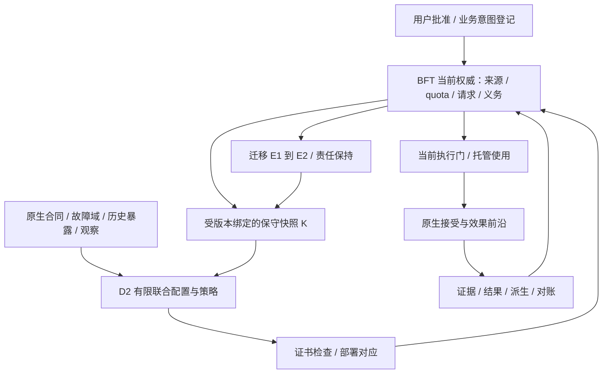

# D1 / D2 联合架构

2026-11-09。当前归类：带明确保持义务的工程集成；独立联合创新待严格分离。

## 1. 配置到运行

D2 的 DeployCert 绑定：模型摘要、原生版本及接受路径、组件与控制域、权限和秘密使用方式、失陷集合、观察合同、初始 K、配置/owner 版本、quota 与未决义务根、策略和终态后续保持规则。

D1 的 Release/Activate 只接纳经过验证且当前前提满足的 DeployCert。证书只承担它检查的模型内结论；执行资格仍由 Q 的当前事务产生。证据验证输出和部署证书均保留明确角色及作用域。

## 2. 运行会改变配置前提

完整秘密重建、返回可复用令牌、执行域失陷、共享管理员权限变化、Provider 版本/原生接受策略变化、成员重配、观察权限丢失均可能扩大 K 或攻击闭包。

每次潜在秘密交付在实际交付前创建暴露预留；成功或丢响应均保留 MaySeen。D1 的原生执行与迟到结果把变化写回 Q。新状态若超出 Cert 的已证明闭包，冻结相关新放行并重评。证书可预先覆盖一组允许未来状态；在闭包内的事件用已证保持引理继续执行。

## 3. 不可逆的历史与可恢复的支持

移除 E1、重分享份额和切换 TEE 版本均保留历史披露事件。新的原生撤销事实可以使旧能力失去接受路径；其历史事件继续用于来源与后代分析。所谓“重新变安全”依赖原生可达能力真正被切断。

UNKNOWN 义务可与独立 B 并行。若 A/B 共用需要暂停创建的对账窗口、撤销域或管理员权，则 D2 应报告真实可用性损失/不可行。重新配置可以加独立原生支持，但预建/发行/验证/恢复成本全计入。

## 4. 最小联合手工轨迹

|状态|D1 事件|D2 影响与允许动作|
|---|---|---|
|s0|A/B 独立批准，E1 获 task-specific 材料|Cert 覆盖两个独立原生域 uA/uB|
|s1|A refresh 放行，丢回复|Obl 含未知派生，K 同时包含未生效/已生效|
|s2|E1 失陷，A 撤回|Hist 加 E1 可能见过的材料；枚举全部可达刷新/登录路径|
|s3|PrepareMove E2|快照含全部来源/charge/Obl/Hist；冻结旧 owner 新放行|
|s4a|P 证明 uA 谱系截止，覆盖未知派生和旧发送|仍有 uB 独立支持则允许 E2 激活 B；效果载体另证|
|s4b|P 只撤销已知 AT，旧密码可再登录|保留 MODEL_BLOCKED/UNKNOWN；仅独立证书覆盖的 B 与善后权限可激活|
|s5|匹配效果前沿证据后关闭 A|逐 kind 关闭；新配置继续维持旧声明|

上述 s4a profile 为条件纸面对象，当前 Casdoor M6 的有限证据应按已有 scope 使用。以该轨迹为配置与协议接口的回归设计，执行授权另行审查。

## 5. 联合贡献审查

本轮联合性质是“每次新放行和接管保持配置前提、责任和历史”。它可由 G3 的同一证书/版本/事务组合获得，因此暂归工程集成。潜在进一步研究点：原生证据不足时的可实现边界、可核查 profile 导出、动态保持条件的结构压缩；每点需新实例和直接近邻比对，当前均为待核候选。
