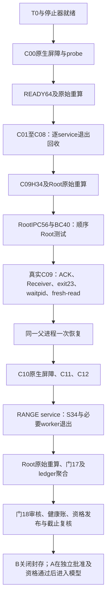

# 完整校准关键路径与时间模型

Material Passport：B09-AdmissionFix-static-1/r1；静态时间分析；当前完整耗时未知。

父slice最多4tasks，校准case按源码顺序执行。C00–C12共13个payload service，另有C09H与RANGE，共15；外部Root停止器1个。READY64复用C00票据，RootIPC56/BC40复用C09H上下文，新增ledger复用RANGE Root审核，均没有新增service。C09真实退出后由同一父进程验证并一次恢复；下一case前需要上一组为空。

|阶段|最少可核验动作/持久责任|等待与局部停止界|历史同范围耗时|
|---|---|---|---|
|启动|新T0/账、停止器握手、父slice|停止器握手原14秒；预检120秒另列T0外TCB|新r1未知|
|C00/C10|各真实8字段双次读、pidfd、再次确认、probe1|各自原14秒屏障，取较早全局/校准截止|batch08只有C00路径|
|C01|probe1、watchdog/组读取、结果与回收|受case/校准截止|历史正常结果存在|
|C02|entry1＋一次N=32,896持久范围；至少一次内存尝试；claim持久化|child最多240秒并受剩余case期限约束|旧child 2.578066/2.720971秒|
|C03|entry1＋一次N=4,096范围；成功路径4,096页扣减|同child截止与回收|旧成功记录存在，完整新版本未知|
|C04|entry1＋范围1＋第5任务请求|实际EAGAIN与pids.events；回收后续case|旧成功记录存在|
|C05|entry1＋18并发请求；局部17成功/1拒绝|线程join与同case期限|旧成功记录存在|
|C06|entry1＋就绪标记＋时间停止|case期限原2秒；原sleep20由监督器停止|旧成功记录存在|
|C07/C08|各entry1；控制器退出/kill watchdog及拒发|pidfd、wait、组空与停止响应|旧成功记录存在|
|C09H34|冻结204事件、34即时oracle、34 Root审核|共享C09H截止/5,000访问|旧版本有部分整体观察|
|IPC56/BC40|56/40输入与独立审核；必要顺序Root凭据子进程|Root probe alarm2、父等3、回收3；wait夹具原局部界|当前继承版本全套未知|
|真实C09/恢复|PREPARE→COMMIT/持久ACK→exit23→waitpid→fresh-read→恢复|原交接12秒及同T0+300；生命周期锁2秒|完整成功链未知|
|C11|entry1＋4个镜像故障＋4个恢复拒绝|实际持久屏障/故障触发；同case截止|完整当前版本未知|
|C12|entry1＋6个身份/关闭/入口拒绝|同case截止|完整当前版本未知|
|S34|每job初始化/故障/原件；最大2 actor；34即时及34 Root检查|worker启动5、join8、握手8，均再受校准截止|全套未知|
|门18|17旧负向；新健康控制/13异常/4mutant与Root重算|每次先收费并复核期限；原件读写仍需存储条件|新增路径未知|
|资格/停止|fresh账、Root保护发布、deadline复核、进程退出与封存|原清理/停止界；退出和fsync调度条件保留|新完整路径未知|

时间模型为：

\[T_{cal}=T_{start}+\sum T_{C00\ldots C12}+T_{READY64}+T_{H34}+T_{IPC56}+T_{BC40}+T_{S34}+T_{gate18}+T_{recovery}+T_{evidence}+T_{stop}.\]

case内部并发采用实际join的最长分支，外部case顺序相加。service正常结束与清理必须先于后继；C09监督器与Receiver交互按重叠区间计，形成完整流程的一部分。最终归档中属于资格发放后的行政封存开销单列，资格所需写证与发布计入300秒。

账操作粒度：普通payload单信用事务7个fsync，Root单信用最多9个，精确range预留9个，claim另2个。C02的32,896预付额度对应一次范围事务；局部扣减保持内存信用语义。全校准全局事务静态最多25,556，事务fsync最多230,004，另有claim最多6及辅助记录/心跳/快照/封存。新ledger原件与保护资格固定112次fsync；额外632个Root全局事务最多5,688次，新增合计约束部分为5,800次fsync。

这些原语计数没有给出单次存储屏障延迟上界。若以u_f表示可证明的fsync延迟界，尚须补齐调度、启动、读取/哈希及全部辅助持久化的界，才能完成Σn_f·u_f＋其余关键路径≤300的证明。每处timeout规定失败控制，完整成功完成的保证另需这些前提。
