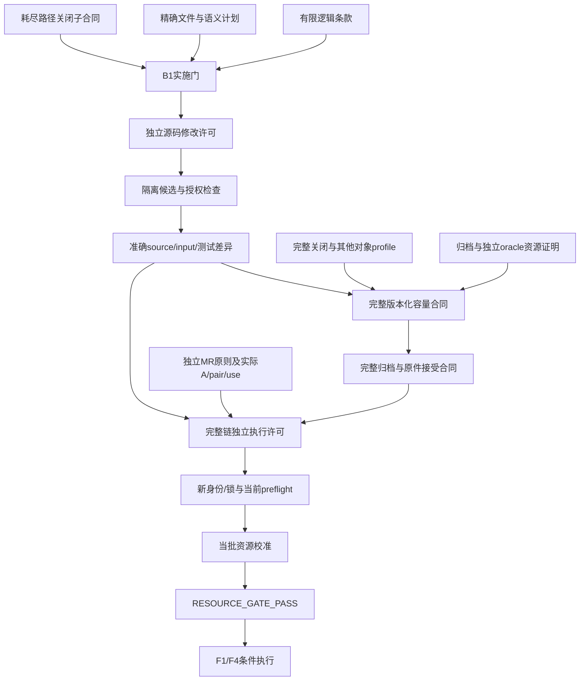

# 完整资格链依赖图

## Material Passport

DCL-R6-B1-ApprovalGate，B1-ApprovalGate/review-1，2026-11-16，Asia/Shanghai。本阶段完成合同、语义差异规划与实施准入审查。证据为冻结源码/输入、既有证明和两项分开执行的只读源审查。

旧成功验收目标维持CURRENT_CONTRACT_UNSAT。新B1局部实施门为B1_BLOCKED_BY_CLOSE_RESERVE，完整资格链还需要其他容量、归档、MR及新鲜授权输入。下图展示证明/审批和实际运行事实的产生顺序。[DEPENDENCY_GRAPH.json](D:/毕业设计/research_main_innovation/decentralized_credential_lifecycle/DCL-R6-B1-ApprovalGate/evidence/DEPENDENCY_GRAPH.json)

RESOURCE_GATE_PASS是校准结果。完整执行许可的静态申请需先具备相应限额/来源/监督/原件条件，获准后当前运行内完成校准，模型入口再核对实际PASS。该顺序避免把一个未来校准结果作为启动该校准本身的先决事实。[src/guard.py:530](D:/毕业设计/DCL-R6-isolated-verification/ra01/src/guard.py:530)

现有终态reader负责原件/身份/窗口/退出与既有ZIP验证，5秒属于该只读阶段。原生builder的运行时核查、停止等待和ZIP/hash另有工作量责任。行政30秒属于Linux child，host后层ZIP/hash也需完整合同。[src/terminal_evidence.py:193](D:/毕业设计/DCL-R6-isolated-verification/ra01/src/terminal_evidence.py:193) [src/guard.py:993](D:/毕业设计/DCL-R6-isolated-verification/ra01/src/guard.py:993) [host/startup_finalize.py:52](D:/毕业设计/DCL-R6-isolated-verification/ra01/host/startup_finalize.py:52)

当前B1图的直接缺口限定在必要停止信息保留与耗尽安全接线。完整容量中的其余null继续作为后层门记录。任何放行应引用精确子合同和边界，现有记录无法据此解除当前B1门。[B1_INDEPENDENCE_GATE.json](D:/毕业设计/research_main_innovation/decentralized_credential_lifecycle/DCL-R6-B1-ApprovalGate/evidence/B1_INDEPENDENCE_GATE.json)

RESOURCE_GATE_PASS=NOT_OBTAINED

F1=UNRUN_RESOURCE_GATE，F4=UNRUN_RESOURCE_GATE

MR_CROSS_INSTANCE_ADMISSION=PROPOSED_NOT_EFFECTIVE

STRICT_SEPARATION_INSTANCES=0，PASS_BOUNDED=[]，IMPLEMENTATION_GATE=CLOSED。
