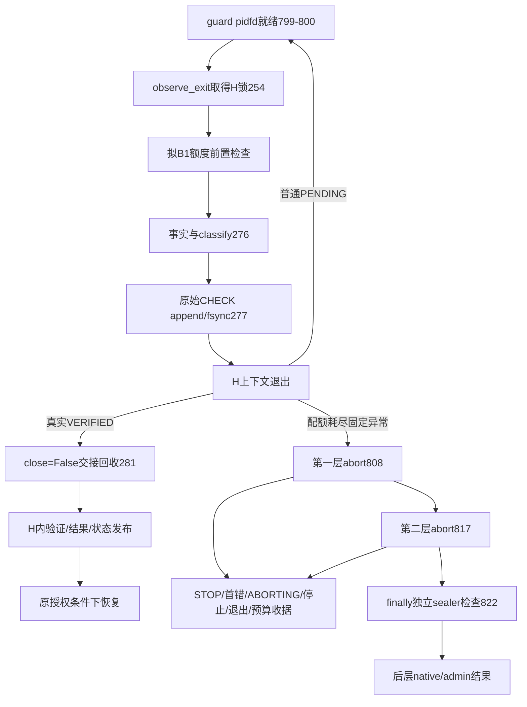

# B1真实关闭调用图

## Material Passport

DCL-R6-B1-CloseReserve-Contract，B1-CloseReserve-Contract/review-1，2026-11-16，Asia/Shanghai。证据为当前冻结文件、源码调用关系、字节语法和抽象失败轨迹。本轮DCL动态、原生故障和模型执行均为0。

当前64份源码/输入已先核对摘要。调用图逐节点记录函数、调用方、结果、前提、锁、原件、预算和失败出口。额度检查、cursor与EXHAUSTED属于待批B1语义，其接入点以原生真实调用路径固定。[INITIAL_CHECK.json](D:/毕业设计/research_main_innovation/decentralized_credential_lifecycle/DCL-R6-B1-CloseReserve-Contract/evidence/INITIAL_CHECK.json) [CURRENT_SOURCE_EXCERPTS.json](D:/毕业设计/research_main_innovation/decentralized_credential_lifecycle/DCL-R6-B1-CloseReserve-Contract/evidence/CURRENT_SOURCE_EXCERPTS.json)

|节点|函数/调用者|结果/前提|锁、日志和预算|失败出口|
|---|---|---|---|---|
|CG01|guard.main:1283 / external_stop:813，caller=frozen external-stop role entry|normal exit code or exception，Root current source/identity/authorization|none，existing stderr and final sealer outcome，no initialization by close path|top-level traceback/exit status|
|CG02|guard._external_stop_impl:771,799-800，caller=external_stop|observe_exit result，STOP_ARMED role, valid coordinator/sender identity, sender pidfd readable|no H lock at call site，STOP_ARMED already exists，no observe-loop global debit|except806 calls first abort|
|CG03|Receiver.observe_exit:252,254-261，caller=guard800|CLOSED/VERIFIED/PENDING or exception，current state and binding; quota gate is proposed|H exclusive lock，optional first EXIT_OBSERVED stage，proposed local debit only|context unwinds before caller except|
|CG04|proposed quota gate before facts/classify，caller=observe_exit proposed layer|new slot or denied/exhausted，identity, current stop state, cursor binding/remaining token|H held，cursor predebit, raw input references，burn slot on uncertain outcome|fixed AdmissionBlocked proposal, no classified257|
|CG05|classify:18 / observe_exit276 / event277，caller=admitted observe_exit|PENDING/VERIFIED/FAILED，one admitted classification|H held，full CHECK with raw facts, main LF/fsync，local allowance already reserved|write/fsync errors preserve partial bytes and leave uncertainty|
|CG06|lifecycle_lock:40-53 context exit，caller=observe_exit return/raise|unlock then close fd under normal syscall semantics，valid acquired fd and trusted kernel flock|H released before outer caller catches，none，none|unlock/close error or death handled as distinct failure responsibility|
|CG07|guard808 M.abort first layer，caller=except806|cleanup result or propagated error，H context already exited|MR close lock in record stages; H re-acquired only by stop path，STOP, first, delegate, ABORTING, marker/result, attempts/final，ledger read snapshots, no new visit|original exception re-raised809 or abort error propagates|
|CG08|guard817 M.abort second layer，caller=external_stop815|cleanup result or propagated error，first layer returns/raises into outer exception|same finite MR/H lock pattern，may append/rewrite while CLOSED and noZIP，no close-path global visit|raise818 then finally sealer branch|
|CG09|M.abort328 / guard.request_stop545，caller=both abort layers|shared cancellation file when persistence succeeds，STOP absent check occurs before mr_close lock|RootIPC file publication, not H serialization here，out/STOP_REQUEST.json, random private staging，no debit|STOP_PUBLISH note, shared marker may remain absent|
|CG10|M.abort355-366，caller=valid Root abort|first/delegate/intermediate data，current boot/window or terminal fallback authority|mr_close.lock; first exclusive O_EXCL，mr_first_failure, mr_external_closing, mr_close_state ABORTING，budget_before hash/size map embedded|FAILURE_PERSIST note, no guarantee record saved|
|CG11|M.abort372 / guard.stop_tree749，caller=primary cleanup|group empty result if confirmed，enough remaining existing window|H lock around CLOSED/event publication, then released，CLOSED or new stop_event; stop_result，none|marker errors recorded, manager fallback/UNKNOWN|
|CG12|M._stop_other_roots291-313，caller=abort385|known_other_roles_exited and target facts，protected registry and exact pidfd identity|no H lock while waiting/signalling，facts embedded in attempt/final state，none|ROLE_EXIT_UNKNOWN or targets not exited|
|CG13|guard1225 or1255 waitpid publication，caller=actual direct parent|raw wait status / code or missing witness，parent alive and child genuinely reaped|RootIPC publication，waitpid_<child>.json; C09 witness only before stopped，none|parent loss/missing storage => UNKNOWN, no fabricated status|
|CG14|M.abort390-400，caller=post-cleanup|CLOSED_CLEANUP_CONFIRMED or UNKNOWN，marker/group/role observations|mr_close.lock，mr_close_attempts line, replacement final state; caller_exit_pending=true，budget_after snapshot|FINAL_EVIDENCE note may only reach returned object|
|CG15|external_stop819-823 / M.seal414 / G.seal993，caller=outer finally|native digest or defer/error，CLOSED/group empty/other-role exits, read-ready evidence|mr_seal lock; terminal reader locks，terminal review/disposition/manifest/ZIP as applicable，read-only budget|native UNRESOLVED/partial; MR_SEAL_UNKNOWN stderr|
|CG16|P.post_exit_export412 / host.finalize52，caller=host after active client exit|admin/cleanup/native axes，new admin command authorized by prior run; actual quiescence|read-only runtime inputs，audit/copy/host streams/admin manifest/ZIP/final receipt，no T0 or budget creation|DEFERRED/UNKNOWN or failed admin archive|
|CG17|observe_exit281-295 / resume_admission323-347，caller=VERIFIED branch and admitted resumed scheduler|VERIFIED then optional source-approved RESUMED progression，genuine witness/ACK/resource checks and original once-resume predicates|H released before stop_tree(close=False), reacquired for verified/resumed publication，stop_result; handoff state; result_C09; batch_state; two stage rows already inmain，handoff counter conserved until admitted resume; later legitimate work belongs its own budget|existing exception wrappers, incomplete handoff/UNKNOWN if cleanup or publication fails|
|CG18|guard803-804 existing CLOSED result，caller=observe_exit stopped return|stop_tree(close=False), exit125，genuine STOP/CLOSED absorption observed at255|H released before cleanup，stop_result if generated, no CLOSED publication at this specific close=False call，no grant|existing wrappers/finally; a fabricated CLOSED return lacks this precondition|

直接返回EXHAUSTED时，801–805分支无法消费该新值，已就绪pidfd可再进入观察。其他deadline/异常仍可能结束循环，quota自身没有给该调用次数终止界。实际额外分类或日志是否生成取决于拟议额度门，当前冻结代码没有EXHAUSTED返回分支。[src/guard.py:799](D:/毕业设计/DCL-R6-isolated-verification/ra01/src/guard.py:799)

映射成CLOSED会调用close=False，仍尝试payload stop/empty确认，该调用不发布CLOSED，也未在该分支执行MR首错/共享STOP及Root角色回收。现有CLOSED吸收返回来自真实STOP/CLOSED存在判断。[src/c09_handoff.py:255](D:/毕业设计/DCL-R6-isolated-verification/ra01/src/c09_handoff.py:255) [src/guard.py:803](D:/毕业设计/DCL-R6-isolated-verification/ra01/src/guard.py:803)

唯一推荐语义是最后完整PENDING与拟cursor完成后抛出现有固定AdmissionBlocked，经H上下文退出交给808/817。正常有效fd语义下，lifecycle_lock的finally先unlock再close，outer except随后进入abort。unlock/close错误、Root死亡和kernel完成时延进入独立故障矩阵，释放锁事实需要对应前提。[src/c09_handoff.py:40](D:/毕业设计/DCL-R6-isolated-verification/ra01/src/c09_handoff.py:40) [src/guard.py:806](D:/毕业设计/DCL-R6-isolated-verification/ra01/src/guard.py:806)

RESOURCE_GATE_PASS=NOT_OBTAINED，F1=UNRUN_RESOURCE_GATE，F4=UNRUN_RESOURCE_GATE。

MR_CROSS_INSTANCE_ADMISSION=PROPOSED_NOT_EFFECTIVE，STRICT_SEPARATION_INSTANCES=0，PASS_BOUNDED=[]，IMPLEMENTATION_GATE=CLOSED。
