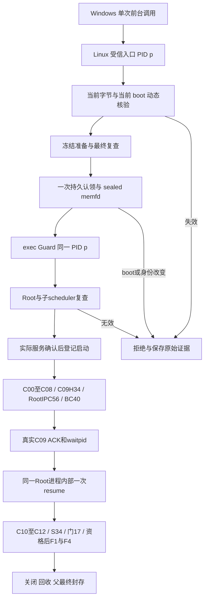

# 单次WSL入口与可复核启动交接

Material Passport：BootContinuity-static-1/r4；host离线静态修复；2026-11-11；WSL查询/目标执行0。

Windows前台入口只创建一次获准WSL子进程并等待，不运行keep-alive或新常驻服务。Linux入口在同一进程完成fresh检查、六条原准备命令、最终快照和资格认领，再以os.execve替换为Guard。PID/start_ticks与受控fd共同跨交接，切换发生在同一实例中。



前置进程exec后转为原Root父协调器，常驻进程增量0、systemd服务增量0。原scheduler、external-stop及RootIPC顺序探针TCB保持；Linux入口设AS1GiB，预检单独120秒上限，初始启动ticket最长10秒。运行T0仍由原Guard在预检后创建，总窗1800/校准300保持；预检TCB开销在T0之前单列，不能用来延长已开始的窗口。

单次原生入口：

```text
C:\Windows\System32\wsl.exe --distribution Ubuntu-24.04 --user root --exec /usr/bin/python3.12 -I -S -B /var/lib/dcl-r6/bc01/src/boot_continuity.py --activate --batch-root /var/lib/dcl-r6/batch07
```

Root实际exec argv仍为冻结Guard.launch_command，两个环境fd键由受信入口传递；所有直接Guard启动缺少有效凭据将拒绝。C09后不再发起另一次WSL命令；旧resume argv仅保存参考，不构成启动路径。

NoFalseStart分界：请求成功/exec接入只记录REQUESTED/ENTRY；[boot_continuity.py:330 service_confirmed](<../../../DCL-R6-isolated-verification/bc01/src/boot_continuity.py>)在ticket放行前观测实际C00/C10单位active、稳定MainPID、UID/GID/补充组、CapEff/NoNewPrivs、AS与cgroup匹配后才发布BOOT_START/BOOT_RESUME。该记录表示真实观测，资源资格仍需原完整链。

无法宣称全平台事务原子性。final check到exec之间的强制重启会杀死Owner并销毁cap；systemd成功但没有实际服务则缺少启动证明；同boot的特权文件/单位变更仍有检查间隙，依赖原可信部署/无并发特权更新及服务内重查。Windows记录器丢失不等价于Linux Owner必定退出；原独立停止源和deadline继续负责运行安全。严格实时延迟、掉电持久性和实际fd继承均待动态验证。
