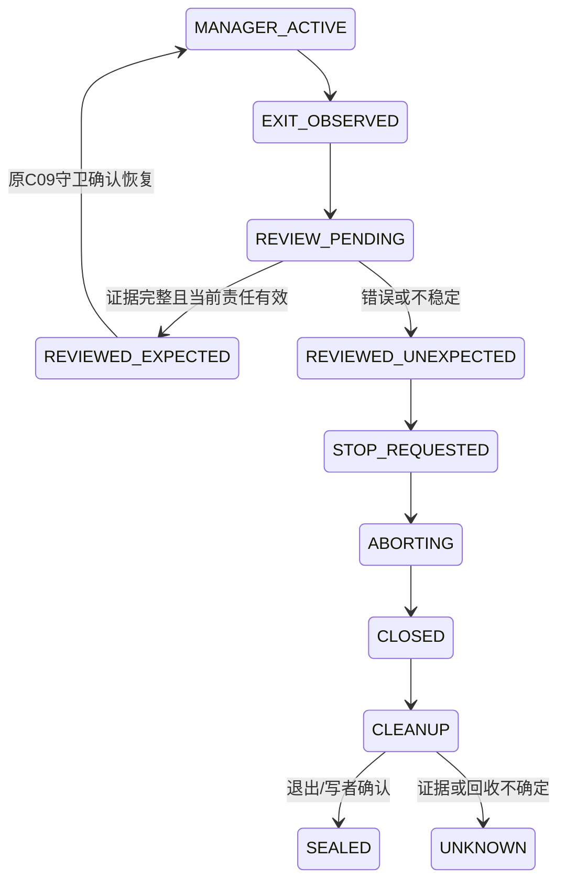

# 管理器事件审查状态模型

Material Passport：ManagerRecovery-static-1/r5；逻辑模型与原生接线；动态UNRUN。

模型分别描述systemd单位实例的退出事件、当前Root监督责任和关闭阶段。旧Sender退出可以成为已审查历史事实；当前Root/Receiver及恢复scheduler责任须由当下身份与窗口证明。

|状态|成立条件|可执行行为|
|---|---|---|
|MANAGER_ACTIVE|当前监督身份活着、boot/窗口有效|继续既有监督；该标签本身不产生恢复发放权|
|EXIT_OBSERVED|本批单位/InvocationID及实际退出状态已取样|记录实例、ticket和事件身份|
|REVIEW_PENDING|开始审查或证据/版本尚待核验|暂停恢复；在原窗口内至多2秒完成本次取样，错误/不稳定直接进入停止|
|REVIEWED_EXPECTED|全部类型特定证据、当前快照、来源、预算/期限、责任满足|生成唯一受保护event_id证书，允许后续原C09恢复守卫继续核验|
|REVIEWED_UNEXPECTED|身份/版本/来源/退出或当前责任违反约束|记录原始原因并进入统一失败关闭|
|STOP_REQUESTED / ABORTING|本地HALTED及持久STOP优先发布，首错固定|阻断新工作；保持原预算/原window|
|CLOSED|原CLOSED吸收标记已发布|迟到事件和恢复继续拒绝|
|CLEANUP / SEALED|退出与写者状态已确认；归档存在且摘要一致|结束当前诊断；未知退出保持UNKNOWN，单独保留caller_exit_pending|

审查证书的事件键包含当前binding、case、原始ticket/结果/启动捕获摘要及systemd实际退出快照，InvocationID区分同名重启。相同事件再次审查返回既有证书，新的实例冲突拒绝。日志可追加观察行，有效终态证书保持唯一。

恢复API对已完成的同一恢复返回ALREADY_RESUMED事实且dispatch=false；原Boot once/claim守卫继续阻断第二次调度。CLOSED检查优先于读取历史成功。manager原生审查直接读取OS和Root保护原件；MR-SIMULATION/1数据只用于隔离测试，不能替代原生启动捕获或当前恢复证书。

两次单位快照及failed集合书签提供版本一致性检查。跨systemd/文件系统的全局原子快照、任意并发特权改写和不可返回系统调用保持原TCB/故障模型边界。
