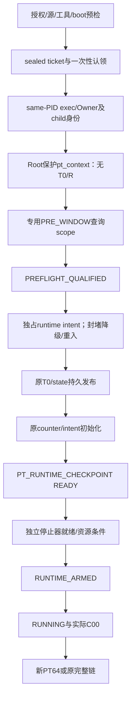

# 初始化依赖图与循环消除

Material Passport：PreT0Recovery-static-1/r3；静态依赖检查；动态UNRUN。

修复前的state→health→state循环已拆开：专用initial_query_scope通过活体sealed上下文检查当前身份、源/授权、Owner、STOP/CLOSED及原120秒TCB截止，完全不依赖运行state。M.query只有处于该认证scope时才调用预窗接口，其余仍进入严格运行检查点。

runtime intent在T0和counter前独占持久发布。任何后继失败保留该intent，不能以state文件缺失倒退到PRE_WINDOW。创建state之后、创建counter之前再次检查停止/阶段；失败路径保持已有部分原件，没有第二次init或免费重试。runtime_ready在原counter持久完成后核对新state、cap/magic/used0/COMMITTED intent，再发布运行checkpoint。

STOP_ARMED和父资源检查在真实state/checkpoint之后，RUNTIME_ARMED在工作服务之前。launch_one在systemd-run之前要求work gate，READY只能检查或启动停止源，校准/模型工作必须等ARMED/RUNNING。

[静态顺序检查](evidence/LIFECYCLE_STATIC_CHECKS.json) · [调用图](evidence/SYNTAX_CALL_GRAPH.json)。
