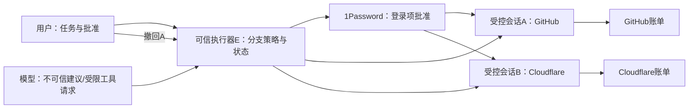

# 双站发票任务：场景、授权合同与撤销边界

SR-1；2026-11-07，Asia/Shanghai。公开文档、本地资产与纸面轨迹。没有登录真实账号、下载真实账单或执行撤销操作。引用ID、版本/定位、原文哈希见[sources/SOURCE_INDEX.md](D:/毕业设计/research_main_innovation/main_topic_selection/ae_scenario_reanchoring/sources/SOURCE_INDEX.md)。

## 1. 恢复原课题与本轮场景

2026-11-04详细计划书的工程对象是支持网站密码及OAuth的研究型凭据管理器；学术命题是认证关系/撤销效果不完全已知时，选择核验、配置和停止—保留策略，并控制诊断披露。现有A/B/AB、托管批准、持久状态和原生profile是资产，完整端到端AI密码管理器未由旧报告取得。[L01–L04]

本轮选定有文档依据的实例：

> 用户拥有GitHub账单访问资格和Cloudflare自助付费账户，令代理下载这两个指定账户中“开票日期属于2026-10”的原站点发票PDF并汇总；有效期T由用户指定。中途撤回GitHub分支，Cloudflare分支继续。

GitHub官方“Viewing payment history”提供按付款记录下载Receipt/Invoice；Cloudflare官方“Invoices”提供Billing→Invoices and documents下载。1Password合作方请求文档直接把“下载上个月发票”作为原因示例，并支持一个任务请求1至5个登录项。因此业务和代理登录需求有直接官方依据。[P03,P15,P18]

**实际证据等级：** 任务组成有接口与产品用例依据；这条双站撤销轨迹为纸面组合，本轮未实测。此需求的用户发生频率、人工负担和愿付代价没有真实工作负载数据。GitHub某账户若只有Receipt而用户要求法定Invoice，应报告缺失；不把收据自动充当法定发票。Cloudflare企业账单由会计团队发出，与本轮自助账单UI分列。

采用用户名/密码及可用TOTP登录。当前1Password for Agents不支持Passkey、SSO型登录项和共享vault；企业政策禁止个人vault时须改用获准企业接口/人工流程。可用性条件不能默认为已满足。[P01,P07]

## 2. 三种授权状态分别建账

|层|授权对象及边界|谁实际执行|
|---|---|---|
|用户任务许可W|某用户、run、站点、预期账户、invoice.download、开票月份、期限、数据保留|可信执行器E的用户认证、策略和工具边界|
|1Password连接/登录批准|OAuth client＋用户＋1Password账户的连接；用户选定的登录项|1Password、用户本地app、扩展；当前批准可复用30天|
|目标网站会话|登录账户、服务器会话cookie/站点令牌及本身权限|GitHub/Cloudflare；登录后生命周期由网站管理|

1Password的goal/reason用于向用户说明与建议登录项；keywords只排序、不过滤，未列字段被忽略。它们没有把月份、业务操作或T自动变成网站权限。批准项也未绑定某一聊天会话。任务限制必须在E或实际支持该限制的目标API执行。[P03–P05]

本轮把授权主体定义为E管理的任务运行与分支，不以模型名称作为安全身份：
\[
(\text{tenant,user,run,site,expected-account,runtime-session,policy-version,deadline}).
\]
E通过认证的用户会话建立该绑定，用受鉴权工具接口识别调用者；代理不能自行更改site/account/version。原网站仍只看到其账户会话，未据此得到模型实例或任务身份。

本轮W明确允许可信E读取完成筛选所需的登录身份及账单目录元数据，只下载/交付指定月的Invoice。若用户要求任何组件连其他月份目录都不能读取，这是更强的数据最小化合同，需原生筛选接口，当前未登记覆盖。

登录项由用户在1Password中明确选择。E在业务访问前核对实际账户；这能阻止错账户的后续发票操作，不能仅凭事后检查保证“从未对其他账户发起登录”。严格先验账户绑定需用户正确核对项、已验证的项映射或额外提交前校验，费用单列。模型物理实例的不可复制身份也未由上述run ID保证，本轮身份合同取受控任务运行。

这是标准工程绑定责任；现有项目caller/task/account/audience/generation与origin账本可作辅助审查资产，当前Casdoor适配器没有因此变成Browserbase/发票适配器。[L02]

## 3. 可执行的工作流组合与信任关系

基准选择两个独立Browserbase session，默认新用户数据目录、不复用持久Context。它是一份明确可行资源上界，未证明必须使用两个浏览器进程。强基线还可选择同等隔离/中介的本地浏览器context、原生API或网关；相关工程与信任成本均计入。[P08–P12]

**信任模型T₀：** 模型/其提示可能恶意，E、浏览器托管方及1Password扩展承担可信中介。模型仅获得受限的发票工具和过滤结果，不持Browserbase API key、CDP连接URL、1Password key/token、原密码或cookie，也没有任意CDP/evaluate/文件系统/出网接口。E的任务/站点适配、结果过滤、审计和故障处理是需实现/验证的集成工作，未被算作免费能力或本轮新主创新。

若把浏览器/执行器内存也交给对手，进入更强T₁；以下T₀保证不自动覆盖它。1Password官方安全说明明确要求信任agent developer及其控制的浏览器环境。[P02]

## 4. 完整纸面轨迹

符号G/C是预期GitHub/Cloudflare账单账户，不代表本轮已持有账号。E维护两分支的状态和版本；下表每步均区分文档能力DOC与集成责任DESIGN。

|步|主体、输入→输出|秘密/会话与可观察状态|控制接口及失败|
|---|---|---|---|
|0|用户给任务；E形成W并展示账户/日期/期限/保留含义→用户许可|W含账单账户标识和数据范围，无密码；模型只提出任务建议|DESIGN：用户鉴权、结构化参数核对。日期/账户不清则补问，不能由模型自授|
|1|E创建A/B分支、独立session及任务映射→运行ID/session ID|Browserbase API key/CDP URL只在可信侧；状态PENDING/RUNNING|DOC：Create Session；DESIGN：映射和deadline。启动失败该分支失败/待重试，另一分支不被撤销|
|2|用户连接1Password；E完成PKCE/state/回调→连接凭据|E保管client secret、AT/RT、integration key；用户账户密码/Secret Key留在1Password体系|DOC：合作方连接。key只首建交付，缺key/账号不匹配按官方恢复；不把空值覆盖旧key|
|3|E批量请求两个登录项；用户本地app解锁、选择/批准→grant references|一次请求可1–5项，能跨session续接同一连接；appLink有敏感请求信息；模型不能自批|DOC：createAccessRequest v2/approval。拒绝、漏授、额外无entryId项分别处理；只接受W对应项|
|4|扩展在A/B各填充并提交→网站登录|扩展/网站短时接触密码/TOTP；网站产生cookie。浏览器内存有AT和integration key，RT在backend|DOC：fillCredential v1。填充期间暂停模型读页/截图。多页/MFA/验证码需要续填或用户介入；fill_submitted后还须验证登录成功|
|5|E核对实际账户/账单实体→允许发票操作|grant按entryId匹配；网站账户cookie成为新的可复用权力|DESIGN：预期username/账户ID、账户选择器核对。匹配网站或keywords不等于匹配账户|
|6|A/B按原站点账单步骤检索2026-10→E下载并核验PDF日期/账单主体|浏览器可看到完整账单权限；只把W允许的PDF/字段释放给模型；下载URL、日志可能也敏感|DOC：GH/CF下载UI；DESIGN：两个站点adapter、只读动作和数据过滤。可复用下载URL保留可信侧，对外artifact句柄每次读取重查版本。只有Receipt/缺Invoice、日期歧义或页面漂移时报告|
|7|设A第二份下载在途、B仍执行；用户撤回A→E持久提交A inactive/new version|E可观察本地cut及所有已登记请求，不因此得知Native全部状态|DESIGN/项目已有成熟状态思路：后续A工具/新填充/结果释放均拒绝；排队动作派发前重查。此前已放行给远端的命令和已发送请求按在途处理|
|8|E停止A分支、丢弃A reference并请求释放session A→关闭待确认|原生cookie不会因本地drop reference自然失效；1Password共享连接保留以供B后续填充|DOC：REQUEST_RELEASE；DESIGN：所有A受控载体登记。200是请求回执，终态须再核对；失败保持“关闭未确认”|
|9|A旧版本响应/PDF迟到→隔离或丢弃；不再交付模型|网站可能已处理该在途请求；provider文件缓存/下载产物需单独保留策略|DESIGN：结果版本检查。不能用“已close”倒写成服务器未执行；禁止未确认状态重启旧分支|
|10|E取得A终态→仅声明受控会话停止；B继续|Provider COMPLETED表示session结束，不表示业务成功或所有cookie副本失效|DOC：Get Session/终态合同；DESIGN：停止ACK分层。网络/控制器故障时保持UNKNOWN，不靠超时升级|
|11|B必要时继续使用原B grant登录、完成下载与汇总→部分/完整结果|B的授权状态和cookie保留；A已交付数据按W保留政策处理|普通重试/故障恢复。没有B原生可用性或网络永久可达的无条件承诺|
|12|任务结束或deadline到达→停止B、释放环境、清理引用及产物|浏览器内存key/AT移除；backend连接是否留给后续用户任务须另经同意；下载/Context/录制分别处理|DOC：sessions/contexts及1Password disconnect；DESIGN：保留与清理。共享连接不能擅自全局删除；专用连接成功revoke后再删本地材料|

轨迹中的成功分支是来源支持的组合，未登记为一次实际运行。人工确认次数和停止时延见BASELINE；所有账号操作均未在本轮发生。

## 5. 材料暴露表

|主体|可持有/使用什么|保证边界|
|---|---|---|
|用户/1Password app|vault解锁材料、选定登录项；批准app/站点建议|当前支持个人/Families US账户、app≥8.12.42、Personal/Private项；Passkey/SSO/共享vault不在该入口|
|E backend|1Password OAuth client secret、RT、AT、integration key、references，Browserbase控制能力|这是可信高权主体；source key/token联合构成对该用户全部已批准登录项的持续使用能力|
|浏览器/扩展|AT与integration key在task内存；填充时密码/OTP；登录后cookie/localStorage等|当前无更窄session key。合法fill API不向应用返回密码，不等于恶意环境控制者看不到材料|
|模型/请求者|受限任务句柄、已许可发票数据/摘要|不交付秘密、CDP URL或任意浏览器控制；若授予这些能力须重审T₁|
|目标网站|用户凭据提交、站点会话及账单数据|原网站权限可以宽于“本月下载”；业务限制由E或原生精细API承担|
|模型服务提供方|实际送入模型的PDF/字段、提示|数据保留/训练条款另配；Browserbase关闭录制不控制模型提供方|
|Browserbase运营方|承载浏览器/扩展、会话数据及按配置保存的产物|可信执行边界；其ZDR设置、下载、Context、上传、扩展是不同对象|

HttpOnly cookie限制普通页面JS读取，不排除特权CDP/Context导出。Browserbase文档实际展示cookies()/addCookies()复制会话；模型若能使用该接口，T₀前提已改变。[P08]

## 6. 可观察撤销合同

按E的持久顺序/单调时钟区分：

“接纳/交付”均按E的授权释放事件排序；cut前已放行给远端的命令、已发送的数据可能在cut后才到达，作为在途单列。这里没有给出“用户点击后任何接收端都立刻收不到旧字节”的承诺。

- **c_A：本地撤回提交。** 此后E不得接纳A的新工具或新填充，不向模型释放A旧版本的迟到结果；恢复不回滚版本。
- **r_A：释放请求回执。** 仅证明Browserbase接受请求，不表示原生cookie失效。
- **a_A：受控停止确认。** E依据真实session终态和自身载体清单，确认受控A运行环境结束，并已阻断旧分支。没有终态或清单不全时只能“未确认”。
- **n_A：网站原生会话撤销确认。** 需要GitHub等实际服务器会话接口；与c/r/a不同，不由1Password断开或浏览器退出代替。

主要验收合同C_exec：

1. c_A之后没有被E新接纳的A动作/填充，也没有旧版本A结果的新交付。
2. a_A之后受控A浏览器不再启动新请求；此前已派发或在网络中的请求按在途处理。
3. B未被撤销，可在服务/执行器可用时继续；故障可重试，未要求全前缀无停顿。
4. 密码、cookie和控制能力不进入请求者；全部可用路径受E中介。

强化C_native要求撤回后所有原生可用副本及派生路径都失效。它需要服务端撤销/完整中介/确定过期等实际依据，见BASELINE。C_exec下禁止代理持有受控边界外cookie副本；允许副本的轨迹不能拿来反驳这个前提明确的强基线。

**数据：** 已取得并已交付的数据按用户保留合同处理。撤销访问不能保证模型遗忘；撤销后才到的未交付PDF可由E隔离。已发送请求不能被写成“从未发生”，撤销也不回滚历史业务。

## 7. 信任、故障和残余保证

|情况|仍可保证/必须记录|
|---|---|
|恶意模型要求别的站点、月份或账户|在受限工具/参数与身份绑定下拒绝；自然语言goal本身无强制力|
|浏览器可被代理任意CDP/内存访问|cookie和1Password广泛连接材料可能复制；T₀保证不能移用到该T₁|
|E崩溃/响应丢失|已有持久cut继续阻止旧分支；已派发/释放结果未明则保留UNKNOWN；B可恢复，不宣称故障期间连续可用|
|网络延迟/服务端已接受请求|local cut不能回滚；只有受控交付检查能阻止迟到新数据进入模型|
|Context存在|删除Context只阻止后续用它建session，不能代替关闭已有session；旧cookie可能仍在网站有效|
|单个session结束|COMPLETED也可由脚本崩溃断连产生，不能当作发票任务完成|
|1Password整连接revoke|会使所有批准的未来fill失效；已登录B可能仍能继续，需再登录的B会受影响|
|只改导航策略|当前session保留启动时策略；即使新版策略对iframe更强，也不检查XHR/fetch/WebSocket，不能当运行中请求围栏|
|原生网站/托管方不提供可判定终态|保持条件性/未知；不凭本地ACK签发Native全关闭结论|

## 8. 与旧项目证据的对应

MR-1的CD425-M203-ORIGINAL（Casdoor4.25.0）中，旧本地批准撤回后新放行被拒，known A0处置；未知后继A1仍可原生接受，B继续。它直接排除“本地ACK/已知清单阴性＝Native完整世系退役”的旧映射。它没有实测本轮浏览器场景。[L02]

当前B停止菜单只有revoke/close/gate，不能加入新的任务—根支持；共享根的原子迁移、完整后继关闭与空根计费也未成立。保持M1_NOT_REFINED_BY_CURRENT_PROFILE。普通隔离、托管、版本门控及已知逐项处置属于强基线，不能改名作为新增机制。

本轮双站任务可以按既有站点/账户边界隔离，停止A无需把B跨服务迁到另一凭据根。原理想原子重绑定合同不作为这个场景的默认能力。

