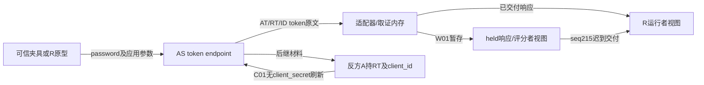
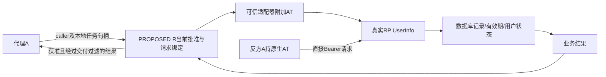
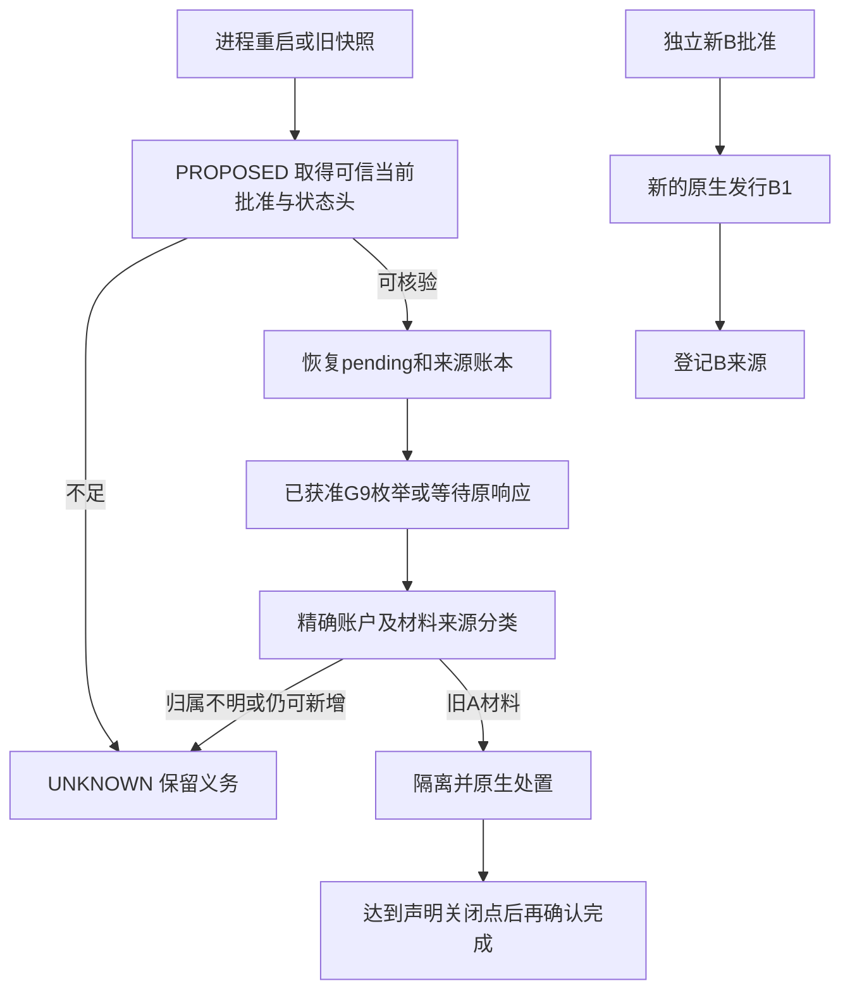

# 完整接受路径与最后接受权

选定资源为Casdoor UserInfo，选定派生接口为该版本的password/refresh_token路径。图中的OBSERVED/SOURCE表示现有证据，PROPOSED表示主合同要求。任一图均不代表新增实现。

## 1. 签发与刷新

AS验证原生应用、材料有效性、用户/账户与scope/resource等条件。当前流程不向AS提交本地主体A/B及批准g0/g1。运行者在held交付前只知道pending。评分者已知材料真实存在不能代替R观察。

P-MED要求每个新登录、刷新、重试和恢复再激活都先经过R当前批准检查。R把精确task、caller、account、audience、operation、来源、批准代次和attempt绑定到持久pending，再进入真实派发边界。实际网络提交与本地事务之间的未决结果保留。

当前Gate.call仅把操作许可和预算检查置于锁内，HTTP dispatch在锁外执行。它没有生产式任务身份/批准代次的原子接纳协议。该发现限定为所需保证未实现，现有固定轨迹没有提供并发撤回窗口下的漏洞证明。

## 2. 资源接受

UserInfo的最后接受权位于Casdoor。auto_signin_filter取得Token记录，检查期限及用户状态，DPoP-bound类型另走证明校验，然后GetUserinfo构造主体信息。原生接收端没有读取R的本地任务批准。

观察者额外核验JWT签名、issuer、audience和期望sub，这些检查不应被误写成每一项都已经在生产R接纳路径中执行。当前L1资源fixture的use分支检查closed，remote分支绕过该本地集合并调用Witness。两者是可控实验路径，原生UserInfo观察单独登记。

| 路径 | 当前批准验证者 | 任务/账户/受众/调用者绑定 | 退役执行点 | 最后接受权 |
|---|---|---|---|---|
| 当前普通发行/刷新 | 实验流程及Gate，生产批准服务未实现 | AS原生字段，实验任务关联由源码/日志提供 | token-specific revoke影响对应记录 | AS |
| P-MED拟议原生调用 | R，真实派发前当前版本核对 | R完整应用绑定，加AS/RP原生绑定 | R停止新派发并处置在途/已知材料 | 本地派发由R决定，原生接受仍由AS/RP决定 |
| P-EXPORT直接刷新 | R无法检查绕过请求 | AS按RT/application/resource等原生条件 | AS撤销或其他实际接收约束 | AS |
| P-EXPORT直接UserInfo | R不在路径上 | 原生AT对应记录及用户，不含任务批准代次 | RP读取已撤销状态或验证发送者约束 | RP |
| 当前Resource.use | closed集合及原生/模拟观察 | task路径加AT匹配，没有独立代理身份协议 | 本地closed | 实验fixture |
| 当前Resource.remote | 不读取closed | 同上，之后按Witness模式判断 | native revoke或模式各自的规则 | 实验fixture，不能外推任意RP |

同一auto-signin过滤器还识别accessToken/access_token参数、应用凭据、accessKey/accessSecret、已有会话及受条件限制的用户名/密码入口。本轮仅把这些列为源码可见路径，具体到UserInfo的配置和完整端到端符合性没有新增采样。原生请求型凭据的清单因此覆盖多种获取/使用方式，生产闭包需要逐一确认。

本地签名回执可认证R作出的声明。除非AS/RP已经实现验证该回执并据此拒绝的协议，它不改变Bearer的原生接受规则。

## 3. 恢复、重新授权与迟到材料

该恢复图是拟议合同。N01/W01已有B重新发行和迟到结果来源分配，实际控制器崩溃、快照恢复、批准UI和防回滚头未运行。A1按其原A请求和批准归属处理，B新批准不会把A1改成B1。

恢复出有效旧签名、旧token或旧数据库行，只证明某个历史对象仍能验证。当前批准需要独立新鲜来源。缺少该来源时，两段不同撤销历史可能给出相同旧快照，R无法仅凭它决定当前批准。

## 4. 成熟接收端机制

这些机制作为同条件能力目录，不增加第三个被测profile，也不自动启用。

| 能力 | 标准及本轮核读位置 | 当前实现/配置证据 | 对闭包的作用范围 |
|---|---|---|---|
| Bearer | RFC6750 §1.2、§2 | 本批AT为Bearer，UserInfo实测接受 | 持有原文者不必证明私钥，R控制需要材料托管或原生失效 |
| 撤销 | RFC7009 §2.1—2.2 | per-token撤销及已知子代收尾有实测 | 200不能独自证明整族失效 |
| 内省 | RFC7662 §2、§4 | 当前客户端内省已有观测 | 查询者、时点、缓存和资源契约均需保留 |
| DPoP | RFC9449 §4.3、§5、§7、§11.1—11.2 | token_dpop.go及UserInfo分支存在，本批没有DPoP请求或密钥 | AS和RP都须验证绑定、请求与重放条件。旧Bearer不会因本地签一份证明自动受约束 |
| mTLS | RFC8705 §2、§3、§7.1 | 本批为HTTP，mTLS部署未核验 | 客户端认证与证书绑定AT是不同功能，RP须验证证书与token的对应 |
| 旋转及发送者约束 | RFC9700 §2.2.2、§4.14.2 | 旋转开启，C01后继仍可用，完整族状态未由接口承诺 | 不能仅由“启用rotation”推出持久family关闭能力 |

DPoP绑定方法、URI、token和密钥，其标准URI比较排除query/fragment。精确业务参数和本地批准仍需另外绑定，不能从DPoP验证成功推出整个业务意图已经获准。所测UserInfo为明确的只读资源，其他业务RP的效果条件另行审计。

发送者约束证明的是相应密钥或请求证明的可用性。若私钥也交给A，A仍可生成证明。若R持钥却向A提供无审批的签名服务或可保留的预签证明，同样需要检查其接纳窗口和在途范围。现有源码分支不等于完整RFC符合性、重放持久性或实际启用证明。

标准原文已保存并哈希固定。本轮仅作定向核读，运行符合性继续未决。[RFC6750](https://www.rfc-editor.org/rfc/rfc6750.txt) [RFC7009](https://www.rfc-editor.org/rfc/rfc7009.txt) [RFC7662](https://www.rfc-editor.org/rfc/rfc7662.txt) [RFC8705](https://www.rfc-editor.org/rfc/rfc8705.txt) [RFC9449](https://www.rfc-editor.org/rfc/rfc9449.txt) [RFC9700](https://www.rfc-editor.org/rfc/rfc9700.txt)
