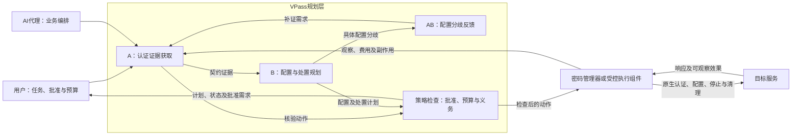
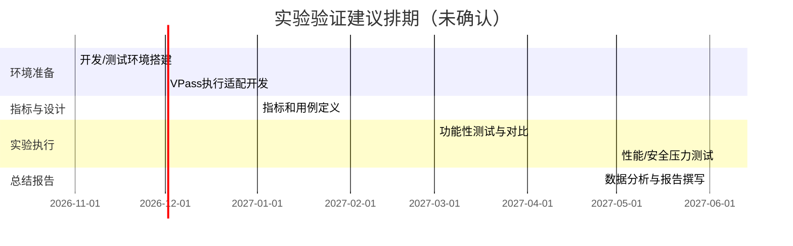

# 执行摘要

面向 AI 代理的认证与委托，各方案关注凭据保管、授权使用及运行时控制。VPass 当前研究进一步将认证语义获取、凭据配置、任务停止与保留要求纳入同一有限模型：A 在批准和预算约束下获取证据，B 生成满足生命周期约束的配置与处置计划，AB 利用配置分歧协调补证。其已有成果包括算法原型、有限精确参考、可检查证书和开发验证；端到端产品能力及总体算法优势仍待验证。

本文保留原报告的产品对照结构，并按最新研究材料修正 VPass 的定位、比较表和架构说明。凭据注入、加密存储和 MCP 接入各有不同的安全边界，不能仅凭这些机制名称推导模型始终不可见凭据或远端会话已经撤销。

**版本与证据说明（2026年11月3日修订）：**本文将当前 A/B/AB 研究方案称为 VPass，依据[《A、B与AB三项算法研究报告_v1.1_密码学机制融合版》](D:/毕业设计/研究/主线与密码学机制融合_2026-11-03/A、B与AB三项算法研究报告_v1.1_密码学机制融合版.docx)第2—11、13—18节更新。文中区分已有有限模型原型、方案设计和待验证产品能力；本次没有重新运行实验。其他产品描述及其评分沿用原稿，尚未在本次修订中逐项核实，不应作为已经核验的产品事实或性能排名。

## 1. VPass 关键设计点

- **架构与分工**：用户确定任务目标和批准，AI 代理组织业务，VPass 规划层处理认证证据及配置，密码管理器或受控执行组件调用目标服务的原生认证接口。已有本地有限模型算法原型；最终本地、云端或混合部署尚未冻结。
- **研究 A：风险受限的认证证据获取**：维护非空可能状态集合 K，将观察、真实状态变化、批准、共享预算、核验副作用和未决义务纳入有限决策步策略。空 K 不被解释为成功；响应丢失不被解释为未执行。
- **研究 B：生命周期约束下的配置与委托规划**：统一考虑任务、账户、原生授权范围、共享代理、隔离环境、独立授权、停止目标及保留任务。主要资源目标 G 按原生语义确认的独立撤销单元计数，不按 token 字符串计数；最小 G 也不等于所有权限维度都最小。
- **研究 AB：配置冲突驱动的补证协调**：将具体配置分歧反馈给证据获取过程，研究查询与配置、停止、清理的共同代价。已实现的静态下界存在适用条件，有状态核心传递仍是待证明、未实现路线。A、B、AB 不是将密码转为可验证凭证的三种密码学算法。
- **凭据保管与模型暴露控制**：方案分工将秘密保管和实际使用交给密码管理器或受控后端，以减少凭据进入模型上下文的需要。当前材料未建立新保险库的加密、同步和密钥管理保证，也未证明所有运行路径中代理绝不接触明文。
- **授权、审计与可撤销性**：批准与预算是动作约束；停止与保留要求是配置可行性条件。已有有限模型证书、检查器和可复现运行记录。真实访问令牌、会话及共享授权根的撤销效果仍须原生证据支持，研究日志也不等于生产级防篡改审计系统。
- **身份认证及兼容性**：依赖目标服务原生能力，实际账户和凭据接受语义需要核验。TOTP、WebAuthn、硬件密钥及通用 MCP/浏览器接入尚未完成全面适配验证。
- **辅助密码学机制**：结构化私密诊断提供受限模型的手工论证、小域证书检查和本地参考结果；PublicDiagnosticEvidence 仍为未安装的接口提案，不能授权执行、证明真实来源或代替原生撤销语义。尚无强独立密码学原创性和端到端成本优势证据。

当前 A2/A3、B2/B3、AB2 已有研究原型；局部改善可被通用精确参考复现，B 的总体加速和 AB 的净收益尚未建立。H-A、H-B、H-AB 保持未正式检验状态。

## 2. 国内外主要方案现状

> 本节保留原稿的产品调研描述，尚未逐项补齐官方版本、原文链接和运行证据。发布时间、集成范围、保密保证及商业状态均需另行核验。

### 2.1 国外代表方案

- **1Password for Agents**（2026年10月发布）  
  1Password 推出了“1Password for Agents”功能，构建了一个信任层，允许个人AI代理在不见到或存储密码的情况下使用用户凭据。其流程为：当代理遇到登录表单时，使用唯一数字密钥向1Password云验证身份；用户在自己的设备上看到哪个凭据将被使用并批准；然后1Password将凭据直接填入登录表单，代理仍继续执行而凭据不会暴露给模型。该方案采用云端Vault存储（零知识加密），用户同意后动态注入登录表单，密码信息始终保留在1Password中。支持包括Meta Muse、Anthropic Claude、OpenAI等多个AI助理的集成。优点是成熟厂商支持、多平台集成、支持多因素认证（其产品已有2FA/TOTP等支持）、细粒度控制（审批机制）和审计功能。缺点在于依赖云服务，需用户和代理都使用1Password生态；代理批准需人为交互，无法完全无人干预；且部署成本（付费订阅）较高。

- **Bitwarden MCP Server**（2025年上市）  
  Bitwarden 推出 Model Context Protocol (MCP) Server，在本地环境运行，提供AI代理与Bitwarden密码库的安全互通。其特点是“local-first”架构：凭据保留在用户设备上（零知识、端到端加密），MCP服务器充当桥梁，让AI代理可按需访问和检索密码，而无需暴露给模型。代理可以像工具调用一样，经MCP协议获得登录信息；凭据可以加密托管、自托管部署。MCP标准统一了AI与外部工具的数据交换接口，减少定制工作。该方案保证了令牌管理、凭据不会泄露（代理不保存明文），并具有本地化部署优势（可脱离云端），适合对隐私要求高的场景。缺点是需要部署和维护Bitwarden基础设施，与1Password相比生态和商业支持较弱；用户体验相对复杂（需要配置MCP服务器）；支持的代理生态正在建设中。

- **Agent Vault (Self Labs)**（2026年10月媒体报道）  
  美国金融科技创业公司Self Labs 推出了Agent Vault服务，专注于金融场景下AI代理使用密码的安全问题。该服务的关键技术是“凭证与支付层”，将用户的支付和登录凭证安全存放在保险库中，仅当代理执行交易时才注入凭证给登录表单。换言之，代理在执行任务时可以代表用户登录并完成交易，但无需直接获取原始卡号或密码。Agent Vault连接不同的AI助理（如Muse、Claude、Codex等），以保护银行账户登录安全。这种模式类似于1Password/Bitwarden：凭证安全托管在Agent Vault云端，仅在必要时代理触发使用。其优势在于专注金融合规（银行认可读写隔离，仅允许只读接入且不移动资金），业务适配度高。劣势是依赖公司云服务，费用模型基于订阅（免费额度与付费方案），并且主要针对金融场景，对一般Web登录的通用性待观察。且目前是较新产品，成熟度有限。

- **Agent Vault (Infisical)**（2026年4月开源发布）  
  Infisical 推出了开源的 Agent Vault 工具（见），用于API密钥管理，使用HTTP代理拦截代理访问，将真实凭据注入请求。其原理是将代理的网络请求透明代理到凭据保险库，代理从不看到真实密钥。虽然主要用于API调用（如Anthropic/GitHub密钥），原理同样适用于密码管理：凭证存储在保险库，代理通过设置HTTPS_PROXY等方式透明调用，凭证由Agent Vault附加。这种方案的优势是开源、可自托管、支持精细访问控制（白名单、日志审计）。对比1Password/Bitwarden，更灵活但需要自行部署运维，且当前着重网络层代理而非浏览器自动填充。

### 2.2 国内代表方案

- **腾讯云 AI Agent 安全基座**（2026年6月发布）  
  腾讯云提出了“AI Agent 全栈安全基座”解决方案。其中提到：通过原生集成、全链路防护与零信任架构，建立基于用户ID+智能体ID的细粒度授权体系，解决机器代理身份的盲区；并提供“服务凭据管理”，对后端服务凭据进行加密托管、网关代理（可用不可见），支持使用临时凭据替代长效凭据。这意味着代理执行任务时，可以通过网关使用被加密托管的凭证进行登录或API调用，而代理本身无法直接获取密钥内容。该架构还包括运行时安全、提示词安全过滤和会话审计等模块，对敏感数据（如密码、密钥、身份证等）进行实时检测与脱敏。优势是体系完备、符合企业级合规要求，支持与现有SSO/OAuth体系对接。劣势是目前主要在云环境中运行（云端安全网关），用户需引入腾讯云生态；对个人应用或开源社区的支持尚不明确；商业化产品状态未知（目前偏概念和实验室阶段）。

- **字节跳动、百度、阿里、智谱等**  
  截至目前暂无公开报道表明其他国内厂商推出专门面向AI代理的密码登录方案。智谱、阿里巴巴等主要聚焦大模型和云服务，并未公布类似的凭据注入服务。猜测传统密码管理器厂商在国内尚未快速跟进代理场景。阿里和腾讯已布局企业云安全，未来可能推出相应产品。

## 3. VPass 与现有方案的比较分析

下表按原图的“**方案特点**＋简短评价”格式展示13个维度。VPass列依据当前研究材料填写；“优（模型设计）”仅表示机制在声明模型中的设计特点，不表示相对商用产品的实测优势；“中（原型阶段）”表示仍需适配；“待验证／待集成”保留缺失证据。其他产品列沿用原稿，不能与VPass的有限验证状态直接合成为安全或性能排名。

| 比较维度 | **VPass** | **1Password Agents** | **Bitwarden MCP Server** | **Self Labs AgentVault** | **腾讯云 AI-Agent 安全** |
|:--------|:---------:|:-------------------:|:----------------------:|:----------------------:|:----------------------:|
| 架构模型 | **分层受控架构**（AI规划＋密码管理器执行） *优（模型设计）*：目标、批准与执行分离；已有本地算法原型，部署形态待定。 | **云+客户端**（托管服务+客户端填表） *优*：全流程云端托管，用户轻部署。 | **本地/混合**（本地运行MCP，支持自托管） *优*：本地化，可自托管。 | **云端服务** *中*：用户调用云端API完成注入，需联网。 | **云+网关** *中*：企业内云端服务，依赖腾讯生态。 |
| 凭据存储 | **密码管理器／受控后端保管**（方案分工） *待验证*：规划与秘密使用分离；加密存储及密钥管理依赖所接后端。 | **加密云Vault**（零知识） *优*：凭据加密存储；无明文泄露。 | **加密本地Vault** *优*：凭据零知识加密，本地库。 | **加密云Vault** *中*：据说安全储存，但无开源细节。 | **加密网关托管** *优*：加密存储后端，支持硬件隔离（假设）。 |
| 授权流程 | **任务授权＋批准预算** *优（模型设计）*：核验、配置与处置均受批准和预算约束，并考虑批准撤回与核验副作用。 | **用户审批**（数字密钥+用户同意） *优*：操作透明，安全审计。 | **用户配置/授权**（CLI或MCP集成） *中*：需要配置，较复杂。 | **动态注入**（按需注入，无用户交互） *优*：自动化，只在交易时注入。 | **动态凭证**（短期凭证+代理签名） *优*：支持临时凭证授权，无需人交互。 |
| 模型泄露风险 | **凭据隔离使用**（设计目标） *待验证*：减少原始秘密进入模型上下文；尚无端到端“绝不接触明文”保证。 | **低**：代理绝不接触明文凭据。 | **低**：加密存储，MCP注入形式，不泄露凭据。 | **中**：凭证短暂注入，理论可能被截获，需要网络TLS等保护。 | **低**：后端托管，代理仅调用网关API，不持有密钥。 |
| 身份认证/MFA | **原生认证适配** *待集成*：核对实际账户与认证语义；通用TOTP、WebAuthn及硬件密钥支持尚未验证。 | **支持**：1Password已有多因素验证，可用于额外用户验证。 | **支持**：Bitwarden 支持TOTP、密钥等，可用于解锁Vault。 | **未知**：文档未提，推测可结合外部OTP。 | **支持**：兼容OAuth/OIDC等，可集成企业MFA方案。 |
| 最小权限与细粒度 | **任务级生命周期约束** *优（模型设计）*：关联账户、原生scope、支持路径及停止／保留要求；控制粒度受服务能力限制。 | **中**：只能审批单次登录，缺少细粒度策略。 | **高**：可为每账号设置访问规则和作用域（按MCP规范）。 | **中**：仅按交易注入，缺少账户级别策略。 | **高**：支持基于用户+代理身份的精细授权，服务凭据可限定权限。 |
| 审计与可撤销性 | **语义化撤销＋可检查证书** *优（模型设计）*：区分本地／远端停止，检查保留任务与清理义务；原生撤销效果仍需补证。 | **优**：1Password后台提供操作日志，可撤销代理密钥。 | **中**：Bitwarden企业版可审计MCP调用；支持手动锁库。 | **未知**：未公布审计细节。 | **优**：设计中包含会话审计与访问控制，支持实时阻断及审计日志。 |
| 部署兼容性 | **接口适配式集成** *中（原型阶段）*：已有本地研究原型；接入真实服务、浏览器和密码管理器仍需逐项适配。 | **优**：与主流浏览器、SSO集成；支持多平台App。 | **中**：需运行MCP服务器，兼容所有MCP客户端。 | **中**：Agent生态整合较新，主要针对聊天/交易类工具。 | **中**：主要支持腾讯云环境与企业SSO，个人部署门槛高。 |
| 性能 & 延迟 | **完整成本规划** *待验证*：同时计入外部请求与求解开销；已有局部改善，但尚无总体速度或端到端成本优势。 | **中**：涉及云端通信和人工审批，延迟略高（但用户可离线授信）。 | **优**：本地部署，响应快；但首次配置需手动。 | **中**：需网络调用云端，交易前才获取凭证，有短暂延迟。 | **中**：网关架构多环节（认证、加密），延迟适中；适合企业批量场景。 |
| 用户体验 | **目标驱动委托**（设计目标） *待验证*：用户设定任务、批准与停止要求，系统规划配置；尚无完整产品可用性测试。 | **中**：需在手机/浏览器确认授权，增加操作；但整体无缝登录。 | **中**：需安装和授权客户端，技术门槛高；自动化集成待完善。 | **中**：使用代理卡概念简便，但需了解额度和方案规则。 | **中**：对最终用户透明，由企业IT配置，个人感觉到中规中矩。 |
| 合规与隐私 | **证据作用域＋受限诊断隐私** *待验证*：约束证据复用与信息披露；尚无完整系统隐私证明或法规合规认证。 | **优**：1Password符合GDPR等合规要求（欧洲注册），数据加密。 | **优**：自托管可符合区域法律；加密存储保护隐私。 | **中**：美国服务商，须评估金融监管和隐私政策。 | **优**：定向企业级方案，可根据中国等法规设计合规控制。 |
| 攻击面 & 缓解 | **保守状态更新＋有限步安全策略** *优（模型设计）*：处理错账户、响应丢失、预算不足及义务遗漏；真实部署防护仍待验证。 | **优**：密码永不暴露；需防范1Password账户被攻破。 | **优**：MCP服务器可隔离，需防范本地设备被攻破。 | **中**：云端服务需防攻破；网络代理若配置不当可能被绕过。 | **优**：零信任网关加持；含恶意指令检测；代理凭证不可见于进程。 |
| 产业成熟度/商业模式 | **硕士研究原型** *低（产业成熟度）*：已有算法、参考求解器及复现测试；尚未商业化，商业模式未确定。 | **中**：新功能（2026），1Password底层成熟；付费订阅制。 | **中**：MCP刚推出（2025），Bitwarden成熟免费；企业付费服务。 | **低**：新创公司产品，正处种子阶段；免费和低价试用。 | **中**：概念级产品，未商业化；基于大企安全需求定制化服务。 |

**说明：**VPass的能力边界以第1节及研究来源为准，有限模型测试不等于一般安全证明或产品验收。表中的设计评价不是实验评分；未取得证据的能力不按一般情况推断为已支持。其他产品列保留原稿措辞供后续核验，尤其不能由加密存储推出运行时不泄露、由MCP推出细粒度授权，或由锁库推出远端会话已撤销。

## 4. 主要参考来源

1. **PChome 科技新闻 – Self Labs Agent Vault**：报道了 Self Labs 的Agent Vault如何将用户支付与登录凭证存入保险库，仅在代理执行交易时注入凭证，从而在不泄露卡号密码的情况下完成交易。
2. **TechIntelPro – 1Password for Agents**：及说明1Password的Agents功能架构：代理到达登录表单时使用数字密钥验证后，用户批准后由1Password直接填写凭据，代理始终看不到密码。
3. **Bitwarden 官方博客 – MCP Server**：介绍Bitwarden MCP Server本地优先架构，使AI助手可在用户设备上访问和管理密码，凭据始终加密存储在本地（零知识）。
4. **CIO Influence – Bitwarden Agentic AI**：发布BitwardenModel Context Protocol (MCP) 服务器，强调本地-first架构和零知识安全，标准化AI与工具的交互，同时保持端到端加密和本地部署。
5. **腾讯云开发者社区 – AI Agent 安全基座**：分析腾讯云AI-Agent安全架构，阐述“服务凭据加密托管、网关代理”等功能，以及兼容OAuth/OIDC的零信任认证体系。
6. **AgentID 博客**：提出AI代理登录问题：传统登录假设人类，AI代理会以用户身份完成密码/OTP流程，难以区分；AgentID为代理提供独立OIDC身份和签发token，解决代理身份验证问题。
7. **Nango 博客**：介绍“Token Vault”概念：AI代理凭据存储与管理在独立服务中，代理不持有原始秘密，凭据在调用时注入，实现全生命周期管理、加密存储和审计。
8. **HashiCorp 官方 – AI Agent 动态凭据**：提供验证模式：将AI代理与Vault集成，使用OAuth 2.0动态生成按需凭证并自动轮转，记录每次访问，实现权限控制和合规审计。
9. **Help Net Security – 1Password Agentic Security**：披露1Password在企业级访问管理中为AI代理设计的功能：通过服务账号为代理生成作用域API密钥，让代理获取秘密而不暴露人类凭据，同时支持最小权限和审计日志。
10. **AI/TLDR – Infisical Agent Vault**：概述开源Agent Vault：代理与API之间的凭据中介器，确保代理本身从不持有真实密钥，所有请求通过代理注入真实凭据并转发。

11. **VPass研究主材料（本次已读取）**：[《A、B与AB三项算法研究报告_v1.1_密码学机制融合版》](D:/毕业设计/研究/主线与密码学机制融合_2026-11-03/A、B与AB三项算法研究报告_v1.1_密码学机制融合版.docx)，2026年11月3日。第2—3节给出分工与模型；第4—7节给出A/B/AB算法；第9—11节给出开发结果与限制；第13—18节说明辅助密码学机制和接口边界。本文沿用该报告的实现及验证记录，未重新执行实验。

第1—10项为原稿的来源描述，缺少可定位原文链接，尚不能视为已核实引文；第11项是本次VPass修订的直接研究依据。

## 5. 建议与展望

- **补齐产品实现边界**：冻结部署形态、凭据后端、执行隔离与日志接口，将已有算法原型接入可核验的受控执行路径。
- **完成原生语义补证**：分别确认grant局部撤销、共享根撤销、刷新令牌及已有访问令牌的真实效果，核查查询者受限的active、缓存、新会话与未知句柄。
- **落实生命周期执行**：保留现有停止与保留约束，逐项验证真实配置和处置操作。可靠原子配置是当前模型边界，不能直接推到非原子发行、迟到请求及并发恢复。
- **扩展认证适配**：在服务实际支持的范围内加入MFA、OAuth/OIDC或浏览器接口；把交互、费用和副作用纳入同一模型，而非假定接口名称意味着已经兼容。
- **验证凭据隔离与体验**：检查工具返回、浏览器状态、日志及进程边界，测量完整延迟和用户批准负担。未测量前不宣称无泄露或无感使用。
- **保持公平算法比较**：固定原目标、成本函数、原生接口、批准和预算，继续与强基线及通用精确参考比较。独立参考能复现的改善不计为新算法原理。
- **限定密码学扩展**：先补齐可信来源、相同成功域与泄漏契约及完整成本证据，再考虑结构化私密诊断的执行接入。当前接口规格与手工证明不代表生产可用。

## 6. 方案逻辑架构与部署边界

下图描述VPass的逻辑分工。用户批准、AI业务编排、认证规划和凭据执行分开；最终由目标服务决定原生授权及撤销的真实效果。图中执行与服务适配部分表示方案接口，不表示已经完成完整产品集成，也不预设自建云服务、可信硬件或通用一次性凭证发行能力。

*图：当前研究的逻辑架构。密码学诊断接口仍为可选规格，不参与自动授权；秘密保护、真实执行和原生语义映射需分别验证。*

## 7. 实验验证计划与时间线

**实验指标与方法：**研究主线分别评估A的完整请求成本C_Q、B的原生独立撤销单元成本C_G，以及AB反馈开关的配对C_Q，并记录合法完成、拒绝、UNKNOWN、INCONCLUSIVE、超时、副作用、未决义务与求解开销。失败、重试、配置、撤销、清理和恢复进入统一成本；未完成运行不得从分母任意剔除。算法验证采用同条件强基线与精确参考；产品对比另行确认版本、功能范围和可比目标，不能用产品比较替代算法归因。

开发验证、独立预实验与正式确认性实验分开记录。H-A、H-B、H-AB仍未正式检验，原建议阈值未被本报告改写或确认。只有研究者确认阈值、代码、样本划分、统计脚本及留出配置后，才进入正式实验。

**时间计划（保留原稿建议排期，未经确认，不表示阶段已经完成）：**

| 阶段        | 任务                          | 指标/方法                        | 时间          |
|-----------|-----------------------------|-------------------------------|-------------|
| 环境准备      | 搭建开发与测试环境 部署相关组件    | 原生能力调查、环境稳定性测试            | 2026.11 – 2026.12 |
| 原型开发      | 完善受控执行与服务适配原型        | 功能完整性 安全设计评审          | 2027.01 – 2027.02 |
| 指标设计      | 定义评价指标及测试用例 准备基准系统 | 完成率、完整成本、延迟及暴露路径检查   | 2027.01 – 2027.02 |
| 实验执行      | 与对照方案比较测试             | 强基线与精确参考；产品对比另列 | 2027.03 – 2027.04 |
| 性能与安全评估   | 压力测试和安全攻击模拟           | 并发登录延迟测试、渗透攻击实验        | 2027.04 – 2027.05 |
| 结果分析      | 数据分析与改进建议             | 定量对比分析、指标可视化            | 2027.05 – 2027.06 |
| 报告撰写      | 完成研究报告                 | 整理实验结论与建议                | 2027.06 – 2027.07 |

*表格：VPass方案实验设计示例（包括关键指标与计划时间）*   *注：时间线以月为单位，实际可根据项目进展调整。*

## 8. 风险评估与合规建议

- **认证与执行风险**：除设备、后端及供应链被攻破外，还需防范错误账户绑定、错误的独立撤销判断、缓存过期、响应丢失和义务遗漏。有限模型的安全结论以真实行为被模型覆盖、观察更新保守及执行符合规格为前提。
- **凭据与运行时保护**：对所选后端明确加密存储、密钥管理、传输保护、执行隔离及日志脱敏措施；是否使用硬件保护取决于实际部署。逐项检查秘密可能进入模型或非授权接收者的路径，不能用加密存储或接口名称代替运行时验证。
- **合规与隐私评估**：按实际数据流、部署地区、处理目的、接收者及保留期限评估适用法律。授权、最小化收集、删除及审计机制可提供技术基础，但零知识加密、自托管或可撤销性均不自动构成GDPR或个人信息保护法合规结论。当前方案未完成法规合规认证。

---

**修订说明：**本次补全VPass比较列，并修正其研究定位、授权与撤销机制、逻辑架构及验证状态；原报告的其他产品描述和来源清单保留为待核验材料。历史代码、算法成本和实验结果未作修改。
