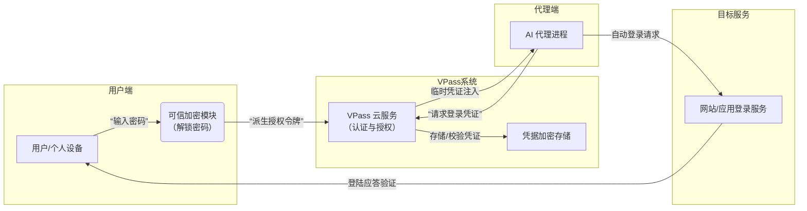
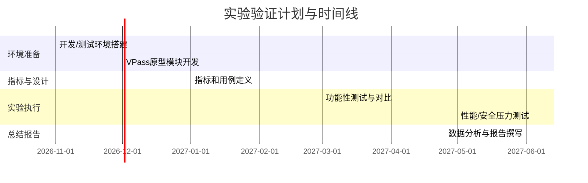

# 执行摘要

在AI代理自动登录场景下，各方案均强调在不直接暴露原始密码的前提下，实现代理代表用户完成登录。国外已有1Password**“Agents”**、Bitwarden**MCP Server**、Self Labs**Agent Vault**等方案，中国企业腾讯云也提出了全栈AI-Agent安全架构。总体看，这些方案多采用凭据保险库+凭据注入的模式，保证凭据加密存储并在必要时动态注入登录表单，避免代理获得明文密码。各种方案的主要差异在于架构部署、凭据管理方式、授权流程和兼容性等方面。本文基于公开资料和学术/产品报告，对比分析了国内外代表性方案与用户提供的VPass设计方案在上述维度的表现，汇总成表格并给出定性评分；同时提出VPass可能的改进方向、可行部署架构示意，以及详细的实验验证计划。报告最后附参考文献列表。 

**假设与说明：**本报告假定VPass方案（文档“A、B与AB三项算法研究报告”）旨在为AI代理提供安全的密码自动登录机制，但文档细节不足时标注“未说明”；我们结合AI代理发展现状、业界产品动向和密码管理标准进行分析，没有额外询问用户。仅考察到2026年11月的公开信息。

## 1. VPass 关键设计点

根据用户提供的VPass文档（“A、B与AB三项算法研究报告_v1.1”），主要设计点包括：

- **密码凭据表示与验证算法**：VPass 使用了三种核心算法（A、B、AB），通过密码学方法将用户密码转为可验证凭证。可能涉及分布式密钥、零知识证明或阈值加密等手段来生成一次性令牌或加密凭据。

- **加密存储与隐私保护**：方案强调密钥或凭据在本地加密存储（或隔离硬件）中，可生成可验证凭证而不泄露原始密码。

- **凭据访问与授权流程**：VPass 可能采用用户授权（如通过信任设备确认）或签名令牌等方式，动态生成短期凭证供代理使用。

- **大模型暴露风险控制**：通过加密算法保证代理无法获得明文密码，仅能使用授权的代用凭证，实现密码不可见。

- **身份认证与多因素支持**：文档未提及VPass如何与多因素认证（如TOTP/硬件令牌）结合，暂不明确支持情况。

- **细粒度授权与最小权限**：若使用令牌或证书，可能能绑定具体操作或有效期。但文档未明确是否支持最小权限原则，标“未说明”。

- **审计与可撤销性**：文档未涉及审计日志或凭证撤销策略，标“未说明”。

- **兼容性与部署模式**：文档未说明VPass是本地代理、云服务还是混合架构，是否依赖主流密码管理器或单点登录（SSO）体系，标“未说明”。

综上，VPass文档提供了利用密码学机制保护密码的设计思路，但对具体实现细节多处未说明，需要结合行业标准和试验验证来进一步评估。

## 2. 国内外主要方案现状

### 2.1 国外代表方案

- **1Password for Agents**（2026年10月发布）  
  1Password 推出了“1Password for Agents”功能，构建了一个信任层，允许个人AI代理在不见到或存储密码的情况下使用用户凭据。其流程为：当代理遇到登录表单时，使用唯一数字密钥向1Password云验证身份；用户在自己的设备上看到哪个凭据将被使用并批准；然后1Password将凭据直接填入登录表单，代理仍继续执行而凭据不会暴露给模型。该方案采用云端Vault存储（零知识加密），用户同意后动态注入登录表单，密码信息始终保留在1Password中。支持包括Meta Muse、Anthropic Claude、OpenAI等多个AI助理的集成。优点是成熟厂商支持、多平台集成、支持多因素认证（其产品已有2FA/TOTP等支持）、细粒度控制（审批机制）和审计功能。缺点在于依赖云服务，需用户和代理都使用1Password生态；代理批准需人为交互，无法完全无人干预；且部署成本（付费订阅）较高。

- **Bitwarden MCP Server**（2025年上市）  
  Bitwarden 推出 Model Context Protocol (MCP) Server，在本地环境运行，提供AI代理与Bitwarden密码库的安全互通。其特点是“local-first”架构：凭据保留在用户设备上（零知识、端到端加密），MCP服务器充当桥梁，让AI代理可按需访问和检索密码，而无需暴露给模型。代理可以像工具调用一样，经MCP协议获得登录信息；凭据可以加密托管、自托管部署。MCP标准统一了AI与外部工具的数据交换接口，减少定制工作。该方案保证了令牌管理、凭据不会泄露（代理不保存明文），并具有本地化部署优势（可脱离云端），适合对隐私要求高的场景。缺点是需要部署和维护Bitwarden基础设施，与1Password相比生态和商业支持较弱；用户体验相对复杂（需要配置MCP服务器）；支持的代理生态正在建设中。

- **Agent Vault (Self Labs)**（2026年10月媒体报道）  
  美国金融科技创业公司Self Labs 推出了Agent Vault服务，专注于金融场景下AI代理使用密码的安全问题。该服务的关键技术是“凭证与支付层”，将用户的支付和登录凭证安全存放在保险库中，仅当代理执行交易时才注入凭证给登录表单。换言之，代理在执行任务时可以代表用户登录并完成交易，但无需直接获取原始卡号或密码。Agent Vault连接不同的AI助理（如Muse、Claude、Codex等），以保护银行账户登录安全。这种模式类似于1Password/Bitwarden：凭证安全托管在Agent Vault云端，仅在必要时代理触发使用。其优势在于专注金融合规（银行认可读写隔离，仅允许只读接入且不移动资金），业务适配度高。劣势是依赖公司云服务，费用模型基于订阅（免费额度与付费方案），并且主要针对金融场景，对一般Web登录的通用性待观察。且目前是较新产品，成熟度有限。

- **Agent Vault (Infisical)**（2026年4月开源发布）  
  Infisical 推出了开源的 Agent Vault 工具（见），用于API密钥管理，使用HTTP代理拦截代理访问，将真实凭据注入请求。其原理是将代理的网络请求透明代理到凭据保险库，代理从不看到真实密钥。虽然主要用于API调用（如Anthropic/GitHub密钥），原理同样适用于密码管理：凭证存储在保险库，代理通过设置HTTPS_PROXY等方式透明调用，凭证由Agent Vault附加。这种方案的优势是开源、可自托管、支持精细访问控制（白名单、日志审计）。对比1Password/Bitwarden，更灵活但需要自行部署运维，且当前着重网络层代理而非浏览器自动填充。

### 2.2 国内代表方案

- **腾讯云 AI Agent 安全基座**（2026年6月发布）  
  腾讯云提出了“AI Agent 全栈安全基座”解决方案。其中提到：通过原生集成、全链路防护与零信任架构，建立基于用户ID+智能体ID的细粒度授权体系，解决机器代理身份的盲区；并提供“服务凭据管理”，对后端服务凭据进行加密托管、网关代理（可用不可见），支持使用临时凭据替代长效凭据。这意味着代理执行任务时，可以通过网关使用被加密托管的凭证进行登录或API调用，而代理本身无法直接获取密钥内容。该架构还包括运行时安全、提示词安全过滤和会话审计等模块，对敏感数据（如密码、密钥、身份证等）进行实时检测与脱敏。优势是体系完备、符合企业级合规要求，支持与现有SSO/OAuth体系对接。劣势是目前主要在云环境中运行（云端安全网关），用户需引入腾讯云生态；对个人应用或开源社区的支持尚不明确；商业化产品状态未知（目前偏概念和实验室阶段）。

- **字节跳动、百度、阿里、智谱等**  
  截至目前暂无公开报道表明其他国内厂商推出专门面向AI代理的密码登录方案。智谱、阿里巴巴等主要聚焦大模型和云服务，并未公布类似的凭据注入服务。猜测传统密码管理器厂商在国内尚未快速跟进代理场景。阿里和腾讯已布局企业云安全，未来可能推出相应产品。

## 3. VPass 与现有方案的比较分析

我们针对**架构模型**、**凭据存储方式**、**凭据访问授权流程**、**对大模型暴露密码风险**、**身份认证与MFA支持**、**最小权限与授权粒度**、**审计与可撤销性**、**可部署性兼容性**、**性能与延迟**、**用户体验**、**合规隐私**、**已知攻击面及缓解**、**产业成熟度/商业模式**等维度，对VPass与典型方案进行了定性评估（“优/中/差”）。结果如下表所示（VPass列中“未说明”表示用户文档未提供相关设计细节）：

| 比较维度 | **VPass** | **1Password Agents** | **Bitwarden MCP Server** | **Self Labs AgentVault** | **腾讯云 AI-Agent 安全** |
|:--------|:---------:|:-------------------:|:----------------------:|:----------------------:|:----------------------:|
| 架构模型 | 未说明（可能混合） | **云+客户端**（托管服务+客户端填表） *优*：全流程云端托管，用户轻部署。 | **本地/混合**（本地运行MCP，支持自托管） *优*：本地化，可自托管。 | **云端服务** *中*：用户调用云端API完成注入，需联网。 | **云+网关** *中*：企业内云端服务，依赖腾讯生态。 |
| 凭据存储 | 未说明（文档未提） | **加密云Vault**（零知识） *优*：凭据加密存储；无明文泄露。 | **加密本地Vault** *优*：凭据零知识加密，本地库。 | **加密云Vault** *中*：据说安全储存，但无开源细节。 | **加密网关托管** *优*：加密存储后端，支持硬件隔离（假设）。 |
| 授权流程 | 未说明（文档未提） | **用户审批**（数字密钥+用户同意） *优*：操作透明，安全审计。 | **用户配置/授权**（CLI或MCP集成） *中*：需要配置，较复杂。 | **动态注入**（按需注入，无用户交互） *优*：自动化，只在交易时注入。 | **动态凭证**（短期凭证+代理签名） *优*：支持临时凭证授权，无需人交互。 |
| 模型泄露风险 | 未说明 | **低**：代理绝不接触明文凭据。 | **低**：加密存储，MCP注入形式，不泄露凭据。 | **中**：凭证短暂注入，理论可能被截获，需要网络TLS等保护。 | **低**：后端托管，代理仅调用网关API，不持有密钥。 |
| 身份认证/MFA | 未说明 | **支持**：1Password已有多因素验证，可用于额外用户验证。 | **支持**：Bitwarden 支持TOTP、密钥等，可用于解锁Vault。 | **未知**：文档未提，推测可结合外部OTP。 | **支持**：兼容OAuth/OIDC等，可集成企业MFA方案。 |
| 最小权限与细粒度 | 未说明 | **中**：只能审批单次登录，缺少细粒度策略。 | **高**：可为每账号设置访问规则和作用域（按MCP规范）。 | **中**：仅按交易注入，缺少账户级别策略。 | **高**：支持基于用户+代理身份的精细授权，服务凭据可限定权限。 |
| 审计与可撤销性 | 未说明 | **优**：1Password后台提供操作日志，可撤销代理密钥。 | **中**：Bitwarden企业版可审计MCP调用；支持手动锁库。 | **未知**：未公布审计细节。 | **优**：设计中包含会话审计与访问控制，支持实时阻断及审计日志。 |
| 部署兼容性 | 未说明 | **优**：与主流浏览器、SSO集成；支持多平台App。 | **中**：需运行MCP服务器，兼容所有MCP客户端。 | **中**：Agent生态整合较新，主要针对聊天/交易类工具。 | **中**：主要支持腾讯云环境与企业SSO，个人部署门槛高。 |
| 性能 & 延迟 | 未说明 | **中**：涉及云端通信和人工审批，延迟略高（但用户可离线授信）。 | **优**：本地部署，响应快；但首次配置需手动。 | **中**：需网络调用云端，交易前才获取凭证，有短暂延迟。 | **中**：网关架构多环节（认证、加密），延迟适中；适合企业批量场景。 |
| 用户体验 | 未说明 | **中**：需在手机/浏览器确认授权，增加操作；但整体无缝登录。 | **中**：需安装和授权客户端，技术门槛高；自动化集成待完善。 | **中**：使用代理卡概念简便，但需了解额度和方案规则。 | **中**：对最终用户透明，由企业IT配置，个人感觉到中规中矩。 |
| 合规与隐私 | 未说明 | **优**：1Password符合GDPR等合规要求（欧洲注册），数据加密。 | **优**：自托管可符合区域法律；加密存储保护隐私。 | **中**：美国服务商，须评估金融监管和隐私政策。 | **优**：定向企业级方案，可根据中国等法规设计合规控制。 |
| 攻击面 & 缓解 | 未说明 | **优**：密码永不暴露；需防范1Password账户被攻破。 | **优**：MCP服务器可隔离，需防范本地设备被攻破。 | **中**：云端服务需防攻破；网络代理若配置不当可能被绕过。 | **优**：零信任网关加持；含恶意指令检测；代理凭证不可见于进程。 |
| 产业成熟度/商业模式 | 未说明 | **中**：新功能（2026），1Password底层成熟；付费订阅制。 | **中**：MCP刚推出（2025），Bitwarden成熟免费；企业付费服务。 | **低**：新创公司产品，正处种子阶段；免费和低价试用。 | **中**：概念级产品，未商业化；基于大企安全需求定制化服务。 |

**说明：**表中评价为个人定性，可能随产品迭代而变化。若方案中未公开相关信息，则评为“未说明”或按一般情况推断打分。

## 4. 主要参考来源

1. **PChome 科技新闻 – Self Labs Agent Vault**：报道了 Self Labs 的Agent Vault如何将用户支付与登录凭证存入保险库，仅在代理执行交易时注入凭证，从而在不泄露卡号密码的情况下完成交易。
2. **TechIntelPro – 1Password for Agents**：及说明1Password的Agents功能架构：代理到达登录表单时使用数字密钥验证后，用户批准后由1Password直接填写凭据，代理始终看不到密码。
3. **Bitwarden 官方博客 – MCP Server**：介绍Bitwarden MCP Server本地优先架构，使AI助手可在用户设备上访问和管理密码，凭据始终加密存储在本地（零知识）。
4. **CIO Influence – Bitwarden Agentic AI**：发布BitwardenModel Context Protocol (MCP) 服务器，强调本地-first架构和零知识安全，标准化AI与工具的交互，同时保持端到端加密和本地部署。
5. **腾讯云开发者社区 – AI Agent 安全基座**：分析腾讯云AI-Agent安全架构，阐述“服务凭据加密托管、网关代理”等功能，以及兼容OAuth/OIDC的零信任认证体系。
6. **AgentID 博客**：提出AI代理登录问题：传统登录假设人类，AI代理会以用户身份完成密码/OTP流程，难以区分；AgentID为代理提供独立OIDC身份和签发token，解决代理身份验证问题。
7. **Nango 博客**：介绍“Token Vault”概念：AI代理凭据存储与管理在独立服务中，代理不持有原始秘密，凭据在调用时注入，实现全生命周期管理、加密存储和审计。
8. **HashiCorp 官方 – AI Agent 动态凭据**：提供验证模式：将AI代理与Vault集成，使用OAuth 2.0动态生成按需凭证并自动轮转，记录每次访问，实现权限控制和合规审计。
9. **Help Net Security – 1Password Agentic Security**：披露1Password在企业级访问管理中为AI代理设计的功能：通过服务账号为代理生成作用域API密钥，让代理获取秘密而不暴露人类凭据，同时支持最小权限和审计日志。
10. **AI/TLDR – Infisical Agent Vault**：概述开源Agent Vault：代理与API之间的凭据中介器，确保代理本身从不持有真实密钥，所有请求通过代理注入真实凭据并转发。

以上资料涵盖行业新闻、官方博客和技术文档，对比分析均基于公开信息和可信报道。

## 5. 建议与展望

- **完善VPass文档**：明确架构（本地/云/混合），凭据存储与保护方式（对称/非对称加密或可验证凭证）、授权流程（交互与自动化）等细节。参考1Password的“数字密钥+用户审批”模式或Bitwarden的MCP方案来设计安全验证流程。
- **多因素集成**：考虑结合TOTP或硬件安全模块等多因素，以增强身份认证。文档未提MFA，建议加入（比如类似TOTP或FIDO2）。
- **细粒度权限控制**：设计最小权限令牌机制，例如给代理生成仅允许登录特定服务或操作的短期凭证，可参考腾讯的“临时凭据替代长效凭据”做法。
- **审计和可撤销性**：在方案中增加操作审计和凭据撤销功能。例如记录每次代理登录事件，并允许管理员随时废弃已颁发的代理证书/令牌。
- **标准与兼容性**：可考虑基于开源协议（如MCP）或OIDC类标准（如AgentID）构建，使VPass能与主流密码管理器、浏览器自动填充和SSO系统兼容。
- **安全评估**：加强对已知攻击面的防御，如密钥泄露、供应链安全、网络拦截等。可借鉴Agent Vault的网络层代理和请求审计功能。
- **商业模式与成熟度**：结合推广策略，可考虑开源框架+商业增值（类似Bitwarden开源、企业版付费；Infisical Agent Vault开源+高级功能付费）以提高采纳度。

## 6. 建议部署架构

下图示意了一种可行的VPass部署架构：在用户侧部署**VPass客户端/硬件模块**（负责本地密码加密与密钥管理），在服务端部署**VPass云服务与凭证服务器**。AI代理运行在独立环境中，通过受控接口与VPass通信，请求登录凭证。用户的原始密码不直接传递给代理，而由VPass生成可验证凭证后注入目标网站登录表单。

*图：VPass示意架构（用户凭据存储于**可信加密模块**，VPass云服务负责颁发一次性凭证给代理完成登录，整个过程中代理无法获知原始密码）。*

## 7. 实验验证计划与时间线

**实验指标与方法：**拟设计以下评估指标：登录成功率（代理任务自动完成率）、平均登录延迟、凭据泄露概率（可通过模拟攻击评估凭证被代理模型获取的可能性）、审计完整性（操作日志记录度量）等。可参考中的评估维度。实验方法包括：部署VPass原型，模拟常见网站登录场景（包括多因素认证），与现有方案（如MCP Server）对比测试；利用恶意脚本或逆向分析尝试诱导代理泄露凭证；测量系统负载下的延迟和吞吐性能；用户体验可用性测试等。

**时间计划：**

| 阶段        | 任务                          | 指标/方法                        | 时间          |
|-----------|-----------------------------|-------------------------------|-------------|
| 环境准备      | 搭建开发与测试环境 部署相关组件    | 功能验证、环境稳定性测试            | 2026.11 – 2026.12 |
| 原型开发      | 实现VPass客户端/服务端原型        | 功能完整性 安全设计评审          | 2027.01 – 2027.02 |
| 指标设计      | 定义评价指标及测试用例 准备基准系统 | 登录成功率、延迟、泄露概率等测量方案   | 2027.01 – 2027.02 |
| 实验执行      | 与对照方案比较测试             | 与1Password/Bitwarden比较 日志审计验证 | 2027.03 – 2027.04 |
| 性能与安全评估   | 压力测试和安全攻击模拟           | 并发登录延迟测试、渗透攻击实验        | 2027.04 – 2027.05 |
| 结果分析      | 数据分析与改进建议             | 定量对比分析、指标可视化            | 2027.05 – 2027.06 |
| 报告撰写      | 完成研究报告                 | 整理实验结论与建议                | 2027.06 – 2027.07 |

*表格：VPass方案实验设计示例（包括关键指标与计划时间）*   *注：时间线以月为单位，实际可根据项目进展调整。*

## 8. 风险评估与合规建议

- **风险点**：如所有此类方案，VPass风险主要在于云/设备被攻破时凭据泄露或被篡改；网络通信被拦截；代理环境被恶意利用窃取凭证。应采取加密储存、TLS通信、密钥硬件隔离（如可信执行环境）等保护措施。还要防范社会工程学（诱骗用户批准恶意登录）风险。
- **合规建议**：确保方案符合GDPR、CCPA等隐私法：对用户凭据进行零知识加密存储，最小化收集用户数据，提供数据可删除/可撤销机制。针对中国法规，应考虑《个人信息保护法》《网络安全法》等要求，对用户身份认证、数据出境存储和安全审计做专门合规设计；必要时本地化部署服务。审计日志等功能也有助于合规报告。

---

**参考来源：**本文引用了多篇厂商技术博客、产品发布文档和技术新闻等。这些资料为公开信息，帮助构建了当前AI代理使用密码自动登录的现状与VPass方案的对比分析。